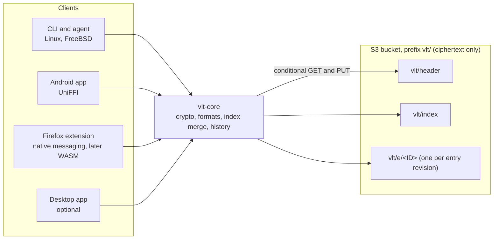

# Personal Password Manager: Requirements

Oct 10, 2026 · @Ned Wolpert

## Overview

Build a single-user password manager named `vlt`, which keeps the spirit of [pass](https://www.passwordstore.org/): one encrypted entry per item, a plain-text entry format, a Unix-friendly CLI, and full history. Storage is a private S3 bucket (AWS, or self-hosted RustFS) that never sees plaintext, so the running cost is cents per year and there is no server to operate or trust.

The trigger is lock-in risk: Bitwarden works today, but its free tier is not guaranteed. The goal is a tool I own end to end, with an exit path built in from day one.

### Goals

1. Replace Bitwarden for daily use on Linux, FreeBSD, Android and Firefox.
2. Zero-knowledge storage: the bucket, AWS, and anyone holding a stolen AWS key see only ciphertext.
3. pass ergonomics: `vlt show -c`, `vlt generate`, `vlt edit`, tree listing, tab completion, scriptable output.
4. No running server. S3 is a dumb blob store; all logic lives in the clients.
5. Lossless import from Bitwarden and pass, and lossless export to pass, JSON and CSV.

### Non-goals (v1)

- More than one user. vlt is single-user by design: no sharing, no shared folders.
- Windows, macOS and iOS clients.
- Passkey storage and security-key unlock. Both are planned for a later revision (see Phasing).
- A hosted service for anyone but me.
- GPG compatibility. pass interop is import and export only; GPG keys are never vault recipients.

## Threat model

The bucket is treated as hostile: anything that can read it must learn nothing beyond object counts, sizes, timestamps, the number of enrolled devices and a few plaintext write counters. The AWS access keys live on every device, so a lost phone or laptop is the most likely way the ciphertext leaks, and the design must hold up to offline brute force when it does.

| Adversary | Can do | Must not be able to |
| --- | --- | --- |
| AWS / anyone reading the bucket | Read all objects and versions | Read any secret, entry name, URL or username |
| Thief with a device's AWS key | Read all objects; write new objects and new versions | Decrypt anything; permanently destroy history on a versioned bucket (on single-disk RustFS, which cannot version, the thief can overwrite history; `vlt init` warns about this) |
| Thief with a powered-off or locked device | Copy the local cache and device key file | Unlock without the master password, device biometric, or OS login (the CLI keeps its device key in the OS keyring, or wraps it with the master password where no keyring exists) |
| Malicious web page | Trigger autofill prompts | Receive credentials for a different origin |
| Me, months later | Forget the master password while at least one device is still enrolled | Lose the vault (an enrolled device that unlocks without the password sets a new one) |

Forgetting the master password and losing every enrolled device loses the vault. No one, including me, can recover it; the emergency kit holds the secret key but not the password.

### Security principles

- **Pass's one known leak is fixed.** pass exposes entry names as filenames. `vlt` encrypts names; object keys in S3 are opaque IDs.
- **Two-factor key derivation.** Vault unlock needs the master password plus a high-entropy secret key stored on enrolled devices (the 1Password model), so a leaked bucket alone cannot be brute forced.
- **Standard, boring primitives only.** Argon2id for password stretching, XChaCha20-Poly1305 or AES-256-GCM for AEAD, X25519 for wrapping keys to devices. No custom crypto.
- **Authenticated everything.** Each entry's ciphertext is bound to its ID and version, so the bucket cannot swap, roll back or replay entries without detection.
- **Least privilege AWS keys.** Device credentials can read and write objects under one prefix; they cannot delete object versions or change bucket settings.
- **Plaintext lives only in memory.** Clipboard copies auto-clear (45 s default, as in pass); nothing decrypted is written to disk.

## Architecture

Proposed: a pass-style store of one encrypted object per entry plus one encrypted index, in a versioned S3 bucket, with all logic in a shared client core. This keeps pass's per-entry model (small writes, rare conflicts, history per entry) while hiding entry names, which pass does not.

Every client embeds the same core, so encryption happens before anything leaves the device; the bucket stores three kinds of opaque objects.

### Bucket layout (prefix `vlt/`)

| Object | Contents | Encrypted |
| --- | --- | --- |
| `vlt/header` | Format version, Argon2id parameters, the vault key wrapped once by password + secret key and once per enrolled device (the equivalent of pass's `.gpg-id` recipients) | Wraps only; header itself is authenticated, not secret |
| `vlt/index` | Map of entry path (`Email/zx2c4.com`) to entry ID and revision | Yes |
| `vlt/e/<128-bit random ID>` | One entry, padded to a 512-byte multiple to blur length | Yes |
| `vlt/enroll/<device ID>` | A new device's enrollment request, sealed under a key from the invite QR code | Yes |

### Entry format

The decrypted entry is a pass-format text file: line 1 is the password, then `key: value` lines (`url:`, `username:`), an optional `otpauth://` line, then free-form notes. This keeps `vlt edit` a plain `$EDITOR` session and makes pass import and export lossless.

### Sync and concurrency

- **History:** client-side history replaces `pass git`. Every edit writes a new immutable entry object that points at its predecessor; `vlt log` and `vlt restore` walk that chain. S3 Versioning, where the backend has it, is a second safety net.
- **Writes:** write the entry object, then update `vlt/index` with a conditional `PutObject` (`If-Match` on the ETag). A `412 Precondition Failed` means another device won; re-read, merge, retry.
- **Merge rule:** index changes merge per path. Two edits to the same entry keep the newer revision and save the other as `<path>.conflict-<device>`.
- **Offline:** each client keeps an encrypted local mirror, with full history by default, and a write queue, so reads always work and writes sync when the network returns. A vault can also start local on one device, with no bucket, and attach one later to add devices.

### Why not one file or DynamoDB

A single vault file is simpler, but every edit rewrites the whole vault and any two devices editing anything collide. DynamoDB would also cost pennies, but it adds a second service, and S3 gives version history and lifecycle rules for free. Cost is a wash; S3 wins on simplicity.

### Credentials

Each device gets an IAM access key scoped to `vlt/*`: `GetObject`, `PutObject`, `ListBucket`, `GetObjectVersion`, `ListBucketVersions`. No `DeleteObjectVersion` and no bucket-policy rights, so a stolen key can add bad versions but cannot erase history. One key per device, so a lost device is revoked in IAM without touching the others.

### Storage backends

vlt talks to any S3-compatible endpoint, chosen at `vlt init` (endpoint URL, bucket, prefix, credentials).

| Backend | Use | History comes from |
| --- | --- | --- |
| AWS S3, existing account | Default; reachable from every device. Dedicated bucket, versioning required, Object Lock recommended; IAM key per device as above | S3 Versioning plus vlt's client-side history |
| RustFS, single disk | Simplest self-hosted setup, no AWS at all | vlt's client-side history only (RustFS cannot version objects without erasure coding, [per its docs](https://docs.rustfs.com/features/versioning)) |
| RustFS, 4+ disks with erasure coding | Self-hosted with server-side protection | RustFS object versioning plus vlt's client-side history |

Two requirements fall out of this:

- **Capability probe.** `vlt init` checks the backend for conditional writes (`If-Match`, `If-None-Match`) and versioning. Without conditional writes it refuses to run; without versioning it warns and switches to client-side history.
- **Client-side history.** Each entry revision is written as a new immutable object (`vlt/e/<new ID>`) that records its predecessor's object ID, so history is a chain inside the entries and the index stays small. History then works on any backend, and S3 Versioning becomes a second safety net rather than the only one.

## Functional requirements

P0 is needed to retire Bitwarden; P1 follows soon after; P2 is nice to have.

### Core (shared by every client)

| ID | Requirement | Priority |
| --- | --- | --- |
| CORE-1 | Create, read, update, delete, move and copy entries by path (`Email/zx2c4.com`) | P0 |
| CORE-2 | Unlock with master password + secret key; per-device unlock via device key after first enrollment | P0 |
| CORE-3 | Password generator: length, character classes, no-symbols mode, and diceware passphrases | P0 |
| CORE-4 | Search by path, URL and username; full-text grep over decrypted entries in memory | P0 |
| CORE-11 | Storage backend set at init: AWS S3 (existing account) or any S3-compatible endpoint such as RustFS; capability probe for conditional writes and versioning | P0 |
| CORE-12 | Client-side revision history that works on backends without versioning | P0 |
| CORE-5 | TOTP codes from an `otpauth://` line (pass-otp equivalent) | P1 |
| CORE-6 | Version history per entry: list, diff, restore | P1 |
| CORE-7 | Enroll and revoke devices; rotate the vault key on revoke | P1 |
| CORE-8 | Change master password without re-encrypting entries (rewrap only) | P1 |
| CORE-9 | Attachments up to 10 MB per entry | P2 |
| CORE-10 | Health report: reused, weak and old passwords | P2 |
| CORE-13 | Security-key unlock (FIDO2 hmac-secret or WebAuthn PRF) | Later revision |
| CORE-14 | Passkey storage in the vault | Later revision |

### CLI (Linux and FreeBSD)

| ID | Requirement | Priority |
| --- | --- | --- |
| CLI-1 | pass-compatible verbs: `init`, `ls`, `show`, `insert [-m]`, `edit`, `generate`, `rm`, `mv`, `cp`, `grep`, `find` | P0 |
| CLI-2 | `show -c` copies line 1 to the clipboard and clears it after 45 s; works on X11, Wayland and the console (`wl-copy`, `xclip`, OSC 52) | P0 |
| CLI-3 | Session agent so the vault stays unlocked for a configurable time (the gpg-agent role) | P0 |
| CLI-4 | bash, zsh and fish completion | P0 |
| CLI-5 | Stable machine-readable output (`--json`) and correct exit codes for scripting | P0 |
| CLI-6 | Runs on FreeBSD from packages or a single static binary | P0 |
| CLI-7 | Extensions: executables named `vlt-<cmd>` on `$PATH` become subcommands | P1 |
| CLI-8 | dmenu / rofi / fuzzel picker (passmenu equivalent) | P1 |
| CLI-9 | git credential helper and `ssh-askpass` style integration | P2 |

### Android

| ID | Requirement | Priority |
| --- | --- | --- |
| AND-1 | Browse, search, view and copy entries; copied secrets marked sensitive so they are hidden from clipboard previews | P0 |
| AND-2 | Autofill Service for apps and Chrome/Firefox on Android, matched by package name and `url:` | P0 |
| AND-3 | Biometric unlock backed by an Android Keystore key | P0 |
| AND-4 | Add, edit and generate entries | P0 |
| AND-5 | Offline read access from the local mirror | P0 |
| AND-6 | TOTP display with countdown | P1 |
| AND-7 | Act as a Credential Manager provider for passkeys (depends on CORE-14) | P2 |

### Firefox extension (desktop)

| ID | Requirement | Priority |
| --- | --- | --- |
| FF-1 | Fill username and password on the current page, matched by exact origin, with an explicit user action | P0 |
| FF-2 | Popup search and copy | P0 |
| FF-3 | Offer to save or update credentials after a login form submits | P1 |
| FF-4 | Unlock via the local CLI agent (native messaging), so the browser holds no long-lived keys | P1 |
| FF-5 | Standalone mode that talks to S3 directly when no native host is installed | P2 |

### Linux desktop app

| ID | Requirement | Priority |
| --- | --- | --- |
| DSK-1 | Tray or launcher app for search, copy and TOTP | P2 |
| DSK-2 | Full entry editing and history view | P2 |

## Non-functional requirements

The bar: cheaper than free-tier anxiety, fast enough to feel like pass, and impossible to lock myself out of.

| Area | Requirement |
| --- | --- |
| Cost | Under $1 per year at 1,000 entries and daily use on 4 devices (S3 Standard storage for a few MB plus request charges is approximately cents; confirm against current S3 pricing) |
| Unlock latency | Argon2id tuned to about 500 ms on the slowest enrolled device; per-device unlock under 100 ms |
| CLI latency | `show` from a warm agent under 150 ms with no network; sync runs in the background |
| Sync | A change on one device is visible on another within 10 s of the next sync |
| Scale | 5,000 entries without a noticeable slowdown; index under 1 MB |
| Portability | One Rust core: native CLI for Linux x86\_64 and arm64 and FreeBSD amd64; UniFFI bindings for Android 10+; WASM build for Firefox ESR and current |
| Durability | Client-side revision history on every backend; on AWS, S3 Versioning on with noncurrent versions kept 365 days by lifecycle rule, optional Object Lock; on RustFS, versioning when run with erasure coding |
| Backup | `vlt export --encrypted` writes a single self-contained file I can store offline |
| Recovery | Printable emergency kit (secret key, bucket name, recovery steps); vault opens from the kit plus master password on a fresh machine |
| Auditability | Open source; crypto design written down in a short spec before code; reproducible CLI builds |
| Format stability | Versioned header; every client refuses to write a format version newer than it understands |

## Migration and exit

Getting in from Bitwarden and getting out to anything else are both P0, because the exit path is the reason this project exists.

| Direction | Format | Notes |
| --- | --- | --- |
| Import | Bitwarden JSON export (unencrypted) | Folders become path prefixes; logins, notes, cards and identities map to pass-format entries; TOTP seeds become `otpauth://` lines |
| Import | Bitwarden password-protected JSON export | Same mapping, so the plaintext export never touches disk |
| Import | Existing `~/.password-store` | Decrypt via local `gpg`; keep the folder tree as-is |
| Export | pass store (GPG) | Writes a working `~/.password-store` for a chosen GPG key; the bail-out path |
| Export | JSON and CSV | Plaintext, behind an explicit `--i-understand` flag |
| Export | Encrypted backup file | Self-contained, opens with `vlt` and the master password |

Acceptance test: import my real Bitwarden export, export to pass, and diff the two field by field with zero unexplained losses.

## Phasing

Ship the CLI first and live in it, because it exercises the crypto, storage format and sync before any UI depends on them.

1. **Spec.** Write the crypto and storage spec (header, key wrapping, entry AEAD, index merge, client-side history). Get it reviewed before code.
2. **Rust core + CLI.** Shared Rust core library, pass-compatible CLI, agent, Bitwarden and pass import, pass export, tested against AWS S3, single-disk RustFS and 4-disk RustFS. Exit: I use it daily on Linux and FreeBSD for 2 weeks alongside Bitwarden.
3. **Android.** Kotlin UI over the Rust core via UniFFI: viewer, autofill, biometric unlock, offline mirror. Exit: Bitwarden uninstalled from the phone.
4. **Firefox.** Extension with native messaging to the CLI agent; WASM core for standalone mode later. Exit: Bitwarden extension removed; Bitwarden account exported and closed.
5. **Polish.** TOTP everywhere, history UI, health report, optional Linux desktop app.
6. **Later revision.** Security-key unlock and passkey storage, including the Android Credential Manager provider.

## Decisions and open questions

The big decisions were made on 2026-10-10; what remains can be settled in the spec.

| Topic | Decision |
| --- | --- |
| Implementation stack | Rust. One core for the native CLI (Linux, FreeBSD), Android via UniFFI, Firefox via WASM |
| Storage model | Per-entry objects plus an encrypted index; revisit only if a concrete problem shows up |
| Storage backend | AWS S3 in an existing account, or self-hosted RustFS |
| RustFS layouts | Both supported: single disk (history in vlt) and 4+ disks with erasure coding (object versioning on as well) |
| GPG compatibility | Not needed; pass interop through import and export only |
| Security-key unlock | Later revision |
| Passkey storage | Later revision |
| Users | Single user only |
| Name | vlt |

| Crypto crates | RustCrypto (`argon2`, `chacha20poly1305`, `x25519-dalek`, `ml-kem`, `hkdf`, `sha2`, `zeroize`); XChaCha20-Poly1305 for AEAD; device wraps use a hybrid of X25519 and ML-KEM-768 so recorded ciphertext resists a future quantum computer |
| Credential lifetime | Long-lived IAM access key per device, scoped to the vault prefix; short-lived credentials (STS or IAM Roles Anywhere) are out of scope for v1 |
| AWS hardening | Dedicated bucket required; `vlt init` refuses to proceed if versioning is off and warns if Object Lock is off |
| Single-disk RustFS | Supported with a weaker guarantee: without versioning, a stolen device key can overwrite history. `vlt init` warns. Entry objects are always written with `If-None-Match: *` |
| CLI device key at rest | OS keyring (Secret Service or KWallet) when available; otherwise wrapped by the master password |
| IAM provisioning | vlt never holds admin credentials; enrollment and revocation print the IAM policy and `aws` (or RustFS `mc admin`) commands for me to run |
| Local start | `vlt init --local` creates a vault with no bucket; `vlt attach` uploads it to a bucket later, after which devices can enroll |
| Licence | MIT; every dependency MIT, Apache-2.0, BSD, ISC, Zlib, or Unicode, enforced with `cargo-deny` |

### Still open

Nothing at the requirements level; the crypto and storage spec settles the rest.
