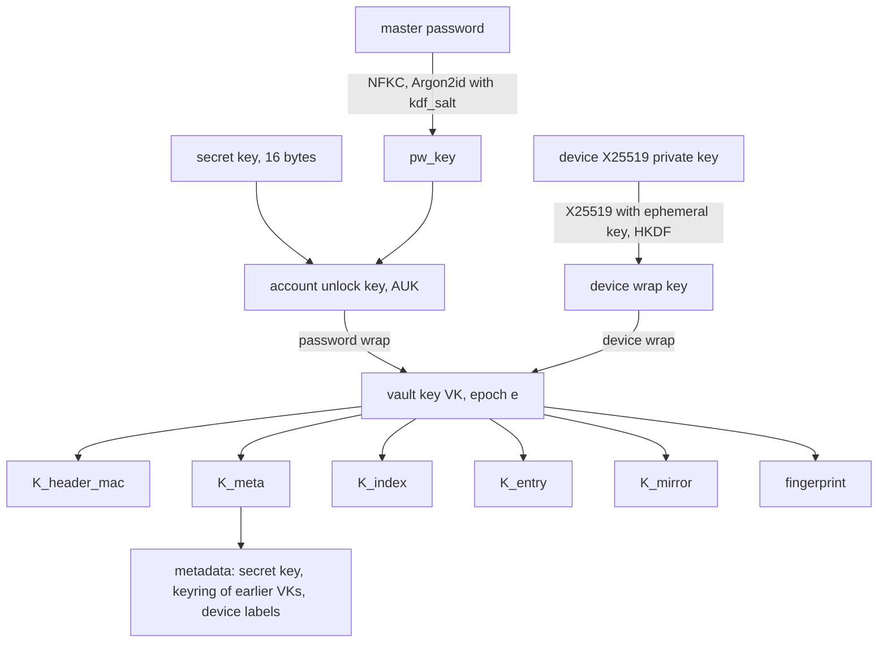

# vlt crypto and storage spec

Format version 1. Status: draft for review, 2026-10-10.

This spec defines how vlt derives and wraps keys, the byte layout of every object it stores, how
clients authenticate those objects, how the index merges, how history and deletion work, and how
devices sync, enroll, and revoke. It is normative: a client that follows it interoperates with every
other client, and the known-answer vectors in `spec/vectors/` check that it does.

## Contents

1. [Conventions](#conventions)
2. [Threat model summary](#threat-model-summary)
3. [Primitives](#primitives)
4. [Key hierarchy](#key-hierarchy)
5. [KDF parameters and calibration](#kdf-parameters-and-calibration)
6. [Bucket layout](#bucket-layout)
7. [Extension lists](#extension-lists)
8. [Size limits](#size-limits)
9. [Header object](#header-object)
10. [Header authentication and pinning](#header-authentication-and-pinning)
11. [Entry object](#entry-object)
12. [Entry text format](#entry-text-format)
13. [Index object](#index-object)
14. [Rollback detection](#rollback-detection)
15. [Client-side history](#client-side-history)
16. [Index operations and merge](#index-operations-and-merge)
17. [Sync policy](#sync-policy)
18. [Local mirror and write queue](#local-mirror-and-write-queue)
19. [Vault creation](#vault-creation)
20. [Capability probe](#capability-probe)
21. [Device credentials and IAM policy](#device-credentials-and-iam-policy)
22. [Device key storage](#device-key-storage)
23. [Device enrollment](#device-enrollment)
24. [Device revocation and vault key rotation](#device-revocation-and-vault-key-rotation)
25. [Master password change](#master-password-change)
26. [Deletion and purge](#deletion-and-purge)
27. [Repair](#repair)
28. [Agent protocol](#agent-protocol)
29. [Emergency kit and recovery](#emergency-kit-and-recovery)
30. [Encrypted export format](#encrypted-export-format)
31. [Plaintext export formats](#plaintext-export-formats)
32. [Bitwarden mapping](#bitwarden-mapping)
33. [pass import and export](#pass-import-and-export)
34. [Format versioning](#format-versioning)
35. [CLI exit codes](#cli-exit-codes)
36. [Portability constraints](#portability-constraints)
37. [Test vectors](#test-vectors)

## Conventions

| Notation | Meaning |
| --- | --- |
| `a \|\| b` | Byte concatenation |
| `u8`, `u16`, `u32`, `u64` | Unsigned integers, big-endian |
| `i64` | Signed 64-bit integer, two's complement, big-endian |
| `bN` | Exactly `N` raw bytes |
| `str16` | `u16` byte length followed by that many bytes of UTF-8 |
| `bytes32` | `u32` byte length followed by that many raw bytes |
| `ext` | An extension list (see [Extension lists](#extension-lists)) |
| `"label"` | The ASCII bytes of the label, no terminator |
| `HKDF(ikm, salt, info)` | HKDF-SHA256 (RFC 5869), 32-byte output |
| `HMAC(key, msg)` | HMAC-SHA256, 32-byte output |
| `AEAD(key, nonce, pt, ad)` | XChaCha20-Poly1305 seal; output is ciphertext followed by the 16-byte tag |
| `rand(N)` | `N` bytes from the operating system CSPRNG |
| `crock(b)` | Crockford base32 of `b` (alphabet `0123456789ABCDEFGHJKMNPQRSTVWXYZ`, most significant bit first, no padding) |

Every structure is parsed strictly. A decoder rejects trailing bytes, lengths that run past the end
of the input, unknown flag bits, non-zero padding, lists that are not in the required order or that
contain duplicates, and anything over the [size limits](#size-limits). "Reject" means the operation
fails with an integrity error (exit code 6) and nothing is written.

Object IDs, device IDs, and the vault ID are 16 random bytes. Their text form is 32 lowercase hex
characters.

## Threat model summary

The requirements document holds the full threat model. The properties this spec provides are:

| Adversary | Property |
| --- | --- |
| Reader of the bucket, including all versions | Learns object count, sizes rounded to 512 bytes (entries) or 4,096 bytes (index), timestamps, the number of enrolled devices, and the plaintext counters `epoch`, `header_seq`, and `index_seq`. Learns no path, URL, username, secret, or device label |
| Writer to the bucket without the vault key (a stolen device AWS key) | Any modification of an object is detected. Replaying an older header or index is detected by any device that has seen a newer one. On a versioned bucket, nothing is destroyed. On single-disk RustFS, which cannot version, the writer can overwrite objects; clients detect it and [repair](#repair) current entries from their mirrors, but history that no mirror holds is lost |
| Holder of a revoked device's keys | Reads everything written before the rotation that revoked it. Once its AWS key is deleted, reads nothing written after it, provided the secret key was rotated or the master password resists offline guessing (the holder knows the old secret key). While it still has write access, it can feed forged epoch-`e` objects to a device that has not yet seen the rotation |
| Holder of an old master password, after a password change | Can still open the password wrap in older header versions (kept by S3 Versioning) and so recover the vault key of that time. `vlt passwd --rotate` also rotates the vault key, which cuts this off for content written afterwards |
| Holder of a powered-off device | Needs the master password (no-keyring CLI), the OS login (keyring CLI), or the device biometric (Android) to unlock |

Out of scope: malware running as the user on an unlocked device, a process with the user's UID
talking to an unlocked agent, hardware and side-channel attacks, and traffic analysis beyond the
leaks listed above.

## Primitives

| Purpose | Primitive | Crate |
| --- | --- | --- |
| Password stretching | Argon2id, version `0x13` (RFC 9106) | `argon2` |
| Key derivation | HKDF-SHA256 | `hkdf`, `sha2` |
| Header MAC | HMAC-SHA256 | `hmac`, `sha2` |
| AEAD | XChaCha20-Poly1305, 24-byte random nonce | `chacha20poly1305` |
| Key agreement | X25519 | `x25519-dalek` |
| Secret hygiene | Zero on drop | `zeroize` |
| Password normalisation | Unicode NFKC | `unicode-normalization` |
| Randomness | OS CSPRNG | `getrandom`, `rand_core` |

`hmac`, `unicode-normalization`, `getrandom`, and `rand_core` are additions to the decided crate
list. `hmac` is already a dependency of `hkdf`, and `rand_core` of `x25519-dalek`.

Nonces are always random. With a 192-bit nonce, random nonces under one key carry no practical
collision risk at vlt's write volume. No counter nonces are used, so no nonce state needs to survive
a crash.

XChaCha20-Poly1305 is not key-committing. vlt does not rely on key commitment: every key that opens
an AEAD is either derived from the vault key or tried exactly once during unlock, and the header MAC
(HMAC, which commits) is checked straight after unlock.

## Key hierarchy



### Secret key

The **secret key** is 16 random bytes generated at `vlt init`. It lives in the emergency kit and in
the header's encrypted metadata, so every enrolled device can read the current one. Its text form
is:

1. Compute `check = SHA-256("vlt/v1/secret-key-check" || sk)[0..4]`.
2. Compute `crock(sk || check)`, giving 32 characters.
3. Split into eight groups of four separated by `-`, and prefix `VLT1-`.

Example: `VLT1-7XH6-NSCF-5P9Y-QKXJ-J745-SZYF-BEQY-C51A`.

Decoding requires the `VLT1-` prefix (case-insensitive), then ignores `-` and spaces, accepts lower
case, and maps `O` to `0` and `I` and `L` to `1`. A wrong check value rejects the input as a typo
before any key derivation.

### Account unlock key

```
pw_key = Argon2id(password = NFKC(master_password) as UTF-8,
                  salt = kdf_salt, m = m_kib, t = t, p = p, output = 32 bytes)
AUK    = HKDF(ikm = pw_key || sk, salt = vault_id, info = "vlt/v1/auk")
```

The **account unlock key** (AUK) needs both factors. A leaked bucket gives an attacker `kdf_salt`
and the password wrap, but without the secret key every password guess also needs a 128-bit guess.
The master password is not trimmed. `vlt init` and `vlt passwd` require at least 12 Unicode scalar
values after NFKC normalisation.

### Vault key and subkeys

The **vault key** (VK) is 32 random bytes. Each VK belongs to an **epoch**, a `u32` starting at 1
and incremented by every rotation. Subkeys are derived per epoch:

```
K_purpose = HKDF(ikm = VK_e, salt = vault_id, info = "vlt/v1/" || purpose)
```

| `purpose` | Use |
| --- | --- |
| `header-mac` | HMAC key over the header |
| `meta` | AEAD key for the header's encrypted metadata |
| `index` | AEAD key for the index |
| `entry` | AEAD key for every entry object of the epoch |
| `mirror` | AEAD key for local mirror state and the write queue |
| `fingerprint` | Not a key. A public-safe 32-byte value identifying `VK_e`, stored in pins |

vlt uses a single entry key per epoch rather than per-entry keys. Each entry ciphertext is bound to
its object ID through the associated data, which gives the same swap protection, and a single key
keeps rotation and history reads simple.

### Device keys

Each device has a **device ID** (16 random bytes) and an X25519 key pair generated on the device.
The private key never leaves the device. The header holds one **device wrap** of the current VK per
enrolled device:

```
eph_sk, eph_pk = fresh X25519 key pair
ss  = X25519(eph_sk, device_pk)          ; reject if all 32 bytes are zero
DWK = HKDF(ikm = ss, salt = eph_pk || device_pk, info = "vlt/v1/device-wrap")
ct  = AEAD(DWK, nonce, VK_e, "vlt/v1/device-wrap" || vault_id || u32 epoch || device_id)
```

X25519 lets an enrolled device wrap the VK to a new device's public key without the new device's
private key ever moving, which is what enrollment by QR code needs. A device wrap proves nothing
about who wrote it, because `device_pk` is public; first-unlock trust comes from the enrollment
return code instead (see [Device enrollment](#device-enrollment)).

### Password wrap

```
ct = AEAD(AUK, nonce, VK_e, "vlt/v1/pw-wrap" || vault_id || u32 epoch || kdf_block)
```

`kdf_block` is the exact 29-byte KDF block from the header. A bucket writer who changes the Argon2
parameters or the salt therefore breaks the wrap rather than weakening it. Only a holder of the AUK
can produce a password wrap, so a password-path unlock authenticates the VK it yields.

### What rotation and password change touch

| Operation | Rewritten | Unchanged |
| --- | --- | --- |
| Master password change (CORE-8) | `kdf_salt`, optionally the KDF parameters, the password wrap, `header_seq`, the MAC; then the index is republished to signal the header change | VK, every device wrap, the keyring, every entry object |
| Vault key rotation (CORE-7) | New VK and epoch, password wrap, every remaining device wrap, the metadata (keyring gains the old VK, rotation commitment set), the MAC, the index (re-sealed under the new epoch) | Existing entry objects. They stay sealed under their original epoch's key, which the keyring keeps |

Rotation protects content written after the revocation. It cannot protect content the revoked
device could already read, because that device may have copied every object it could see. Existing
entry objects are therefore not re-encrypted. After revoking a lost or stolen device, the user
changes the passwords of entries that matter; each change is a new revision under the new epoch.

## KDF parameters and calibration

| Set | `m_kib` | `t` | `p` | Allowed in |
| --- | --- | --- | --- | --- |
| Floor | 65,536 (64 MiB) | 3 | 1 | Every build |
| Ceiling | 1,048,576 (1 GiB) | 10 | 4 | Every build |
| Test | 64 | 1 | 1 | Test builds only; header flag `test_kdf` set |

A client rejects a header, device file, or export whose parameters fall outside floor and ceiling,
unless both the `test_kdf` flag is set and the client is a test build. Release builds reject
`test_kdf` objects outright. The ceiling is a parse rule shared by every client; it bounds the
memory a bucket writer can make a client allocate before the MAC can be checked, and it fits inside
`wasm32` and Android memory.

Calibration runs at `vlt init` and at `vlt passwd --recalibrate`. It fixes `p = 1` (WASM has no
threads) and `t = 3`, then picks the largest `m_kib` in `{64, 128, 256}` MiB whose measured
derivation time on the current device is at most 500 ms. If 64 MiB already takes longer, it uses
the floor. The 256 MiB cap keeps password unlock possible on a phone or in a browser. The
requirement targets the slowest enrolled device, so `vlt passwd --recalibrate` is best run on the
slowest device; `vlt enroll` reports the measured password-unlock time on the new device and
suggests recalibration when it exceeds 500 ms.

Password unlock is the slow path. Day-to-day unlock goes through the device wrap and takes no
Argon2 work, which keeps per-device unlock under 100 ms.

## Bucket layout

The vault lives under a configured prefix (default `vlt/`) in a dedicated bucket.

| Object key | Contents | Written with |
| --- | --- | --- |
| `<prefix>header` | Header object | `If-None-Match: *` at init, then `If-Match: <etag>` |
| `<prefix>index` | Index object | `If-None-Match: *` at init, then `If-Match: <etag>` |
| `<prefix>e/<object_id hex>` | One entry revision | Always `If-None-Match: *` |

Entry objects are immutable. A well-behaved client never overwrites one; a `412` on an entry `PUT`
means the object already exists (a retried upload) and the client confirms the stored bytes match.

## Extension lists

Several plaintext structures end in an **extension list**, so later revisions can add data (for
example attachments, CORE-9, or passkeys, CORE-14) without a vault-wide format change.

| Field | Type | Notes |
| --- | --- | --- |
| `count` | `u16` | At most 64 |
| items | `u16 type`, `bytes32 value` | Sorted by `type`, no duplicates |

Two bits of `type` carry rules that every reader applies to types it does not know:

| Bit | Name | Meaning for an unknown type |
| --- | --- | --- |
| 15 | critical | Set: reject the structure. Clear: ignore the item when reading |
| 14 | copy-safe | Set: keep the item when the writer changes other fields of the record. Clear: drop the item when the writer changes the record |

A writer that rewrites a record without changing it (for example, carrying an index entry over
during merge) keeps every extension item byte for byte, whatever the bits. A writer that changes a
record keeps unknown items with bit 14 set and drops unknown items with bit 14 clear. An edit to an
entry's content is a change to the entry plaintext record; a new head for an index entry is a change
to that index record. Format version 1 defines no extension types, so version 1 writers emit
`count = 0`.

## Size limits

Clients check these before allocating or decrypting. For objects fetched from the bucket, the
`Content-Length` is checked before the body is read.

| Item | Limit |
| --- | --- |
| Header object | 64 KiB |
| Header `device_count` | 32 |
| Metadata keyring entries | 1,000 |
| Index object | 16 MiB |
| Entry content | 1 MiB |
| Entry object | 1 MiB + 4 KiB |
| Path | 1,024 bytes |
| Device label | 1 to 32 characters from `[a-z0-9-]` |
| Extension list | 64 items |
| Agent message | 16 MiB |

## Header object

| Offset | Field | Type | Notes |
| --- | --- | --- | --- |
| 0 | `magic` | `b4` | `"VLTH"` |
| 4 | `format_version` | `u16` | `1` |
| 6 | `flags` | `u16` | Bit 0 `test_kdf`. Other bits zero |
| 8 | `vault_id` | `b16` | Random at init, never changes |
| 24 | `header_seq` | `u64` | `1` at init, incremented on every header write |
| 32 | `epoch` | `u32` | Current VK epoch |
| 36 | `kdf_block` | `b29` | See below |
| 65 | `pw_nonce` | `b24` | |
| 89 | `pw_ct` | `b48` | Password wrap of `VK_epoch` |
| 137 | `device_count` | `u16` | |
| 139 | `devices` | 152 bytes each | See below, sorted by `device_id` |
| | `meta_nonce` | `b24` | |
| | `meta_ct` | `bytes32` | Encrypted metadata |
| | `mac` | `b32` | `HMAC(K_header_mac, every preceding byte)` |

`kdf_block`:

| Field | Type | Notes |
| --- | --- | --- |
| `alg` | `u8` | `1` = Argon2id version `0x13` |
| `m_kib` | `u32` | |
| `t` | `u32` | |
| `p` | `u32` | |
| `kdf_salt` | `b16` | Fresh on every password change |

Device record:

| Field | Type |
| --- | --- |
| `device_id` | `b16` |
| `device_pk` | `b32` |
| `eph_pk` | `b32` |
| `nonce` | `b24` |
| `ct` | `b48` |

Metadata plaintext, sealed as
`AEAD(K_meta, meta_nonce, meta_plain, "vlt/v1/meta" || vault_id || u32 epoch)`:

| Field | Type | Notes |
| --- | --- | --- |
| `secret_key` | `b16` | The current secret key |
| `rotated_from_epoch` | `u32` | Epoch the last rotation left, or `0` if the vault never rotated |
| `rotated_from_index_seq` | `u64` | `index_seq` of the index the rotation started from, or `0` |
| `rotated_from_index_sha256` | `b32` | SHA-256 of that index object, or zeros. Carried forward unchanged until the next rotation; once a device has accepted a newer index, its `index_seq` pin makes the commitment irrelevant to it |
| `keyring_count` | `u32` | |
| keyring entries | `u32 epoch`, `b32 vk` | Every earlier epoch, ascending |
| `device_info_count` | `u16` | Equals `device_count` |
| device info | `b16 device_id`, `u8 kind`, `str16 label`, `u64 enrolled_header_seq` | Same order as the device records; IDs must match one to one |
| `ext` | `ext` | |

`kind` is `1` CLI, `2` Android, `3` Firefox, `4` desktop. Labels are unique within a vault and are
used in conflict-copy paths, IAM user names, and `vlt revoke`. Labels live in the encrypted
metadata so the bucket does not reveal device names.

## Header authentication and pinning

The header is authenticated by `HMAC(K_header_mac, header bytes before mac)`, where `K_header_mac`
derives from the current VK. Only a holder of the VK can produce a valid header. The password wrap
and device wraps are additionally bound to the KDF block and epoch through their associated data.

Unlock proceeds in this order:

1. Parse the header. Reject an unknown `magic`, a `format_version` the client does not know, unknown
   flags, `test_kdf` in a release build, KDF parameters outside floor and ceiling, or anything over
   the size limits.
2. Open the device wrap with the device private key, or open the password wrap with the AUK. A
   failure is reported as a wrong password or an unknown device; nothing distinguishes a tampered
   wrap from a wrong password.
3. Verify `mac`. A failure is an integrity error.
4. Decrypt the metadata and check that its device info matches the device records.
5. Check the pins (below). A failure is an integrity error.

A device stores a **header pin** in its local state:

| Pin field | Check on every later header |
| --- | --- |
| `vault_id` | Must be equal |
| `epoch` | Must be greater than or equal |
| `fingerprint` of `VK_epoch` | If the epoch is equal, the fingerprint must be equal. If the epoch is greater, the keyring must contain the pinned epoch with a VK whose fingerprint matches the pin |
| `header_seq` | Must be greater than or equal; equal requires a byte-identical header |

The pins update after every accepted header. The keyring check gives each rotation a chain of
custody: a device accepts a new VK only from a header that proves knowledge of the VK it already
trusts.

First-unlock trust depends on how the device obtains the VK:

| Path | Trust anchor |
| --- | --- |
| Password and secret key (kit path, `vlt init`) | The password wrap. Only an AUK holder can produce it. `vault_id` must equal the kit's |
| Device wrap after `vlt enroll approve` | The enrollment return code, which carries the approver's `epoch` and 80 bits of its fingerprint. The new device sets its pins from the code and accepts only a header that satisfies them |

A return-code pin holds an 80-bit fingerprint prefix; the first header accepted against it replaces
it with the full fingerprint. A fresh device cannot detect an index rollback that happened before it
enrolled; its index pins start from the first index it accepts.

## Entry object

Key: `<prefix>e/<object_id hex>`.

| Offset | Field | Type | Notes |
| --- | --- | --- | --- |
| 0 | `magic` | `b4` | `"VLTE"` |
| 4 | `format_version` | `u16` | `1` |
| 6 | `flags` | `u16` | `0` |
| 8 | `vault_id` | `b16` | |
| 24 | `epoch` | `u32` | Epoch whose `K_entry` sealed this object |
| 28 | `object_id` | `b16` | Must equal the object key's hex |
| 44 | `nonce` | `b24` | |
| 68 | `ciphertext` | rest | `AEAD(K_entry, nonce, plain, bytes 0..68)` |

The associated data is the full 68-byte prefix, so the ciphertext is bound to the vault, the epoch,
and the object ID.

Entry plaintext:

| Field | Type | Notes |
| --- | --- | --- |
| `revision` | `u64` | `1` for a new entry, parent's revision plus one for an edit |
| `parent_object_id` | `b16` | Previous revision, or 16 zero bytes for the first |
| `device_id` | `b16` | Device that wrote this revision |
| `created_unix` | `i64` | Writer's wall clock, seconds. Display only, never used for ordering |
| `content` | `bytes32` | Entry text, at most 1 MiB |
| `ext` | `ext` | |
| padding | zero bytes | Up to the size rule below |

Padding makes the whole object (prefix, ciphertext, and tag) the smallest multiple of 512 bytes that
holds it, so the smallest entry object is 512 bytes. A decoder requires every padding byte to be
zero.

When a client reads an entry through the index, it checks that the object's `object_id`, the key it
was fetched from, and the index's head ID agree, and that `revision` and `device_id` equal the
index's. When walking history, it checks that each parent's revision is exactly one less than its
child's.

## Entry text format

The entry content is bytes, stored verbatim. vlt never rewrites content to normalise it. The parsing
below drives display, search, TOTP, and import mapping; content that does not parse as UTF-8 is
shown and exported as-is and has no fields.

- Lines split on `\n`. A trailing `\r` on a line is ignored for parsing.
- Line 1 is the password. It may be empty.
- The **field section** follows line 1. It is a run of lines, each of which is one of:
  - a field line, `key: value`, where `key` is one or more characters other than `:` and newline,
    not starting with whitespace, and `value` is everything after the first `": "` up to the end of
    the line (leading and trailing spaces in `value` are kept);
  - a field line with an empty value, `key:`;
  - a block field, `key: |`, followed by one or more lines each indented by exactly two spaces; the
    value is those lines with the two spaces removed, joined by `\n`;
  - an `otpauth://` URI line.
- The field section ends at the first line that is none of these. `key:value`, with no space after
  the colon, is not a field line, matching pass convention. If the ending line is empty, it is a
  separator and is not part of the notes. Everything after it is the **notes**, verbatim; an empty
  remainder means the entry has no notes.
- Keys compare case-insensitively. A key may repeat; order is kept.

A notes line that looks like a field and sits directly under the field section is parsed as a field.
vlt always writes a blank separator line before notes. `vlt insert -m` and `vlt edit` warn when the
saved content has notes that are not preceded by an empty separator line, because a later line
added to the end of the field section would then change how the notes parse.

Keys with meaning to vlt: `username` (also `user`, `login`), `url`, `email`, `type`, `password`
(block form, for passwords containing a newline), `totp`, and the first `otpauth://` line (CORE-5).
`vlt find` and search match path, every `url`, and `username`.

## Index object

Key: `<prefix>index`.

| Offset | Field | Type | Notes |
| --- | --- | --- | --- |
| 0 | `magic` | `b4` | `"VLTI"` |
| 4 | `format_version` | `u16` | `1` |
| 6 | `flags` | `u16` | `0` |
| 8 | `vault_id` | `b16` | |
| 24 | `epoch` | `u32` | Epoch whose `K_index` sealed this object |
| 28 | `index_seq` | `u64` | `1` at init, incremented on every index write |
| 36 | `header_seq` | `u64` | `header_seq` of the header current when this index was written |
| 44 | `nonce` | `b24` | |
| 68 | `ciphertext` | rest | `AEAD(K_index, nonce, plain, bytes 0..68)` |

Index plaintext:

| Field | Type | Notes |
| --- | --- | --- |
| `entry_count` | `u32` | |
| entries | `str16 path`, `b16 head_object_id`, `u64 revision`, `b16 device_id`, `ext` | Sorted by path bytes, paths unique |
| `tombstone_count` | `u32` | |
| tombstones | `str16 path`, `b16 head_object_id`, `u64 revision`, `b16 device_id`, `u64 removed_index_seq`, `ext` | Sorted by path bytes, then `removed_index_seq` |
| `applied_count` | `u16` | |
| applied | `b16 device_id`, `u64 last_op_seq` | Sorted by `device_id`; see [replay](#index-operations-and-merge) |
| `ext` | `ext` | |
| padding | zero bytes | Whole object the smallest multiple of 4,096 bytes that holds it |

`device_id` in an index entry is the writer of the head revision. A `head_object_id` appears at most
once among the entries; a decoder rejects duplicates, because replay locates entries by head ID.

Paths are UTF-8, normalised to NFC on input, `/`-separated, at most 1,024 bytes, with no empty
segment, no `.` or `..` segment, no leading or trailing `/`, and no control characters.

Size at 5,000 entries: each entry costs 44 bytes plus its path. With a 40-byte average path that is
84 bytes, so 5,000 entries take about 420 KB plus tombstones, under the 1 MB requirement. History
lives in the entry objects, not in the index.

## Rollback detection

Per-entry AEAD stops the bucket from swapping or altering entries, and the index binds each path to
one head object ID and revision. A bucket writer can still replay an older, validly sealed index
(for example, an earlier S3 version) to hide recent changes. Clients detect that with monotonic
counters held in local state:

| Pin | Rule |
| --- | --- |
| `index_seq` and `SHA-256(index object)` | A fetched index with a lower `index_seq` is a rollback. An equal `index_seq` with a different hash is a fork. Both are integrity errors |
| `index_epoch` | An index whose `epoch` is lower than the pinned index epoch is rejected |
| `header_seq` | As in [header pinning](#header-authentication-and-pinning) |

An index is acceptable when its `epoch` equals the header's `epoch`, or when it is a **rotation
index**: its `epoch` equals the metadata's `rotated_from_epoch`, which is one less than the
header's, and its SHA-256 equals `rotated_from_index_sha256`. Any other epoch-`e` index under an
epoch-`e + 1` header is rejected, which stops a holder of `VK_e` from injecting an index during a
rotation. See [Device revocation](#device-revocation-and-vault-key-rotation).

When `index.header_seq` exceeds the pinned `header_seq`, the client fetches the header before
anything else. Every header write is followed by an index write carrying the new `header_seq`, so
one conditional `GET` of the index notices header changes too. A writer always sets `index_seq` to
the fetched index's value plus one, and conditional writes ensure two writers never publish the same
value.

A device offline since before a rollback cannot detect it, and a rollback to a state newer than a
device's pin is invisible to that device. Both are inherent to a design without a trusted server.
Recovery is explicit, through [Repair](#repair).

## Client-side history

Every edit writes a new entry object with a fresh `object_id`. Its plaintext records
`parent_object_id`, so the revisions of an entry form a chain from the head back to revision 1.
History works the same on every backend, and S3 Versioning, where present, is a second copy.

- `vlt log <path>` walks the chain from the index's head, one `GET` per revision, stopping at a zero
  parent. Revisions already in the mirror cost nothing. A parent that returns `404` ends the walk
  with "earlier revisions purged"; device keys cannot delete, so only a purge removes objects.
- `vlt show <path>@<revision>` shows one revision.
- `vlt diff <path> <rev-a> <rev-b>` diffs two revisions in memory.
- `vlt restore <path> <revision>` writes a new revision whose content is the old revision's content,
  with the current head as parent. History is never rewritten.

`vlt mv` changes only the index, so a moved entry keeps its chain. `vlt cp` writes a new entry with
revision 1 and a zero parent; the copy starts its own history.

## Index operations and merge

A device never merges two index states. It records each change as an **operation** in its write
queue and, when publishing, replays the queued operations on top of the latest remote index. This is
a rebase, and it needs no clocks.

Each operation carries an `op_seq`, a `u64` the device increments for every operation it queues,
starting at 1 and never reused. The index's `applied` table records, per device, the highest
`op_seq` already published. Replay skips any operation whose `op_seq` is at most the table's value
for this device, and publishing sets the table's value to the highest `op_seq` replayed. A publish
whose response was lost is therefore harmless to retry.

The counter must never go backwards, or the device's new operations would be skipped. A device
therefore initialises its next `op_seq` to `applied[device_id] + 1` whenever it builds a mirror, and
on every accepted index whose `applied[device_id]` is at least its next `op_seq` (a restored or
stale `state`), it raises the counter past it, renumbers its queued operations above it, and reports
the event.

| Operation | Fields |
| --- | --- |
| `put` | `op_seq`, `path`, `object_id`, `revision`, `parent_object_id` (zero for a new entry), `device_id` |
| `remove` | `op_seq`, `path`, `expected_head` |
| `move` | `op_seq`, `from`, `to`, `expected_head` |

`cp` is a `put` with a zero parent. `restore` is a `put` whose parent is the current head.

### Revision order

Revision R1 is newer than R2 when `(revision, device_id, object_id)` of R1 is greater than that of
R2, comparing `revision` numerically and the IDs as bytes. "Newer" therefore means "further along
its chain": a device that made three offline edits beats a later single edit made elsewhere. The
loser is never discarded; it becomes a conflict copy. No device clock takes part.

### Locating an operation's target

Replay finds an operation's target by object ID, not by path, so a queue of edits to one entry
follows that entry wherever earlier operations or remote changes moved it. For a `put` edit, the
target is the path whose head equals `parent_object_id`; for `remove` and `move`, the path whose
head equals `expected_head`.

### Replay rules

Let `remote` be the freshly fetched index. Each queued operation applies to `remote` in queue order.

| Operation | Remote state | Result |
| --- | --- | --- |
| `put`, new entry | Path free | Insert |
| `put`, new entry | Path taken | Conflict at the path |
| `put`, edit | Target found (at the op's path or elsewhere) | Replace the target's head; the entry stays at the target's path |
| `put`, edit | No target; a tombstone's head equals the parent | Edit wins over delete: insert at the op's path (or a conflict path if it is taken); the tombstone stays as history |
| `put`, edit | No target; the op's path holds a head that descends from the parent | Concurrent edit: conflict at the path |
| `put`, edit | No target, no tombstone, path free | Insert at the path; report it |
| `put`, edit | No target, no tombstone, path taken by an unrelated entry | Insert at a conflict path; report it |
| `remove` | Target found | Remove that path, add a tombstone |
| `remove` | No target | Drop (the entry was edited since; edit wins over delete); report it |
| `move` | Target found, `to` free | Move |
| `move` | Target found, `to` taken | Move to a conflict path derived from `to`, labelled with this device |
| `move` | No target, `from` holds a head that descends from `expected_head` | Move it: the rename is the user's intent, the content is the newer one |
| `move` | No target, `from` holds an unrelated entry | Drop; report it |
| `move` | No target, `from` empty | Drop; report it |

"Descends from the parent" is decided by walking the remote head's chain back while its revision is
greater than the parent's; the walk is bounded by the revision difference and served from the mirror
where possible. A walk that cannot complete (objects unavailable offline) treats the case as a
concurrent edit.

A conflict at a path compares the two revisions by [revision order](#revision-order): the newer
keeps the path and the other moves to a conflict path. Later queued operations whose target is the
loser find it at the conflict path.

A **conflict path** is `<path>.conflict-<label>`, where `<label>` is the label of the device that
wrote the losing revision (for a `move`, this device). If that device is no longer enrolled, the
label is the first 8 hex characters of its device ID. If the path is taken, `-2`, `-3`, and so on
are appended. If the result exceeds 1,024 bytes, the last segment of `<path>` is truncated at a
character boundary to fit. The conflict copy points at the losing revision's object; nothing is
re-encrypted.

Every conflict and every dropped or reported operation appears in the sync report
(`vlt sync --json` lists them), so nothing is lost silently.

## Sync policy

S3 cannot push changes, so clients poll. Polling every 10 s from four devices costs about $5 a year
in `GET` requests, which breaks the cost requirement, so vlt syncs at these points only:

| Trigger | What runs |
| --- | --- |
| A CLI command served by the agent | The agent answers from the mirror at once, then syncs in the background if the last sync is older than 10 s. A write command exits 0 once the write is queued; the agent publishes it in the background, and `--wait` makes the command wait for publication (and fail with its exit code) |
| A CLI command with no agent | One sync before the command, with a 3 s network budget; on timeout the command uses the mirror. A write command publishes before exiting |
| The agent, while unlocked | One sync every 60 s (configurable, minimum 10 s). A locked agent does not poll |
| `vlt sync` | One sync, a conditional `GET` of the header as well, and publication of the write queue, all in the foreground |

One sync is:

1. `GET <prefix>index` with `If-None-Match: <cached etag>`. A `304` costs one request and ends the
   sync.
2. On `200`, decode and check the index against the pins. If `index.header_seq` is above the pin,
   fetch and check the header.
3. Fetch any head entry objects missing from the mirror (the mirror keeps every head, so `grep` and
   offline reads work).
4. If the write queue is not empty, publish it (below).

A command that cannot reach the backend because of a connection failure, DNS failure, or timeout
uses the mirror, queues writes, prints `offline` on stderr, and exits 0 (or 9 with `--strict`). Any
HTTP error response, including `403` from a revoked key, is not "offline": the command fails with
exit code 7. `vlt status` and every `--json` result show `queued` and `queue_len`.

Cost at current S3 prices ($0.0004 per 1,000 `GET` requests, $0.005 per 1,000 `PUT` requests,
$0.023 per GB-month):

| Item | Per year |
| --- | --- |
| Agent polling, unlocked eight hours a day: 480 `GET`s a day | About $0.07 per device, $0.28 for four |
| Index writes, 10 a day | About $0.02 |
| Noncurrent index versions kept 365 days, 10 writes a day, at 1,000 entries (about 90 KB each) | About $0.08 |
| The same at 5,000 entries (about 420 KB each) | About $0.37 |
| Current objects, a few MB | Under $0.01 |

The total stays under $1 a year at 1,000 entries on four devices.

## Local mirror and write queue

The **mirror** is a directory, `$XDG_DATA_HOME/vlt/<vault_id hex>/`, created with mode `0700`:

| File | Contents |
| --- | --- |
| `header` | Last accepted header object, verbatim |
| `index` | Last accepted index object, verbatim, and its etag |
| `e/<object_id hex>` | Entry objects, verbatim: every current head and tombstone head, plus history objects already read |
| `state` | Pins, etags, the next `op_seq`, and the write queue, sealed with `K_mirror` |

Objects in the mirror are the bucket's ciphertext, unchanged, so the mirror holds no plaintext and
no new format.

`state` layout: `"VLTS"`, `u16 1`, `u16 0`, `b16 vault_id`, `u32 epoch`, `b24 nonce`, then
`AEAD(K_mirror, nonce, serialised state, bytes 0..52)`. The plaintext serialisation is internal to
each client and is not part of the interchange format. The state is written to a temporary file,
`fsync`ed, and renamed over the old one.

Publishing the queue:

1. In queue order, re-seal every queued entry object that was sealed under an epoch older than the
   header's, or whose `parent_object_id` names an object re-sealed in this step: new plaintext with
   the updated parent, current epoch, fresh `object_id`. Rewrite every later operation's
   `parent_object_id` and `expected_head` that names an old ID. Old objects may already be in the
   bucket; they stay unreferenced.
2. `PUT` each queued entry object with `If-None-Match: *`. On `412`, `GET` the object and require
   identical bytes; anything else is an integrity error.
3. Fetch the index (unconditional on retry), check pins, replay the queued operations, set
   `index_seq` to the fetched value plus one, and seal under the header's current epoch.
4. `PUT` the index with `If-Match: <fetched etag>`. On `412`, go back to step 3, up to eight
   attempts with jittered backoff from 100 ms.
5. On success, clear the queue, update the pins, and report conflicts.

Only one process owns a mirror at a time: the agent if it is running, otherwise the CLI process,
which takes an exclusive `flock` on `state`.

The mirror prunes entry objects that are no longer reachable from any head or tombstone in the
current index, except history objects it has already read.

## Vault creation

`vlt init` creates the vault and enrolls the first device:

1. Collect the endpoint, region, bucket, prefix, and device label. Generate `vault_id`, the device
   ID, and the device key pair.
2. Print the setup the user runs with admin credentials: create the bucket, enable versioning (and
   on AWS, optionally Object Lock and a lifecycle rule keeping noncurrent versions 365 days), and
   create the first device's IAM user, policy, and access key (see [Device
   credentials](#device-credentials-and-iam-policy)). `vlt init --print-setup` prints this without
   starting the rest.
3. Read the device's access key from a prompt or from the standard `AWS_*` variables.
4. Prompt for the master password twice, calibrate the KDF, and generate the secret key, `VK_1`,
   the header, and an empty index. Nothing has been written yet.
5. Run the [capability probe](#capability-probe), which writes the header and the index.
6. Store the device secret bundle, set the pins, and start the agent.
7. Print the emergency kit, only now that the header write has succeeded.

## Capability probe

`vlt init` probes the backend before writing anything that matters, checking settings first so a
refusal leaves nothing behind. The vault's own first objects serve as probes, because device keys
cannot delete.

1. `GetBucketVersioning`, `GetObjectLockConfiguration`, and `GetBucketLifecycleConfiguration`.
   Apply the table below; a refusal stops here, with nothing written.
2. `ListObjectVersions` on the bucket root with `max-keys=1`. Refuse if it returns any object
   version or delete marker, inside or outside the prefix: vault and bucket are one-to-one. A
   backend that does not implement `ListObjectVersions` (an unversioned RustFS) gets
   `ListObjectsV2` with the same rule.
3. `PUT <prefix>header` with `If-None-Match: *`. Expect `200`.
4. `PUT <prefix>header` again, same bytes, `If-None-Match: *`. Expect `412`.
5. `PUT <prefix>header`, same bytes, `If-Match: "00000000000000000000000000000000"`. Expect `412`.
6. `PUT <prefix>header`, same bytes, `If-Match: <etag from step 3>`. Expect `200`.
7. `PUT <prefix>index` with `If-None-Match: *`. Expect `200`.

Any other result in steps 3 to 7 means the backend does not honour conditional writes, and
`vlt init` refuses with exit code 8. The probe bodies are the real header and index, so a backend
that ignores the conditions has only rewritten identical bytes. The bucket then holds a header; the
error prints the admin command that empties it.

| Backend | Versioning | Object Lock | Result |
| --- | --- | --- | --- |
| AWS (endpoint is AWS or unset) | Off or suspended | Any | Refuse, and print the command that enables it |
| AWS | On | Off | Warn, continue |
| AWS | On | On | Continue; warn if no lifecycle rule keeps noncurrent versions at least 365 days |
| Other S3 (RustFS) | On | Any | Continue |
| Other S3 (RustFS) | Off | Any | Warn: "Without versioning a stolen device key can overwrite history; vlt's mirrors are the only copy." Continue |

`vlt doctor` repeats steps 1, 4, 5, and 6 against the existing header (step 6 re-puts the current
bytes), and checks that the device key cannot delete by sending `DeleteObject` for a non-existent
key and expecting `403`.

## Device credentials and IAM policy

Each device has its own long-lived IAM access key, scoped to the vault's bucket and prefix. vlt
never holds admin credentials: enrollment and revocation print the commands, and the user runs them
with admin credentials elsewhere.

Device policy (`BUCKET` and `PREFIX` substituted):

```json
{
  "Version": "2012-10-17",
  "Statement": [
    {
      "Effect": "Allow",
      "Action": ["s3:GetObject", "s3:GetObjectVersion", "s3:PutObject"],
      "Resource": "arn:aws:s3:::BUCKET/PREFIX*"
    },
    {
      "Effect": "Allow",
      "Action": ["s3:ListBucket", "s3:ListBucketVersions", "s3:GetBucketVersioning",
                 "s3:GetBucketObjectLockConfiguration", "s3:GetLifecycleConfiguration"],
      "Resource": "arn:aws:s3:::BUCKET"
    },
    {
      "Effect": "Deny",
      "Action": ["s3:DeleteObject", "s3:DeleteObjectVersion", "s3:PutBucket*",
                 "s3:PutLifecycleConfiguration", "s3:PutObjectRetention",
                 "s3:PutObjectLegalHold", "s3:BypassGovernanceRetention",
                 "s3:DeleteBucket*", "s3:PutEncryptionConfiguration"],
      "Resource": ["arn:aws:s3:::BUCKET", "arn:aws:s3:::BUCKET/*"]
    }
  ]
}
```

`ListBucket` is not limited to the prefix, because the capability probe checks that the bucket is
dedicated. The bucket is dedicated, so this exposes nothing else.

AWS commands printed for a new device with label `L` and vault ID prefix `V` (first 8 hex
characters):

```sh
aws iam create-user --user-name vlt-V-L
aws iam put-user-policy --user-name vlt-V-L --policy-name vlt-device \
    --policy-document file://vlt-device-policy.json
aws iam create-access-key --user-name vlt-V-L
```

Revocation:

```sh
aws iam list-access-keys --user-name vlt-V-L
aws iam delete-access-key --user-name vlt-V-L --access-key-id AKIA...
aws iam delete-user-policy --user-name vlt-V-L --policy-name vlt-device
aws iam delete-user --user-name vlt-V-L
```

RustFS equivalents use `mc admin` against the RustFS alias `A`, with a policy document that has the
same `Allow` statements (RustFS denies anything not allowed, so the `Deny` statement is kept for
clarity):

```sh
mc admin policy create A vlt-device-V vlt-device-policy.json
mc admin user add A vlt-V-L <generated secret>
mc admin policy attach A vlt-device-V --user vlt-V-L
# revoke
mc admin user remove A vlt-V-L
```

The exact RustFS command set is checked against RustFS's documentation and the integration tests in
milestone 2, and this section is corrected if it differs.

## Device key storage

A device's **device secret bundle** holds its device ID, X25519 private key, and S3 access key ID
and secret. The secret key is not in the bundle; devices read the current one from the header
metadata.

| Platform | Storage | Unlock needs |
| --- | --- | --- |
| CLI with an OS keyring (Secret Service or KWallet) | Bundle in the keyring, item attributes `service=vlt`, `vault=<vault_id hex>` | The OS login session that unlocks the keyring. No password prompt |
| CLI without a keyring | File `$XDG_DATA_HOME/vlt/<vault_id hex>/device`, mode `0600`, sealed by the master password | The master password only |
| Android (phase 3) | Bundle sealed by an Android Keystore key that requires biometric authentication | Biometric |

`vlt config set unlock.require_password true` makes a keyring-equipped CLI use the password-sealed
file instead. Independently of unlock method, `vlt kit`, `vlt revoke`, `vlt passwd`, and every
export ask for the master password and check it against the header's password wrap. `vlt passwd
--forgotten` is the one exception (see [Master password change](#master-password-change)).

Password-sealed device file:

| Field | Type |
| --- | --- |
| `magic` | `b4` `"VLTD"` |
| `format_version` | `u16` `1` |
| `flags` | `u16`, bit 0 `test_kdf` |
| `vault_id` | `b16` |
| `kdf_block` | `b29`, calibrated on this device, same floor and ceiling |
| `nonce` | `b24` |
| `ciphertext` | `AEAD(LK, nonce, bundle, every preceding byte)` |

```
LK = HKDF(ikm = Argon2id(NFKC(master_password), kdf_salt, ...), salt = vault_id,
          info = "vlt/v1/local-wrap")
```

Bundle plaintext: `b16 device_id`, `b32 device_sk`, `str16 access_key_id`,
`str16 secret_access_key`, `ext`.

This file depends on the master password but not on the header's KDF block, so a password change on
another device does not reach it. When a no-keyring device sees a header whose `kdf_salt` differs
from the one it last saw, it unlocks once more with the old password, then asks for the new
password, checks it against the header's password wrap, and reseals the file. Until then, the old
password still unlocks that device.

## Device enrollment

Enrollment always has two halves: the user creates the device's AWS key with admin credentials, and
an existing secret (an enrolled device, or the master password plus emergency kit) gives the new
device the VK.

1. On the new device, run `vlt enroll start --label <label>`. It generates the device ID and X25519
   key pair, prints the IAM commands and policy, and shows an **enrollment code** as text and as a
   QR code:
   `vlt-enroll:1:<vault_id hex>:<device_id hex>:<kind>:<label>:<device_pk base64url, no padding>`.
   It also shows the **comparison code**,
   `crock(SHA-256("vlt/v1/enroll-compare" || code)[0..10])` in four groups of four.
2. Run the IAM commands with admin credentials and give the access key to the new device (prompted,
   or read from the standard `AWS_*` variables).
3. Authorise the device by one of two paths:
   - Approve path. On an enrolled device, run `vlt enroll approve <code>` (or scan the QR code). The
     user checks that both screens show the same comparison code; 80 bits means an attacker who can
     swap the code cannot find a key pair whose code compares equal. The approver refuses a
     duplicate label, adds the device record and metadata entry, increments `header_seq`, recomputes
     the MAC, writes the header with `If-Match`, and republishes the index. It then shows a **return
     code**, `vlt-approved:1:<epoch>:<crock(fingerprint[0..10])>`, as text and QR. The user enters
     or scans it on the new device, which sets its pins from it.
   - Kit path. On the new device, enter the master password and the secret key from the emergency
     kit. The new device unwraps the VK through the password wrap, adds its own device record the
     same way, and pins the result.
4. The new device unlocks through its device wrap, checks the header against its pins, and fills
   its mirror.

`vlt init` enrolls the first device as part of creating the vault.

## Device revocation and vault key rotation

`vlt revoke <label>` runs on any enrolled device:

1. Print the IAM revocation commands. The user runs them first; until the access key is deleted, the
   revoked device can still read every object and can still write.
2. Prompt for the master password (needed to rebuild the password wrap) and confirm it by opening
   the current password wrap.
3. Ask whether the device was lost or stolen (`--lost` or `--retired` skip the question). For a lost
   or stolen device, generate a new secret key; for a retired one, keep it (`--rotate-secret-key`
   and `--keep-secret-key` override). The revoked device has read the current secret key from the
   metadata, and a no-keyring device file can be brute-forced offline at the KDF floor, so after a
   theft only a new secret key keeps the thief from opening later password wraps with a recovered
   password. A new secret key makes the printed emergency kit and older encrypted exports' key
   stale; vlt prints a new kit at the end.
   If the master password is forgotten, run `vlt passwd --forgotten` first; revocation needs it.
4. Fetch the index (epoch `e`) and note its `index_seq` and SHA-256.
5. Generate `VK_{e+1}`. Build the header: `epoch = e + 1`; metadata with the secret key, the
   keyring plus `(e, VK_e)`, `rotated_from_epoch = e` and the index's `index_seq` and SHA-256, and
   device info without the revoked device; a fresh password wrap; a fresh device wrap for every
   remaining device; `header_seq + 1`; new MAC. Write it with `If-Match`.
6. Re-seal the fetched index under `K_index` of epoch `e + 1` with `index_seq + 1` and the new
   `header_seq`, and write it with `If-Match: <etag from step 4>`. On `412`, fetch the newer
   epoch-`e` index, check it against this device's own pins, re-seal it under epoch `e + 1`, and
   retry.
7. Re-seal the local mirror state under the new `K_mirror`. If `--rotate-secret-key` was given,
   print the new emergency kit.

Between steps 5 and 6 the bucket holds a header at epoch `e + 1` and the rotation index at epoch
`e`. Every client accepts that index because it matches the committed hash; a client that publishes
replays its queue on it and seals the result under epoch `e + 1`, which completes the rotation. A
crash between the steps therefore self-heals on the next write from any device.

A `412` on the header write in step 5 restarts from step 4. In step 6, a refetched index already at
epoch `e + 1` means another client completed the rotation, and the rotating device stops there.

If another device published an epoch-`e` index between steps 4 and 5, the bucket's index no longer
matches the commitment. Other clients report **rotation pending** (a status, not an integrity
error), serve reads from their mirrors, and keep writes queued; the rotating device finishes in
step 6. A holder of `VK_e` with write access can also create this state on purpose, so the repair
for it never trusts the unknown index by default (see [Repair](#repair)).

Each remaining device verifies the rotation through the keyring check in its header pin. A device
whose wrap was removed fails to unlock and reports that it has been revoked.

The revoked device's holder keeps `VK_e` and can still produce headers and indexes that are valid
under epoch `e`. Devices that have seen epoch `e + 1` reject them through the epoch pins; a device
that has not yet seen the rotation can be fed them while the holder still has write access, which is
why step 1 comes first.

## Master password change

`vlt passwd` on an enrolled device:

1. Unlock, prompt for the current password, and prompt for the new password twice.
2. Generate a new `kdf_salt`. Keep the KDF parameters, or recalibrate with `--recalibrate`.
3. Derive the new AUK with the secret key from the metadata and rewrap the current VK.
4. Increment `header_seq`, recompute the MAC, write the header with `If-Match`, and republish the
   index with the new `header_seq`.
5. If this device uses a password-sealed device file, reseal it under the new password.

No entry object, the keyring, or any device wrap changes. Older header versions still hold a
password wrap that the old password opens; `vlt passwd --rotate` also performs a vault key rotation
(as in revocation, without removing a device) so the old password cannot reach content written
afterwards.

A user who has forgotten the master password runs `vlt passwd --forgotten` on a device that unlocks
without it (a keyring CLI or an Android device). It skips the current-password prompt. A no-keyring
CLI cannot do this, because the password is its only unlock factor.

## Deletion and purge

`vlt rm <path>` is a `remove` operation. It removes the path from the index and adds a tombstone
holding the path and its last head. Every revision's ciphertext stays in the bucket as history, and
`vlt log --deleted` and `vlt restore` reach it through the tombstone.

Purging removes ciphertext for good. Device keys cannot delete, so purge is a separate procedure
that the user runs with credentials that hold `s3:DeleteObject` and `s3:DeleteObjectVersion`. Purge
has two targets:

- `vlt purge plan --deleted <path>`: every revision of a removed entry.
- `vlt purge plan --history <path> --keep <n>`: every revision of a live entry older than its
  newest `n`.

1. Run `vlt purge plan` on an enrolled device. vlt walks the chain, removes from the list every
   object also reachable from any other head or tombstone (conflict copies and edit-wins-over-delete
   chains share ancestors), and prints the remaining object keys and, on a versioned bucket, every
   version ID of those keys (from `ListObjectVersions`). It writes a plan file listing them.
2. Run the printed commands with purge credentials, for example
   `aws s3api delete-object --bucket B --key vlt/e/<id> --version-id <v>` for each line. On a bucket
   with Object Lock in compliance mode, objects inside their retention period cannot be deleted by
   anyone until it expires; the plan says so.
3. Run `vlt purge commit <plan>`. vlt checks that every listed object is gone (`HEAD` returns `404`)
   and, for `--deleted`, publishes an index with the tombstone removed.

`vlt purge forget <path>` drops a tombstone from the index without deleting any object, which keeps
the index small; the orphaned objects stay in the bucket.

Purge does not reach older index versions, which still contain the path in encrypted form until the
lifecycle rule expires them, other devices' mirrors until they next sync and prune, or encrypted
exports. `vlt purge plan` prints these limits.

## Repair

`vlt repair` handles states that sync refuses: a rolled-back, forked, or corrupt index, a rotation
index that no longer matches its commitment, and entry objects that fail authentication. It always
shows what it will publish and asks for confirmation.

| Problem | Repair |
| --- | --- |
| Index rollback, fork, or corruption | Publish the device's mirrored index with `index_seq` set to the larger of the remote and pinned values plus one. `--from-version` instead lists the bucket's index versions (where the backend versions objects), shows each valid one's `index_seq` and entry count, and republishes the chosen one the same way |
| Rotation pending that does not clear | Republish the committed rotation index (found by its SHA-256 in a mirror or among the bucket's index versions), re-sealed under the current epoch, and list every head the unknown index adds as an orphan the user can re-add. Accepting the unknown index itself needs `--force` and a warning |
| Header overwritten or corrupt (unversioned backend) | Re-`PUT` the mirrored header bytes with `If-Match`; equal `header_seq` and identical bytes satisfy every pin |
| Head entry object fails authentication (overwritten on an unversioned backend) | Take the good copy from the mirror, write its content as a new revision with a fresh `object_id` whose parent is the damaged object's parent, and point the index at it. History behind the damaged object survives only where a mirror or S3 version holds it |

## Agent protocol

The agent (CLI-3) holds the unlocked keys and owns the mirror while running. CLI commands talk to it
over a Unix socket and never receive key material.

| Aspect | Rule |
| --- | --- |
| Socket path | `$XDG_RUNTIME_DIR/vlt/agent-<vault_id hex 8>.sock`; without `XDG_RUNTIME_DIR`, `/tmp/vlt-<uid>/` |
| Permissions | Directory `0700`, socket `0600`, both owned by the user. The agent refuses to start if the directory has other owners or wider modes |
| Peer check | Every connection's peer UID (`SO_PEERCRED` on Linux, `getpeereid` on FreeBSD) must equal the agent's UID |
| Process hardening | `RLIMIT_CORE` set to 0, `PR_SET_DUMPABLE` 0 on Linux, `PROC_TRACE_CTL` disabled on FreeBSD, key buffers `mlock`ed where the platform allows and zeroised on lock and exit |
| Timeouts | Lock after 15 minutes idle (configurable, `agent.idle_timeout`) and after 8 hours total (`agent.max_lifetime`). Locking zeroises keys; the agent stays running and stops polling. With keyring unlock, the next command unlocks again without a prompt, so the timeout bounds how long keys stay in memory rather than adding a prompt |
| Start | A CLI command that finds no agent starts one, then unlocks it |

Framing: each message is a `u32` length (at most 16 MiB) followed by that many bytes of UTF-8 JSON.
Requests carry `"v": 1`, an `"id"`, an `"op"`, and arguments. Responses carry the same `"id"` and
either `"ok"` with a result or `"err"` with `{"code": <exit code>, "message": <text>}`. Error
messages never contain entry content, paths, or key material. A client opens every connection with
`hello`; an agent that does not support the client's `v` answers with exit code 2 and the versions
it supports, and the client restarts the agent if the binaries differ.

| `op` | Arguments | Result |
| --- | --- | --- |
| `hello` | `v`, `client_version` | Supported `v` values, agent version |
| `status` | | `locked`, `vault_id`, `device_label`, `last_sync`, `queued`, `queue_len` |
| `unlock` | `password` (absent for keyring unlock) | Nothing |
| `lock` | | Nothing |
| `sync` | | Sync report |
| `list` | `prefix` | Paths |
| `show` | `path`, `revision` | Content (base64) and parsed fields |
| `totp` | `path` | Current code and seconds remaining |
| `put` | `path`, `content`, `expected_head` | New head ID and revision |
| `remove` | `path` | Nothing |
| `move`, `copy` | `from`, `to` | Nothing |
| `restore` | `path`, `revision` | New head ID and revision |
| `find`, `grep` | Pattern | Matches |
| `log` | `path`, `deleted` | Revisions |
| `passwd` | `password`, `new_password`, `forgotten`, `rotate`, `recalibrate` | Nothing |
| `enroll_approve` | `code` | Return code |
| `revoke` | `label`, `password`, `lost`, `rotate_secret_key` | New emergency kit, if any |
| `kit` | `password` | Emergency kit text |
| `export` | `password`, `format`, options | A stream of `chunk` responses (base64, at most 1 MiB each) sharing the request `id`, ended by one with `"done": true` |

`vlt edit` is `show` followed by `put` with `expected_head`; `vlt generate` and `vlt insert` are
`put`. Password generation runs in the CLI process.

The Firefox native-messaging host (phase 4) is a client of the same protocol.

## Emergency kit and recovery

`vlt init`, `vlt kit`, and any `vlt revoke` that rotates the secret key print the **emergency kit**
to standard output, formatted for a printer. It is not written to disk unless `--output <file>` is
given, which warns.

| Kit field | Example |
| --- | --- |
| Vault ID | `3f1c...` (32 hex characters) |
| Secret key | `VLT1-....` |
| Endpoint | `https://s3.eu-west-2.amazonaws.com` |
| Region | `eu-west-2` |
| Bucket | `ned-vlt` |
| Prefix | `vlt/` |
| Master password | A blank line to fill in by hand, or to leave blank and memorise |
| Recovery steps | The procedure below |

Recovery on a fresh machine:

1. Create an access key for the new device with admin credentials (the kit lists the commands).
2. Run `vlt enroll start --label <name>` with the kit's endpoint, region, bucket, prefix, and vault
   ID.
3. Choose the kit path: enter the master password and the secret key.
4. The device unwraps the VK, enrolls itself, and fills its mirror.

What each loss costs:

| Lost | Recovery |
| --- | --- |
| A device | Revoke it from another device; nothing is lost |
| The master password, with a keyring CLI or Android device enrolled | `vlt passwd --forgotten` on that device |
| The emergency kit, with an enrolled device | `vlt kit` reprints it |
| The master password and every device that unlocks without it | The vault is lost. No one can recover it, and an encrypted export does not help, because it needs the password too |

## Encrypted export format

`vlt export --encrypted <file>` writes one self-contained file. It opens with `vlt import --backup`
and the master password plus the secret key, on any machine, with no bucket. The requirements
describe the backup as opening with the master password; the secret key is added by default so the
file resists offline guessing as well as the vault does, and `--password-only` gives the
requirement's literal form.

| Field | Type | Notes |
| --- | --- | --- |
| `magic` | `b4` | `"VLTX"` |
| `format_version` | `u16` | `1` |
| `flags` | `u16` | Bit 0 `test_kdf`, bit 1 `password_only` |
| `vault_id` | `b16` | Source vault; used as the HKDF salt and covered by the associated data. Importing into a different vault is allowed |
| `kdf_block` | `b29` | Fresh salt; the vault's current parameters |
| `nonce` | `b24` | |
| `ciphertext` | rest | `AEAD(XK, nonce, payload, every preceding byte)` |

```
XK = HKDF(ikm = Argon2id(NFKC(password), kdf_salt, ...) || sk, salt = vault_id,
          info = "vlt/v1/export")
```

With `--password-only`, flag bit 1 is set and the secret key is left out of `ikm`
(`info = "vlt/v1/export-password-only"`). That file can be opened with the password alone, so it
is as strong as the password; vlt warns when writing it.

Payload:

| Field | Type |
| --- | --- |
| `created_unix` | `i64` |
| `entry_count` | `u32` |
| entries | `str16 path`, `u32 revision_count`, then revisions newest first |
| `tombstone_count` | `u32` |
| tombstones | `str16 path`, `u32 revision_count`, then revisions newest first |
| `ext` | `ext` |

Revision: `u64 revision`, `i64 created_unix`, `b16 device_id`, `bytes32 content`.

`--no-history` writes only the head revision of each entry and no tombstones. The file is sealed in
one AEAD call, which bounds it by memory; at 5,000 entries with history it is a few tens of MB.

## Plaintext export formats

JSON and CSV exports are plaintext and run only with `--i-understand`. They write to standard output
unless `--output` is given. Both contain live entries only, head revisions only.

JSON:

```json
{
  "vlt_export": 1,
  "entries": [
    {
      "path": "Email/example.com",
      "content": "s3cr3t\nusername: ned\n",
      "password": "s3cr3t",
      "fields": [{"key": "username", "value": "ned"}],
      "otpauth": [],
      "notes": null
    }
  ]
}
```

Content that is not UTF-8 appears as `"content_base64"` instead of `"content"`, and the parsed
members are omitted.

CSV (RFC 4180, UTF-8, header row): `path,password,username,url,otpauth,notes,content`. `username`,
`url`, and `otpauth` hold the first such value; `content` holds the full entry text, so nothing is
lost. Non-UTF-8 entries are skipped and listed on stderr.

## Bitwarden mapping

The importer reads Bitwarden's JSON export, plain or password-protected (decrypted in memory, so the
plaintext never touches disk). Each item becomes one entry.

### Path

| Rule | Detail |
| --- | --- |
| Base | `<folder name>/<item name>`; items without a folder go to the root. Bitwarden folder names already use `/` for nesting |
| `/` in an item name | Replaced by `∕` (U+2215) |
| Leading or trailing whitespace | Trimmed |
| Empty name | `Untitled` |
| Name `.` or `..` | Prefixed with `_` |
| Duplicate path | Suffix ` (2)`, ` (3)`, and so on |
| Any of the above changed the name | Field `bw-name: <original name>` |

### Fields by item type

Line 1 is listed first; the other lines follow in the order shown. Null values and empty strings in
built-in properties are omitted; custom fields are always written, even with an empty value.

| Bitwarden | vlt line |
| --- | --- |
| `login.password` | Line 1 |
| `login.username` | `username: <value>` |
| `login.uris[i].uri` | `url: <value>`, one line per URI, in order |
| `login.uris[i].match` | `url-match: <i+1> <domain\|host\|startsWith\|exact\|regex\|never>` |
| `login.totp`, an `otpauth://` URI | That URI as its own line |
| `login.totp`, a `steam://` URI | `totp: <value>` |
| `login.totp`, a bare secret | `otpauth://totp/<name>?secret=<secret, spaces removed, upper-cased>&issuer=<name>`, URL-encoded |
| `login.passwordRevisionDate` | `bw-password-revised: <value>` |
| `login.fido2Credentials` | `bw-fido2: <compact JSON>` (kept for CORE-14) |
| Secure note (`type` 2) | Line 1 empty, `type: note` |
| `card.number` | Line 1 |
| Card (`type` 3) | `type: card`, then `cardholder`, `brand`, `exp-month`, `exp-year`, `code` |
| Identity (`type` 4) | Line 1 empty, `type: identity`, then `title`, `first-name`, `middle-name`, `last-name`, `company`, `email`, `phone`, `address1`, `address2`, `address3`, `city`, `state`, `postal-code`, `country`, `ssn`, `passport-number`, `license-number`, `username` |
| SSH key (`type` 5) | Line 1 empty, `type: ssh-key`, `public-key`, `fingerprint`, `private-key` (block) |
| `fields[i]`, text or hidden | `<name>: <value>` |
| `fields[i]`, boolean | `<name>: true` or `<name>: false` |
| `fields[i]`, hidden | Also `bw-hidden: <name>` |
| `fields[i]`, boolean | Also `bw-boolean: <name>` |
| `fields[i]`, linked | `bw-linked: <name> -> <linked property name>` |
| `favorite: true` | `bw-favorite: true` |
| `reprompt: 1` | `bw-reprompt: true` |
| `passwordHistory[i]` | `password-history: <lastUsedDate> <password>`, most recent first |
| `creationDate`, `revisionDate` | `bw-created: <value>`, `bw-revised: <value>` |
| `notes` | A blank line, then the notes verbatim |

Value encoding:

- A value containing `\n` uses the block form, `key: |` followed by each line indented two spaces.
- A password containing `\n` leaves line 1 empty and becomes a `password: |` block.
- A custom field is written as `field-<i>: <value>` with `field-<i>-name: <name as a JSON string>`,
  where `<i>` is its 1-based position in `fields`, when its name is empty, contains `:` or a
  newline, starts with whitespace, starts with `bw-` or `field-`, or equals case-insensitively any
  reserved key: `username`, `user`, `login`, `email`, `url`, `url-match`, `type`, `password`,
  `password-history`, `totp`, or any key in the table above.

### Inverse mapping and definition of a loss

The inverse mapping reads the table above from right to left: each vlt key maps back to exactly one
Bitwarden property, `field-<i>` pairs restore custom field names, `bw-name` restores the item name,
and the path's directory restores the folder. `vlt-import` implements it alongside the forward
mapping, and both are tested together.

A loss is a non-empty value, or a named custom field, in the Bitwarden export that the inverse
mapping cannot recover from the vlt entry. Two tests apply it:

- Milestone 6 builds a synthetic Bitwarden export covering every item type, field type, and rule
  above, imports it, exports to pass, applies the inverse mapping, and compares item by item.
- The acceptance test runs the same comparison on the user's real export.

Every difference must be one of these explained differences:

| Explained difference | Reason |
| --- | --- |
| `id`, `folderId`, `organizationId`, `collectionIds`, `login.uris[i].uriChecksum` | Bitwarden-internal identifiers and checksums; the folder survives as the path |
| Folder objects with no items | vlt has no empty directories |
| A bare TOTP secret becoming an `otpauth://` URI | The secret is recoverable from the URI's `secret` parameter |
| Attachments | Bitwarden's JSON export does not contain them |
| Items in Bitwarden's trash | Bitwarden's export does not contain them |

Anything else is a loss and fails the test.

## pass import and export

Import reads `~/.password-store` (or `$PASSWORD_STORE_DIR`), decrypts each `*.gpg` file with the
local `gpg`, and stores the decrypted bytes verbatim as the entry content at the path without
`.gpg`. The folder tree is kept. Decryption output stays in memory (piped from `gpg`, never written
to a file). Non-UTF-8 content is kept as bytes.

Export writes a working store for a chosen GPG key: `.gpg-id` with the key ID, and one
`<path>.gpg` per live entry, produced by piping the content to
`gpg --encrypt --recipient <key> --output <file>`. Content is written verbatim, so a pass import
followed by a pass export is byte-identical per entry. History and tombstones are not exported to
pass. Conflict copies are exported as ordinary entries.

## Format versioning

Every object begins with a magic and a `format_version`. Version 1 is the version this spec
defines.

- The header's `format_version` is the vault's format version. Every other object in the vault uses
  the same version.
- A client refuses to read an object whose version it does not know, and tells the user to upgrade.
- A client never writes a format version newer than it knows, and never writes a version newer than
  the vault's. A client that knows a newer version keeps writing the vault's version until an
  explicit `vlt upgrade`, which a future spec defines.
- Additive data goes into [extension lists](#extension-lists) where possible, which needs no new
  version.
- Changing any byte layout, label, or derivation in this spec requires a new format version, new
  test vectors, and a spec change approved before code.

## CLI exit codes

| Code | Meaning |
| --- | --- |
| 0 | Success, including offline success with writes queued |
| 1 | Other error |
| 2 | Usage error, or an agent protocol version mismatch |
| 3 | Path or revision not found |
| 4 | Locked, wrong password, or device not enrolled |
| 5 | Sync completed with conflicts (only with `--strict`) |
| 6 | Integrity error: authentication failure, rollback, fork, or malformed object |
| 7 | Backend error: an HTTP error response, or no network with no mirror to fall back on |
| 8 | Backend lacks a required capability |
| 9 | Writes were queued but not published (only with `--strict`) |

## Portability constraints

`vlt-core` holds everything in this spec except network and file I/O, so that Android (UniFFI) and
Firefox (WASM) reuse it unchanged.

- No filesystem access, no network access, no threads, and no async runtime in its public API. It
  exposes encode, decode, seal, open, merge, and history functions, plus a sans-I/O sync state
  machine that tells its caller which objects to fetch or write. Chain walks during merge and
  history are fetch requests from that state machine.
- Randomness comes from `getrandom` inside `vlt-core` (with the `wasm_js` backend and its `cfg` flag
  on WASM). Crate-internal functions take a `rand_core` RNG so that tests and vector generation are
  deterministic; the public API does not expose it, because UniFFI cannot express it.
- It builds for `wasm32-unknown-unknown`, which CI checks.
- Public types are plain data (byte vectors, strings, integers, enums), which UniFFI and
  `wasm-bindgen` can both express.

## Test vectors

`spec/vectors/` holds JSON files of known-answer vectors. All binary values are lowercase hex. Each
file has a `description`, the inputs (including the nonces, ephemeral keys, and random IDs that a
real client would generate), and the expected outputs. Every client in every language checks them
in its test suite.

| File | Covers |
| --- | --- |
| `secret-key.json` | Secret key text encoding, decoding with lower case, `O`/`I` substitution, and invalid inputs |
| `kdf.json` | NFKC normalisation, Argon2id `pw_key` and AUK, with the test parameters and with the floor parameters; the parameter bounds |
| `subkeys.json` | Every `K_purpose` for two epochs |
| `wraps.json` | Password wrap and device wraps of a fixed VK |
| `header.json` | A full header after a rotation: two devices, a one-entry keyring, a rotation commitment, and the MAC |
| `entry.json` | Entry objects: a first revision, an edit, and one whose content crosses a 512-byte boundary |
| `index.json` | An index with entries, a tombstone, and an applied table, sealed and padded; the rotation index the header commits to |
| `device-file.json` | A password-sealed device file |
| `export.json` | Encrypted exports with history, with and without the secret key |
| `enrollment.json` | An enrollment code, its comparison code, and a return code |
| `entry-text.json` | Parsing cases for the entry text format, including blocks, `otpauth://`, and a separator |
| `tamper.json` | For each object kind, inputs with one flipped byte per field, each of which must be rejected |

The vectors were generated by a throwaway program written against the decided crates, and the
Argon2id, HKDF, HMAC, NFKC, X25519, and XChaCha20-Poly1305 values were cross-checked with
independent Python implementations. That program is not part of the repository; the vectors are the
reference.
