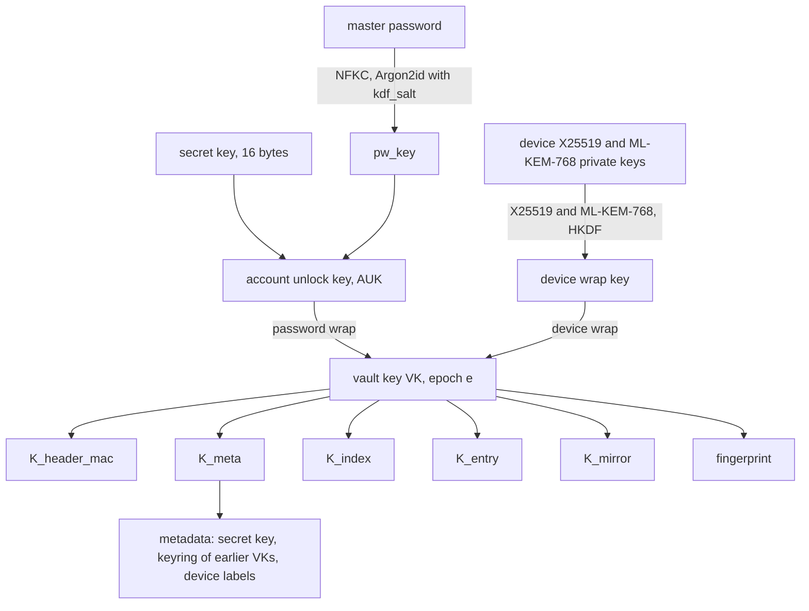

# vlt crypto and storage spec

Format version 1. Status: draft for review, 2026-10-11.

This spec defines how vlt derives and wraps keys, the byte layout of every object it stores, how
clients authenticate those objects, how the index merges, how history and deletion work, and how
devices sync, enroll, and revoke. It is normative: a client that follows it interoperates with every
other client, and the known-answer vectors in `spec/vectors/` check that it does.

## Contents

1. [Conventions](#conventions)
2. [Threat model summary](#threat-model-summary)
3. [Primitives](#primitives)
4. [Key hierarchy](#key-hierarchy)
5. [KDF parameters and calibration](#kdf-parameters-and-calibration)
6. [Bucket layout](#bucket-layout)
7. [Extension lists](#extension-lists)
8. [Size limits](#size-limits)
9. [Header object](#header-object)
10. [Header authentication and pinning](#header-authentication-and-pinning)
11. [Entry object](#entry-object)
12. [Entry text format](#entry-text-format)
13. [Index object](#index-object)
14. [Rollback detection](#rollback-detection)
15. [Client-side history](#client-side-history)
16. [Index operations and merge](#index-operations-and-merge)
17. [Sync policy](#sync-policy)
18. [Local mirror and write queue](#local-mirror-and-write-queue)
19. [Plaintext handling](#plaintext-handling)
20. [Vault creation](#vault-creation)
21. [Local vaults](#local-vaults)
22. [Capability probe](#capability-probe)
23. [Device credentials and IAM policy](#device-credentials-and-iam-policy)
24. [Device key storage](#device-key-storage)
25. [Device enrollment](#device-enrollment)
26. [Device revocation and vault key rotation](#device-revocation-and-vault-key-rotation)
27. [Master password change](#master-password-change)
28. [Deletion and purge](#deletion-and-purge)
29. [Repair](#repair)
30. [Agent protocol](#agent-protocol)
31. [Emergency kit and recovery](#emergency-kit-and-recovery)
32. [Encrypted export format](#encrypted-export-format)
33. [Plaintext export formats](#plaintext-export-formats)
34. [Bitwarden mapping](#bitwarden-mapping)
35. [pass import and export](#pass-import-and-export)
36. [Format versioning](#format-versioning)
37. [CLI exit codes](#cli-exit-codes)
38. [User-facing messages](#user-facing-messages)
39. [Portability constraints](#portability-constraints)
40. [Test vectors](#test-vectors)

## Conventions

| Notation | Meaning |
| --- | --- |
| `a \|\| b` | Byte concatenation |
| `u8`, `u16`, `u32`, `u64` | Unsigned integers, big-endian |
| `i64` | Signed 64-bit integer, two's complement, big-endian |
| `bN` | Exactly `N` raw bytes |
| `str16` | `u16` byte length followed by that many bytes of UTF-8 |
| `bytes32` | `u32` byte length followed by that many raw bytes |
| `ext` | An extension list (see [Extension lists](#extension-lists)) |
| `"label"` | The ASCII bytes of the label, no terminator |
| `HKDF(ikm, salt, info)` | HKDF-SHA256 (RFC 5869), 32-byte output |
| `HMAC(key, msg)` | HMAC-SHA256, 32-byte output |
| `AEAD(key, nonce, pt, ad)` | XChaCha20-Poly1305 seal; output is ciphertext followed by the 16-byte tag |
| `rand(N)` | `N` bytes from the operating system CSPRNG |
| `crock(b)` | Crockford base32 of `b` (alphabet `0123456789ABCDEFGHJKMNPQRSTVWXYZ`, most significant bit first, no padding) |

Every structure is parsed strictly. A decoder rejects trailing bytes, lengths that run past the end
of the input, unknown flag bits, non-zero padding, lists that are not in the required order or that
contain duplicates, and anything over the [size limits](#size-limits). "Reject" means the operation
fails with an integrity error (exit code 6) and nothing is written.

The counters `header_seq`, `index_seq`, `op_seq` (and `last_op_seq`), `revision`, and
`removed_index_seq` are at most 2^48. A decoder rejects a larger value, and a client that would
need to write one stops with an integrity error that names `vlt repair --rekey`. Honest use never
comes near the cap, so reaching it means a holder of the vault key forged a counter; the cap keeps
arithmetic safe, and [rekey](#rekey) is the recovery, because it starts a new lineage whose
counters begin again at 1. A device also reports in the status line, with the writer, any accepted
header or index whose `header_seq` or `index_seq` advances more than 2^32 past its pin, and every
epoch change, as "the vault key was changed by <writer>". Honest epoch changes follow a revocation
or a password change, so a run of them is visible. A header
whose epoch advances more than 16 past the pinned epoch is rejected: honest rotations each need a
user action, and a device that missed more than 16 of them re-enrolls.

Object IDs, device IDs, and the vault ID are 16 random bytes. Their text form is 32 lowercase hex
characters.

## Threat model summary

The requirements document holds the full threat model. The properties this spec provides are:

| Adversary | Property |
| --- | --- |
| Reader of the bucket, including all versions | Learns object count, sizes rounded to 512 bytes (entries) or 4,096 bytes (index), timestamps, the number of enrolled devices, the number, times, and device IDs of enrollment requests (abandoned ones included), and the plaintext counters `epoch`, `header_seq`, and `index_seq`. Learns no path, URL, username, secret, or device label |
| Writer to the bucket without the vault key (a stolen device AWS key) | Any modification of an object is detected. Replaying an older header or index is detected by any device that has seen a newer one. On a versioned bucket, nothing is destroyed. On single-disk RustFS, which cannot version, the writer can overwrite objects; clients detect it and [repair](#repair) current entries from their mirrors, but history that no mirror holds is lost. Entry objects are hash-chained from the index, so an overwrite is detected even when the writer holds an old vault key, as a revoked device does |
| Holder of a revoked device's keys | Reads everything written before the rotation that revoked it. Once its AWS key is deleted, reads nothing written after it, provided the secret key was rotated or the master password resists offline guessing (the holder knows the old secret key). While it still has write access, it can feed forged epoch-`e` objects to a device that has not yet seen the rotation |
| Holder of the current VK before revocation (a thief who unlocks a stolen device) | Is a full member until revoked: it can write any header or index that every device accepts, including a changed password wrap, extra device records, a new VK, and counters at their caps. vlt bounds the damage rather than preventing it: every header and index names its writer, implausible counter jumps are reported, revocation lists devices the lost device enrolled or that appeared recently, a changed password wrap is reported as tampering, and `vlt repair --rekey` rebuilds the vault in a new lineage from the master password and the emergency kit, which no forged counter or password wrap can block |
| Holder of an old master password, after a password change | Can still open the password wrap in older header versions (kept by S3 Versioning) and so recover the vault key of that time. A password change that the user marks as an exposure (`vlt passwd` asks) also rotates the vault key, which cuts this off for content written afterwards |
| Holder of a photographed invite | Reads all ciphertext and writes, as a stolen device key does, until that device's AWS key is deleted. Obtains the VK only if the user types a comparison code the holder's own request produced |
| Recorder of bucket contents or network traffic, with a future quantum computer | Every key that protects content is symmetric (256-bit) or derived through a hybrid of X25519 and ML-KEM-768, so the vault stays protected unless both X25519 and ML-KEM-768 are broken. A quantum attacker that breaks X25519 alone learns nothing |
| Holder of a device with a [local vault](#local-vaults) | The local store is the vault, so the device holder is also the store's reader and writer. A restore of an older home-directory backup rolls the store and the mirror back together, which no pin can detect. A backup that holds the password-sealed device file allows offline guessing of the password alone, at that file's KDF parameters |
| Holder of a powered-off device | Needs the master password (no-keyring CLI), the OS login (keyring CLI), or the device biometric (Android) to unlock |

Out of scope: malware running as the user on an unlocked device, a process with the user's UID
talking to an unlocked agent, hardware and side-channel attacks, and traffic analysis beyond the
leaks listed above.

## Primitives

| Purpose | Primitive | Crate |
| --- | --- | --- |
| Password stretching | Argon2id, version `0x13` (RFC 9106) | `argon2` |
| Key derivation | HKDF-SHA256 | `hkdf`, `sha2` |
| Header MAC | HMAC-SHA256 | `hmac`, `sha2` |
| AEAD | XChaCha20-Poly1305, 24-byte random nonce | `chacha20poly1305` |
| Key agreement | X25519 | `x25519-dalek` |
| Key encapsulation | ML-KEM-768 (FIPS 203) | `ml-kem` |
| Secret hygiene | Zero on drop | `zeroize` |
| Password normalisation | Unicode NFKC | `unicode-normalization` |
| Randomness | OS CSPRNG | `getrandom`, `rand_core` |

`hmac`, `unicode-normalization`, `getrandom`, `rand_core`, and `ml-kem` are additions to the decided
crate list. `hmac` is already a dependency of `hkdf`, and `rand_core` of `x25519-dalek`. `ml-kem` is
RustCrypto's pure-Rust FIPS 203 implementation; it is used only together with X25519, never alone.

Nonces are always random. With a 192-bit nonce, random nonces under one key carry no practical
collision risk at vlt's write volume. No counter nonces are used, so no nonce state needs to survive
a crash.

XChaCha20-Poly1305 is not key-committing. vlt does not rely on key commitment: every key that opens
an AEAD is either derived from the vault key or tried exactly once during unlock, and the header MAC
(HMAC, which commits) is checked straight after unlock.

## Key hierarchy



### Secret key

The **secret key** is 16 random bytes generated at `vlt init`. It lives in the emergency kit and in
the header's encrypted metadata, so every enrolled device can read the current one. Its text form
is:

1. Compute `check = SHA-256("vlt/v1/secret-key-check" || sk)[0..4]`.
2. Compute `crock(sk || check)`, giving 32 characters.
3. Split into eight groups of four separated by `-`, and prefix `VLT1-`.

Example: `VLT1-7XH6-NSCF-5P9Y-QKXJ-J745-SZYF-BEQY-C51A`.

Decoding requires the `VLT1-` prefix (case-insensitive), then ignores `-` and spaces, accepts lower
case, and maps `O` to `0` and `I` and `L` to `1`. A wrong check value rejects the input as a typo
before any key derivation.

### Account unlock key

```
pw_key = Argon2id(password = NFKC(master_password) as UTF-8,
                  salt = kdf_salt, m = m_kib, t = t, p = p, output = 32 bytes)
AUK    = HKDF(ikm = pw_key || sk, salt = vault_id, info = "vlt/v1/auk")
```

The **account unlock key** (AUK) needs both factors. A leaked bucket gives an attacker `kdf_salt`
and the password wrap, but without the secret key every password guess also needs a 128-bit guess.
The master password is not trimmed. `vlt init` and `vlt passwd` require at least 12 Unicode scalar
values after NFKC normalisation, and reject code points that are unassigned in the client's Unicode
tables (only when setting a password, never at unlock): NFKC is stable across Unicode versions only
for assigned code points, so a password containing an unassigned one could normalise differently
after an upgrade.

### Vault key and subkeys

The **vault key** (VK) is 32 random bytes. Each VK belongs to an **epoch**, a `u32` starting at 1
and incremented by every rotation. Subkeys are derived per epoch:

```
K_purpose = HKDF(ikm = VK_e, salt = vault_id, info = "vlt/v1/" || purpose)
```

| `purpose` | Use |
| --- | --- |
| `header-mac` | HMAC key over the header |
| `meta` | AEAD key for the header's encrypted metadata |
| `index` | AEAD key for the index |
| `entry` | AEAD key for every entry object of the epoch |
| `mirror` | AEAD key for local mirror state and the write queue |
| `fingerprint` | Not a key. A public-safe 32-byte value identifying `VK_e`, stored in pins |

vlt uses a single entry key per epoch rather than per-entry keys. Each entry ciphertext is bound to
its object ID through the associated data, which gives the same swap protection, and a single key
keeps rotation and history reads simple.

### Device keys

Each device has a **device ID** (16 random bytes) and two key pairs generated on the device: an
X25519 key pair and an ML-KEM-768 key pair. The ML-KEM-768 private key is stored as its 64-byte
seed `d || z` (FIPS 203, `ML-KEM.KeyGen_internal`). Private keys never leave the device. The header
holds one **device wrap** of the current VK per enrolled device, built as a hybrid of both:

```
eph_sk, eph_pk  = fresh X25519 key pair
ss_x            = X25519(eph_sk, device_pk)          ; reject if all 32 bytes are zero
kem_ct, ss_m    = ML-KEM-768.Encaps(kem_ek)
DWK = HKDF(ikm  = ss_m || ss_x,
           salt = eph_pk || device_pk || SHA-256(kem_ek) || SHA-256(kem_ct),
           info = "vlt/v1/device-wrap")
ct  = AEAD(DWK, nonce, VK_e, "vlt/v1/device-wrap" || vault_id || u32 epoch || device_id)
```

The device recomputes `ss_x` with its X25519 private key and `ss_m` with `ML-KEM-768.Decaps`, whose
implicit rejection turns a tampered `kem_ct` into an unrelated secret and so into an AEAD failure.
A writer checks `kem_ek` with the FIPS 203 encapsulation-key check before encapsulating, and a
reader rejects a header whose `kem_ek` fails it.

`DWK` depends on both shared secrets, so recovering it needs both X25519 and ML-KEM-768 broken. The
salt binds every public value of the exchange, which keeps the combination sound without relying on
properties of either component.

Public-key wrapping lets an enrolled device wrap the VK to a new device without the new device's
private keys ever moving, which is what enrollment needs, and lets a rotation wrap a new VK to every
remaining device without any device knowing another's secrets. A device wrap proves nothing about
who wrote it, because the public keys are public; first-unlock trust comes from the invite instead
(see [Device enrollment](#device-enrollment)).

### Password wrap

```
ct = AEAD(AUK, nonce, VK_e, "vlt/v1/pw-wrap" || vault_id || u32 epoch || kdf_block)
```

`kdf_block` is the exact 29-byte KDF block from the header. A bucket writer who changes the Argon2
parameters or the salt therefore breaks the wrap rather than weakening it. Only a holder of the AUK
can produce a password wrap, so a password-path unlock authenticates the VK it yields.

### What rotation and password change touch

| Operation | Rewritten | Unchanged |
| --- | --- | --- |
| Master password change (CORE-8) without rotation, and `--recalibrate` | `kdf_salt`, the password wrap, `header_seq`, the MAC (and the KDF parameters, for `--recalibrate`); then the index is republished to signal the header change | VK, every device wrap, the keyring, every entry object |
| Master password change with rotation | As above, followed by a vault key rotation | Existing entry objects |
| Vault key rotation (CORE-7) | New VK and epoch, password wrap, every remaining device wrap, the metadata (keyring gains the old VK, rotation commitment set), the MAC, the index (re-sealed under the new epoch) | Existing entry objects. They stay sealed under their original epoch's key, which the keyring keeps |

Rotation protects content written after the revocation. It cannot protect content the revoked
device could already read, because that device may have copied every object it could see. Existing
entry objects are therefore not re-encrypted. After revoking a lost or stolen device, the user
changes the passwords of entries that matter; each change is a new revision under the new epoch.

## KDF parameters and calibration

| Set | `m_kib` | `t` | `p` | Allowed in |
| --- | --- | --- | --- | --- |
| Floor | 65,536 (64 MiB) | 3 | 1 | Every build |
| Ceiling | 1,048,576 (1 GiB) | 10 | 4 | Every build |
| Test | 64 | 1 | 1 | Test builds only; header flag `test_kdf` set |

A client rejects a header, device file, or export whose parameters fall outside floor and ceiling,
unless both the `test_kdf` flag is set and the client is a test build. Release builds reject
`test_kdf` objects outright. The ceiling is a parse rule shared by every client; it bounds the
memory a bucket writer can make a client allocate before the MAC can be checked, and it fits inside
`wasm32` and Android memory.

Calibration runs at `vlt init` and at `vlt passwd --recalibrate`, which re-wraps under the current
password without asking for a new one. It fixes `p = 1` (WASM has no
threads) and `t = 3`, then picks the largest `m_kib` in `{64, 128, 256}` MiB whose measured
derivation time on the current device is at most 500 ms. If 64 MiB already takes longer, it uses
the floor. The 256 MiB cap keeps password unlock possible on a phone or in a browser. The
requirement targets the slowest enrolled device, so `vlt passwd --recalibrate` is best run on the
slowest device. `vlt enroll` measures password-unlock time on the new device and suggests
recalibration only when it exceeds 2 s. Calibration still targets 500 ms; the higher threshold
keeps a slightly slower device from prompting on every enrollment, because password unlock is the
rare path.

Password unlock is the slow path. Day-to-day unlock goes through the device wrap and takes no
Argon2 work, which keeps per-device unlock under 100 ms.

## Bucket layout

The vault lives under a configured prefix (default `vlt/`) in a dedicated bucket. A [local
vault](#local-vaults) uses the same keys, without the prefix, in its local store until a bucket is
attached.

| Object key | Contents | Written with |
| --- | --- | --- |
| `<prefix>header` | Header object | `If-None-Match: *` at init or attach, then `If-Match: <etag>` |
| `<prefix>index` | Index object | `If-None-Match: *` at init or attach, then `If-Match: <etag>` |
| `<prefix>e/<object_id hex>` | One entry revision | Always `If-None-Match: *` |
| `<prefix>enroll/<device_id hex>` | One [enrollment request](#enrollment-request-object) | Always `If-None-Match: *` |

Entry objects are immutable. A well-behaved client never overwrites one; a `412` on an entry `PUT`
means the object already exists (a retried upload) and the client confirms the stored bytes match.
Enrollment requests are small, immutable, and stay in the bucket after use, because device keys
cannot delete.

The prefix is 1 to 64 characters from `[A-Za-z0-9._/-]` and ends in `/`.

## Extension lists

Several plaintext structures end in an **extension list**, so later revisions can add data (for
example attachments, CORE-9, or passkeys, CORE-14) without a vault-wide format change.

| Field | Type | Notes |
| --- | --- | --- |
| `count` | `u16` | At most 64 |
| items | `u16 type`, `bytes32 value` | Sorted by `type`, no duplicates |

Two bits of `type` carry rules that every reader applies to types it does not know:

| Bit | Name | Meaning for an unknown type |
| --- | --- | --- |
| 15 | critical | Set: reject the structure. Clear: ignore the item when reading |
| 14 | copy-safe | Set: keep the item when the writer changes other fields of the record. Clear: drop the item when the writer changes the record |

A writer that rewrites a record without changing it (for example, carrying an index entry over
during merge) keeps every extension item byte for byte, whatever the bits. A writer that changes a
record keeps unknown items with bit 14 set and drops unknown items with bit 14 clear. An edit to an
entry's content is a change to the entry plaintext record; a new head for an index entry is a change
to that index record. Format version 1 defines two extension types, below; version 1 writers
emit `count = 0` everywhere else.

| Type | Bits | Used in | Value |
| --- | --- | --- | --- |
| `0x4001` | copy-safe | Index entry only; a decoder rejects it on a tombstone | **Conflict-of**: the UTF-8 path of the conflict copy's original. Marks the entry as a conflict copy. Kept when the copy is edited or moved; it disappears only when `vlt resolve` removes the copy |
| `0x4002` | copy-safe | Index entry or tombstone | **History floor**: a `u64` revision, the oldest revision kept after `vlt purge commit --history`. Revisions of this record's chain below it were purged. `remove` copies an entry's floor to its tombstone, and a `put` that reinserts a tombstoned entry (edit-wins-over-delete or `restore`) copies it back; edits and moves keep it; a later purge raises it. See [Local mirror and write queue](#local-mirror-and-write-queue) for how mirrors use it |

Decoders check the values of these types: a conflict-of value is a path that satisfies the path
rules and differs from the record's own path; a history-floor value is exactly 8 bytes, with
`1 < floor <= revision` of its record and at most the counter cap. A record carries each type at
most once.

## Size limits

Clients check these before allocating or decrypting. For objects fetched from the bucket, the
`Content-Length` is checked before the body is read.

| Item | Limit |
| --- | --- |
| Header object | 128 KiB |
| Header `device_count` | 32 |
| Metadata keyring entries | 1,000 |
| Index object | 16 MiB |
| Entry content | 1 MiB |
| Entry object | 1 MiB + 4 KiB |
| Path | 1,024 bytes |
| Device label | 1 to 32 characters from `[a-z0-9-]` |
| Extension list | 64 items |
| Invite, enrollment request object | 4 KiB |
| Device file | 64 KiB |
| Agent message | 16 MiB |

## Header object

| Offset | Field | Type | Notes |
| --- | --- | --- | --- |
| 0 | `magic` | `b4` | `"VLTH"` |
| 4 | `format_version` | `u16` | `1` |
| 6 | `flags` | `u16` | Bit 0 `test_kdf`. Other bits zero |
| 8 | `vault_id` | `b16` | Random at init, never changes |
| 24 | `header_seq` | `u64` | `1` at init, incremented on every header write |
| 32 | `epoch` | `u32` | Current VK epoch |
| 36 | `kdf_block` | `b29` | See below |
| 65 | `pw_nonce` | `b24` | |
| 89 | `pw_ct` | `b48` | Password wrap of `VK_epoch` |
| 137 | `device_count` | `u16` | |
| 139 | `devices` | 2,424 bytes each | See below, sorted by `device_id` |
| | `meta_nonce` | `b24` | |
| | `meta_ct` | `bytes32` | Encrypted metadata |
| | `mac` | `b32` | `HMAC(K_header_mac, every preceding byte)` |

`kdf_block`:

| Field | Type | Notes |
| --- | --- | --- |
| `alg` | `u8` | `1` = Argon2id version `0x13` |
| `m_kib` | `u32` | |
| `t` | `u32` | |
| `p` | `u32` | |
| `kdf_salt` | `b16` | Fresh on every password change |

Device record:

| Field | Type |
| --- | --- |
| `device_id` | `b16` |
| `device_pk` | `b32` (X25519) |
| `kem_ek` | `b1184` (ML-KEM-768 encapsulation key) |
| `eph_pk` | `b32` |
| `kem_ct` | `b1088` |
| `nonce` | `b24` |
| `ct` | `b48` |

A header with 32 devices and a full keyring stays under the 128 KiB limit.

Metadata plaintext, sealed as
`AEAD(K_meta, meta_nonce, meta_plain, "vlt/v1/meta" || vault_id || u32 epoch)`:

| Field | Type | Notes |
| --- | --- | --- |
| `writer_device_id` | `b16` | The device that wrote this header. Attribution only; see [writer checks](#writer-checks) |
| `secret_key` | `b16` | The current secret key |
| `rotated_from_epoch` | `u32` | Epoch the last rotation left, or `0` if the vault never rotated |
| `rotated_from_index_seq` | `u64` | `index_seq` of the index the rotation started from, or `0` |
| `rotated_from_index_sha256` | `b32` | SHA-256 of that index object, or zeros. Carried forward unchanged until the next rotation; once a device has accepted a newer index, its `index_seq` pin makes the commitment irrelevant to it |
| `keyring_count` | `u32` | Equals `epoch - 1` |
| keyring entries | `u32 epoch`, `b32 vk` | Every earlier epoch, ascending: exactly epochs 1 to `epoch - 1`. With the keyring limit, this caps `epoch` at 1,001 |
| `legacy_count` | `u16` | Number of earlier lineages, from [rekeys](#rekey); at most 16 |
| legacy lineages | `b16 vault_id`, `u32 count`, then `count` keyring entries (`u32 epoch`, `b32 vk`) | Each lineage's vault ID and every VK of it, epochs 1 to its last, ascending; `count` is at least 1. Sorted by `vault_id`, none equal to the header's. Keyring entries across the current keyring and every lineage count together toward the keyring limit |
| `device_info_count` | `u16` | Equals `device_count` |
| device info | `b16 device_id`, `u8 kind`, `str16 label`, `u64 enrolled_header_seq`, `i64 enrolled_unix`, `b16 enrolled_by` | Same order as the device records; IDs must match one to one. `enrolled_unix` is the enrolling device's wall clock, for display by `vlt devices` only. `enrolled_by` is the inviting device, the device itself for the kit path, or zero for the device that ran `vlt init` |
| `ext` | `ext` | |

`kind` is `1` CLI, `2` Android, `3` Firefox, `4` desktop; a decoder rejects any other value. Labels
are unique within a vault and are used in conflict-copy paths, `vlt devices`, and `vlt revoke`.
Labels live in the encrypted metadata so the bucket does not reveal device names.

## Header authentication and pinning

The header is authenticated by `HMAC(K_header_mac, header bytes before mac)`, where `K_header_mac`
derives from the current VK. Only a holder of the VK can produce a valid header. The password wrap
and device wraps are additionally bound to the KDF block and epoch through their associated data.

Unlock proceeds in this order:

1. Parse the header. Reject an unknown `magic`, a `format_version` the client does not know, unknown
   flags, `test_kdf` in a release build, KDF parameters outside floor and ceiling, or anything over
   the size limits.
2. Open the device wrap with the device private key, or open the password wrap with the AUK. A
   failure is reported as a wrong password or an unknown device; nothing distinguishes a tampered
   wrap from a wrong password.
3. Verify `mac`. A failure is an integrity error.
4. Decrypt the metadata and check that its device info matches the device records.
5. Check the pins (below). A failure is an integrity error.

A device stores a **header pin** in its local state:

| Pin field | Check on every later header |
| --- | --- |
| `vault_id` | Must be equal |
| `epoch` | Must be greater than or equal |
| `fingerprint` of `VK_epoch` | If the epoch is equal, the fingerprint must be equal. If the epoch is greater, the keyring must contain the pinned epoch with a VK whose fingerprint matches the pin |
| `header_seq` | Must be greater than or equal; equal requires a byte-identical header |
| `legacy_sha256` | `SHA-256("vlt/v1/legacy" \|\| legacy block)`, where the legacy block is the metadata bytes from `legacy_count` through the last legacy lineage. Must be equal: the legacy lineages cannot change within a lineage. Only a [rekey](#rekey), which changes `vault_id` and passes no existing pin, writes a different list |

The pins update after every accepted header. The keyring check gives each rotation a chain of
custody: a device accepts a new VK only from a header that proves knowledge of the VK it already
trusts.

First-unlock trust depends on how the device obtains the VK:

| Path | Trust anchor |
| --- | --- |
| Password and secret key (kit path, `vlt init`) | The password wrap. Only an AUK holder can produce it. When the vault configuration line gives a `vault_id`, the header's must equal it |
| Device wrap after an invite | The invite, which carries the inviting device's `vault_id`, `epoch`, fingerprint, and legacy pin. The new device sets its pins from the invite and accepts only a header that satisfies them |

A fresh device cannot detect an index rollback that happened before it enrolled; its index pins
start from the first index it accepts.

### Writer checks

Every header and index names its writer (`writer_device_id`, inside the MAC or the AEAD). A member
can lie about it, so it is attribution, not authentication, but two checks use it:

- A device records the SHA-256 of every header and index it publishes. A header or index that
  names this device as writer but matches no recorded hash is an integrity error reporting that
  another holder of the vault key wrote in this device's name. When the device's records do not
  reach back that far (a restored or rebuilt `state`), it is a warning instead.
- A header whose writer was not enrolled in the previously accepted header, or an index whose
  writer is not enrolled in the current header, is reported in the status line and by
  `vlt devices`.

## Entry object

Key: `<prefix>e/<object_id hex>`.

| Offset | Field | Type | Notes |
| --- | --- | --- | --- |
| 0 | `magic` | `b4` | `"VLTE"` |
| 4 | `format_version` | `u16` | `1` |
| 6 | `flags` | `u16` | `0` |
| 8 | `vault_id` | `b16` | |
| 24 | `epoch` | `u32` | Epoch whose `K_entry` sealed this object |
| 28 | `object_id` | `b16` | Must equal the object key's hex |
| 44 | `nonce` | `b24` | |
| 68 | `ciphertext` | rest | `AEAD(K_entry, nonce, plain, bytes 0..68)` |

The associated data is the full 68-byte prefix, so the ciphertext is bound to the vault, the epoch,
and the object ID.

Entry plaintext:

| Field | Type | Notes |
| --- | --- | --- |
| `revision` | `u64` | `1` for a new entry, parent's revision plus one for an edit |
| `parent_object_id` | `b16` | Previous revision, or 16 zero bytes for the first |
| `parent_sha256` | `b32` | SHA-256 of the previous revision's whole entry object, or 32 zero bytes for the first |
| `device_id` | `b16` | Device that wrote this revision |
| `created_unix` | `i64` | Writer's wall clock, seconds. Display only, never used for ordering |
| `content` | `bytes32` | Entry text, at most 1 MiB |
| `ext` | `ext` | |
| padding | zero bytes | Up to the size rule below |

`revision` is 1 exactly when `parent_object_id` and `parent_sha256` are all zero bytes; a decoder
rejects any other combination.

Padding makes the whole object (prefix, ciphertext, and tag) the smallest multiple of 512 bytes that
holds it, so the smallest entry object is 512 bytes. A decoder requires every padding byte to be
zero.

An entry object opens under the `K_entry` of its own `vault_id` and `epoch`: the current lineage
when `vault_id` is the header's (with `epoch` at most the header's), or a legacy lineage of the
metadata otherwise. Subkeys of a legacy lineage derive with that lineage's `vault_id` as the HKDF
salt. Any other `(vault_id, epoch)` is rejected. The index's `vault_id` always equals the header's.

When a client reads an entry through the index, it checks that the SHA-256 of the whole object
equals the index's `head_sha256`, that the object's `object_id`, the key it was fetched from, and
the index's head ID agree, and that `revision` and `device_id` equal the index's. When walking
history, it checks that each parent object's SHA-256 equals the child's `parent_sha256` and that the
parent's revision is exactly one less than its child's.

The hashes chain every revision to the index, which only a holder of the current VK can write. An
entry object that is overwritten, even with a valid ciphertext under an old or legacy key, no
longer matches its hash and is rejected.

## Entry text format

The entry content is bytes, stored verbatim. vlt never rewrites content to normalise it. The parsing
below drives display, search, TOTP, and import mapping; content that does not parse as UTF-8 is
shown and exported as-is and has no fields.

- Lines split on `\n`. A trailing `\r` on a line is ignored for parsing.
- Line 1 is the password. It may be empty.
- The **field section** follows line 1. It is a run of lines, each of which is one of:
  - a field line, `key: value`, where `key` is one or more characters other than `:` and newline,
    not starting with whitespace, and `value` is everything after the first `": "` up to the end of
    the line (leading and trailing spaces in `value` are kept);
  - a field line with an empty value, `key:`;
  - a block field, `key: |`, followed by one or more lines each indented by exactly two spaces; the
    value is those lines with the two spaces removed, joined by `\n`;
  - an `otpauth://` URI line.
- The field section ends at the first line that is none of these. `key:value`, with no space after
  the colon, is not a field line, matching pass convention. If the ending line is empty, it is a
  separator and is not part of the notes. Everything after it is the **notes**, verbatim; an empty
  remainder means the entry has no notes.
- Keys compare case-insensitively. A key may repeat; order is kept.

A notes line that looks like a field and sits directly under the field section is parsed as a field.
vlt always writes a blank separator line before notes. `vlt insert -m` and `vlt edit` warn when the
saved content has notes that are not preceded by an empty separator line, because a later line
added to the end of the field section would then change how the notes parse.

Keys with meaning to vlt: `username` (also `user`, `login`), `url`, `email`, `type`, `password`
(block form, for passwords containing a newline), `totp`, and the first `otpauth://` line (CORE-5).
`vlt find` and search match path, every `url`, and `username`.

## Index object

Key: `<prefix>index`.

| Offset | Field | Type | Notes |
| --- | --- | --- | --- |
| 0 | `magic` | `b4` | `"VLTI"` |
| 4 | `format_version` | `u16` | `1` |
| 6 | `flags` | `u16` | `0` |
| 8 | `vault_id` | `b16` | |
| 24 | `epoch` | `u32` | Epoch whose `K_index` sealed this object |
| 28 | `index_seq` | `u64` | `1` at init, incremented on every index write |
| 36 | `header_seq` | `u64` | `header_seq` of the header current when this index was written |
| 44 | `nonce` | `b24` | |
| 68 | `ciphertext` | rest | `AEAD(K_index, nonce, plain, bytes 0..68)` |

Index plaintext:

| Field | Type | Notes |
| --- | --- | --- |
| `writer_device_id` | `b16` | The device that wrote this index; see [writer checks](#writer-checks) |
| `entry_count` | `u32` | |
| entries | `str16 path`, `b16 head_object_id`, `b32 head_sha256`, `u64 revision`, `b16 device_id`, `ext` | Sorted by path bytes, paths unique. `head_sha256` is the SHA-256 of the whole head entry object |
| `tombstone_count` | `u32` | |
| tombstones | `str16 path`, `b16 head_object_id`, `b32 head_sha256`, `u64 revision`, `b16 device_id`, `u64 removed_index_seq`, `ext` | Sorted by path bytes, then `removed_index_seq` |
| `applied_count` | `u16` | |
| applied | `b16 device_id`, `u64 last_op_seq` | Sorted by `device_id`; see [replay](#index-operations-and-merge) |
| `ext` | `ext` | |
| padding | zero bytes | Whole object the smallest multiple of 4,096 bytes that holds it |

`device_id` in an index entry is the writer of the head revision. A `head_object_id` appears at most
once among the entries; a decoder rejects duplicates, because replay locates entries by head ID.

Paths are UTF-8, `/`-separated, at most 1,024 bytes, with no empty segment, no `.` or `..`
segment, no leading or trailing `/`, and no control characters (C0, `U+007F`, and C1). Clients
normalise a path to NFC when the user enters or imports it. Decoders of the index and of encrypted
exports enforce the structural rules, so a path that breaks them is rejected even inside a valid
ciphertext, but never check NFC: normalisation depends on the Unicode version of each client's
tables, and clients must not reject each other's paths over it.

Size at 5,000 entries: each entry costs 76 bytes plus its path. With a 40-byte average path that is
116 bytes, so 5,000 entries take about 580 KB plus tombstones, under the 1 MB requirement. History
lives in the entry objects, not in the index.

## Rollback detection

Per-entry AEAD stops the bucket from swapping or altering entries, and the index binds each path to
one head object ID and revision. A bucket writer can still replay an older, validly sealed index
(for example, an earlier S3 version) to hide recent changes. Clients detect that with monotonic
counters held in local state:

| Pin | Rule |
| --- | --- |
| `index_seq` and `SHA-256(index object)` | A fetched index with a lower `index_seq` is a rollback. An equal `index_seq` with a different hash is a fork. Both are integrity errors |
| `index_epoch` | An index whose `epoch` is lower than the pinned index epoch is rejected |
| `header_seq` | As in [header pinning](#header-authentication-and-pinning) |

An index is acceptable when its `epoch` equals the header's `epoch`, or when it is a **rotation
index**: its `epoch` equals the metadata's `rotated_from_epoch`, which is one less than the
header's, and its SHA-256 equals `rotated_from_index_sha256`. Any other epoch-`e` index under an
epoch-`e + 1` header is rejected, which stops a holder of `VK_e` from injecting an index during a
rotation. See [Device revocation](#device-revocation-and-vault-key-rotation).

When `index.header_seq` exceeds the pinned `header_seq`, the client fetches the header before
anything else. Every header write is followed by an index write carrying the new `header_seq`, so
one conditional `GET` of the index notices header changes too. A writer always sets `index_seq` to
the fetched index's value plus one, and conditional writes ensure two writers never publish the same
value.

A device offline since before a rollback cannot detect it, and a rollback to a state newer than a
device's pin is invisible to that device. Both are inherent to a design without a trusted server.
Recovery is explicit, through [Repair](#repair).

## Client-side history

Every edit writes a new entry object with a fresh `object_id`. Its plaintext records
`parent_object_id`, so the revisions of an entry form a chain from the head back to revision 1.
History works the same on every backend, and S3 Versioning, where present, is a second copy.

- `vlt log <path>` walks the chain from the index's head, one `GET` per revision, stopping at a zero
  parent. Revisions already in the mirror cost nothing. A parent that returns `404` ends the walk
  with "earlier revisions purged"; device keys cannot delete, so only a purge removes objects.
- `vlt show <path> --rev <revision>` shows one revision. Revisions are selected by flag, not by
  a path suffix, because paths often contain `@`.
- `vlt diff <path> <rev-a> <rev-b>` diffs two revisions in memory.
- `vlt restore <path> <revision>` writes a new revision whose content is the old revision's content,
  with the current head as parent. History is never rewritten.

`vlt mv` changes only the index, so a moved entry keeps its chain. `vlt cp` writes a new entry with
revision 1 and a zero parent; the copy starts its own history.

## Index operations and merge

A device never merges two index states. It records each change as an **operation** in its write
queue and, when publishing, replays the queued operations on top of the latest remote index. This is
a rebase, and it needs no clocks.

Each operation carries an `op_seq`, a `u64` the device increments for every operation it queues,
starting at 1 and never reused. The index's `applied` table records, per device, the highest
`op_seq` already published. Replay skips any operation whose `op_seq` is at most the table's value
for this device, and publishing sets the table's value to the highest `op_seq` replayed. A publish
whose response was lost is therefore harmless to retry.

The counter must never go backwards, or the device's new operations would be skipped. A device
therefore initialises its next `op_seq` to `applied[device_id] + 1` whenever it builds a mirror, and
on every accepted index whose `applied[device_id]` is at least its next `op_seq` (a restored or
stale `state`, or a value another member forged), it raises the counter past it, renumbers its
queued operations above it, and reports the event in the status line with the index's writer. A
value at the cap leaves no room and is an integrity error that names `vlt repair --rekey`.

| Operation | Fields |
| --- | --- |
| `put` | `op_seq`, `path`, `object_id`, `object_sha256`, `revision`, `parent_object_id` (zero for a new entry), `device_id` |
| `remove` | `op_seq`, `path`, `expected_head` |
| `move` | `op_seq`, `from`, `to`, `expected_head` |

`cp` is a `put` with a zero parent. `restore` is a `put` whose parent is the current head.

### Revision order

Revision R1 is newer than R2 when `(revision, device_id, object_id)` of R1 is greater than that of
R2, comparing `revision` numerically and the IDs as bytes. "Newer" therefore means "further along
its chain": a device that made three offline edits beats a later single edit made elsewhere. The
loser is never discarded; it becomes a conflict copy. No device clock takes part.

### Locating an operation's target

Replay finds an operation's target by object ID, not by path, so a queue of edits to one entry
follows that entry wherever earlier operations or remote changes moved it. For a `put` edit, the
target is the path whose head equals `parent_object_id`; for `remove` and `move`, the path whose
head equals `expected_head`.

### Replay rules

Let `remote` be the freshly fetched index. Each queued operation applies to `remote` in queue order.

| Operation | Remote state | Result |
| --- | --- | --- |
| `put`, new entry | Path free | Insert |
| `put`, new entry | Path taken | Conflict at the path |
| `put`, edit | Target found (at the op's path or elsewhere) | Replace the target's head; the entry stays at the target's path |
| `put`, edit | No target; a tombstone's head equals the parent | Edit wins over delete: insert at the op's path (or a conflict path if it is taken); the tombstone stays as history |
| `put`, edit | No target; the op's path holds a head that descends from the parent | Concurrent edit: conflict at the path |
| `put`, edit | No target, no tombstone, path free | Insert at the path; report it |
| `put`, edit | No target, no tombstone, path taken by an unrelated entry | Insert at a conflict path; report it |
| `remove` | Target found | Remove that path, add a tombstone |
| `remove` | No target | Drop (the entry was edited since; edit wins over delete); report it |
| `move` | Target found, `to` free | Move |
| `move` | Target found, `to` taken | Move to a conflict path derived from `to`, labelled with this device |
| `move` | No target, `from` holds a head that descends from `expected_head` | Move it: the rename is the user's intent, the content is the newer one |
| `move` | No target, `from` holds an unrelated entry | Drop; report it |
| `move` | No target, `from` empty | Drop; report it |

"Descends from the parent" is decided by walking the remote head's chain back while its revision is
greater than the parent's; the walk is bounded by the revision difference and served from the mirror
where possible. A walk that cannot complete (objects unavailable offline) treats the case as a
concurrent edit.

A conflict at a path compares the two revisions by [revision order](#revision-order): the newer
keeps the path and the other moves to a conflict path. Later queued operations whose target is the
loser find it at the conflict path.

A **conflict path** is `<path>.conflict-<label>`, where `<label>` is the label of the device that
wrote the losing revision (for a `move`, this device). If that device is no longer enrolled, the
label is the first 8 hex characters of its device ID. If the path is taken, `-2`, `-3`, and so on
are appended. If the result exceeds 1,024 bytes, the last segment of `<path>` is truncated at a
character boundary to fit. The conflict copy points at the losing revision's object and carries the
conflict-of item naming `<path>`; nothing is re-encrypted.

Every conflict and every dropped or reported operation appears in the sync report
(`vlt sync --json` lists them) and in the [status line](#status-line), so nothing is lost silently.

### Conflict resolution

A **conflict copy** is an index entry that carries the conflict-of extension item (type `0x4001`),
which merge adds when it creates the copy. The item's value is the copy's **original** path. The
`.conflict-<label>` suffix only makes the copy visible in listings; a path that merely contains it,
for example an imported item, is an ordinary entry.

- `vlt conflicts` lists every original with its conflict copies, each copy's writing device, and
  its revision.
- `vlt resolve <path>` takes an original or a copy. For each copy of the original it shows a diff
  of the two contents and asks which to keep. Keeping the copy writes its content as a new revision
  of the original, with the original's head as parent. The copy is then removed. Both versions stay
  in history, the copy's through its tombstone. `--edit` opens the editor on the kept content before
  it is saved, with the same in-memory handling as `vlt edit`.

Resolution is a `put` (when the copy wins) followed by a `remove`, queued together; it adds no
operation type.

## Sync policy

S3 cannot push changes, so clients poll. Polling every 10 s from four devices costs about $5 a year
in `GET` requests, which breaks the cost requirement, so vlt syncs at these points only:

| Trigger | What runs |
| --- | --- |
| A CLI command served by the agent | The agent answers from the mirror at once, then syncs in the background if the last sync is older than 10 s. A write command exits 0 once the write is queued; the agent publishes it in the background. With `--strict`, the command waits for publication and fails with its exit code |
| A CLI command with no agent | One sync before the command, with a 3 s network budget; on timeout the command uses the mirror. A write command publishes before exiting. After a connectivity failure, commands skip the network for the next 60 s, so offline commands do not each wait |
| The agent, while unlocked | One sync every 60 s (configurable, minimum 10 s) |
| The agent, while locked with a non-empty write queue | With keyring unlock, the agent tries to publish every 60 s, backing off exponentially to 15 minutes while offline. It first sends the conditional index `GET`, which needs only the AWS key; only when that succeeds does it read the bundle from the keyring, without any interactive prompt, open the device wrap, publish, and lock again. A keyring that would prompt, a `403`, or an integrity error stops background attempts until the next interactive command. A background unlock does not reset `agent.idle_timeout` or `agent.max_lifetime`. Without keyring unlock, the queue waits for the next unlock, and the status line says so. A locked agent with an empty queue does not poll |
| `vlt sync` | One sync, a conditional `GET` of the header as well, and publication of the write queue, all in the foreground |

One sync is:

1. `GET <prefix>index` with `If-None-Match: <cached etag>`. A `304` costs one request and ends the
   sync.
2. On `200`, decode and check the index against the pins. If `index.header_seq` is above the pin,
   fetch and check the header.
3. Fetch any head entry objects missing from the mirror (the mirror keeps every head, so `grep` and
   offline reads work). With `mirror.history = full`, also fetch, in the background, any history
   object reachable from a head or tombstone that the mirror lacks.
4. If the write queue is not empty, publish it (below).

A command that cannot reach the backend because of a connection failure, DNS failure, or timeout
uses the mirror, queues writes, and exits 0; the status line reports the queued changes. With
`--strict` it exits 9 instead. Any HTTP error response, including `403` from a revoked key, is not
"offline": the command fails with exit code 7. `vlt status` and every `--json` result show `queued`
and `queue_len`.

A background publish that fails after its command has exited is recorded by the agent as
`last_publish_error` (exit code and message) until a later publish succeeds.

### Offline operation

An enrolled device works without a network. `--offline` on any command keeps that command from
contacting the backend. The setting `sync.offline true` does the same for every command and stops
the agent's polling and background publishing. `vlt sync` contacts the backend once without
clearing the setting. Writes still queue; with `--strict`, a write under `--offline` exits 9 at
once. Offline mode never applies to a local store, which needs no network.

After a connectivity failure, a CLI command without an agent records the time in a non-secret
file, `netskip`, in the vault's data directory, and later commands skip the network until 60 s have
passed. The skip does not apply to `vlt sync` or to commands that need the backend.

| Works offline, from the mirror | Needs the backend |
| --- | --- |
| Unlock (device wrap or password), `show`, `ls`, `find`, `grep`, `totp`, `show -c` | `vlt init` with a bucket, and [`vlt attach`](#attaching-a-store) |
| `insert`, `edit`, `generate`, `rm`, `mv`, `cp`, `restore`, `resolve`: queued | `vlt invite` and `vlt enroll` |
| `log`, `diff`, `show --rev`: complete with `mirror.history = full` | `vlt revoke`, `vlt passwd`, `vlt repair`, including `--rekey` |
| `conflicts`, `devices`, `status`, `teardown` (prints only), the password check | `vlt purge`, `vlt doctor` |
| `kit`: from the mirror, marked "as of <last sync>; may be outdated", without the kit confirmation | `vlt kit` with the confirmation, which needs a fresh header so that it never confirms a superseded secret key |
| `export` in every format, `import` into the queue; an export with history from a `heads` mirror warns that it is incomplete | `vlt sync` |

A command that needs the backend and cannot reach it fails at once with exit code 7 and says that it
needs a connection; it never queues a header change. On a [local vault](#local-vaults), every
command in the right-hand column except `invite`, `enroll`, and `attach` runs against the local
store and so needs no network either; `revoke` does not apply there.

### Status line

After its own output, every command prints at most one line to stderr summarising background state,
when stderr is a terminal and any of these hold. The items appear in this order, joined by `; `:

| Condition | Text |
| --- | --- |
| `last_publish_error` is set | `sync failed: <message>` |
| The write queue is not empty | `<n> changes not yet synced` (with `, unlock to sync` on a locked no-keyring agent) |
| Conflict copies exist | `<n> conflicts, run vlt conflicts` |
| Rotation pending | `another device is finishing a key change` |
| The last successful sync is more than 1 hour old (`sync.stale_after`), whatever the cause | `last synced <time> ago` |
| `sync.offline` is set | `offline (by choice)` |
| An attach is in progress or interrupted | `attaching to <bucket>, run vlt attach to resume` |
| A local vault with no encrypted export written in 30 days | `local vault: no recent export` |
| Unread notices: pending invites, a vault key change and its writer, an implausible counter jump, a raised `op_seq`, an unenrolled writer, or dropped operations | `<n> notices, run vlt status` |

`--json` results carry the same conditions as the fields `last_publish_error`, `queue_len`,
`conflicts`, `rotation_pending`, `last_sync`, `offline`, `attaching`, `local`, and `notices`.
`vlt status` lists the notices and marks them read. A script that
needs certainty uses `--strict`.

Cost at current S3 prices ($0.0004 per 1,000 `GET` requests, $0.005 per 1,000 `PUT` requests,
$0.023 per GB-month):

| Item | Per year |
| --- | --- |
| Agent polling, unlocked eight hours a day: 480 `GET`s a day | About $0.07 per device, $0.28 for four |
| Index writes, 10 a day | About $0.02 |
| Noncurrent index versions kept 365 days, 10 writes a day, at 1,000 entries (about 90 KB each) | About $0.08 |
| The same at 5,000 entries (about 420 KB each) | About $0.37 |
| Current objects, a few MB | Under $0.01 |

The total stays under $1 a year at 1,000 entries on four devices.

## Local mirror and write queue

The **mirror** is a directory, `$XDG_DATA_HOME/vlt/<vault_id hex>/`, created with mode `0700`:

| File | Contents |
| --- | --- |
| `header` | Last accepted header object, verbatim |
| `index` | Last accepted index object, verbatim, and its etag |
| `e/<object_id hex>` | Entry objects, verbatim. With `mirror.history = full`, every object reachable from a head or tombstone down to its history floor, which makes history and exports complete offline. With `mirror.history = heads`, every current head and tombstone head, plus history objects the user has displayed |
| `state` | Pins, etags, the next `op_seq`, and the write queue, sealed with `K_mirror` |

Objects in the mirror are the bucket's ciphertext, unchanged, so the mirror holds no plaintext and
no new format.

`state` layout: `"VLTS"`, `u16 1`, `u16 0`, `b16 vault_id`, `u32 epoch`, `b24 nonce`, then
`AEAD(K_mirror, nonce, serialised state, bytes 0..52)`. The plaintext serialisation is internal to
each client and is not part of the interchange format. The state is written to a temporary file,
`fsync`ed, and renamed over the old one.

Publishing the queue:

1. In queue order, re-seal every queued entry object that was sealed under a `(vault_id, epoch)`
   other than the header's, or whose `parent_object_id` names an object re-sealed in this step: new
   plaintext with the updated parent and `parent_sha256`, current epoch, fresh `object_id`. Rewrite
   every later operation's `parent_object_id`, `object_sha256`, and `expected_head` that names an
   old object. Old objects may already
   be in the bucket; they stay unreferenced.
2. `PUT` each queued entry object with `If-None-Match: *`. On `412`, `GET` the object and require
   identical bytes; anything else is an integrity error.
3. Fetch the index (unconditional on retry), check pins, replay the queued operations, set
   `index_seq` to the fetched value plus one, and seal under the header's current epoch.
4. `PUT` the index with `If-Match: <fetched etag>`. On `412`, go back to step 3, up to eight
   attempts with jittered backoff from 100 ms.
5. On success, clear the queue, update the pins, and report conflicts.

Only one process owns a mirror at a time: the agent if it is running, otherwise the CLI process,
which takes an exclusive `flock` on `state`.

The default depends on the platform:

| Platform | Default | Fill |
| --- | --- | --- |
| CLI, desktop | `full` | At enrollment and in the background |
| Android | `full` | Only on unmetered networks; heads are always fetched |
| Firefox | `heads` | None |

Full history is small: entry objects are 512 bytes at their smallest, so 5,000 entries with ten
revisions each take about 25 MB. Filling it takes one `GET` per revision, about 50,000 for that
vault and about $0.02, which is why phones fill only on unmetered networks. Afterwards each new
revision is fetched once, as a head. A `404` during the fill means the object was purged; the
mirror records it in `state` and does not request it again.

The mirror deletes an entry object at once only on an explicit purge signal, and only after the
backend returns `404` for it: the object lies below the history floor of every record whose chain
reaches it, or it belonged to a tombstone that `vlt purge commit` removed. Requiring the `404`
means that a floor written by a member, rather than by a real purge with admin credentials, cannot
make mirrors delete history. Other objects that the current index no longer reaches (or, with
`mirror.history = heads`, that are no longer a head or tombstone head) are kept for 30 days before
pruning, so that a forged index cannot empty the mirrors that `vlt repair` and rekey depend on.
Objects the user has displayed, and objects this device published in the last 30 days, are kept
regardless, unless a purge signal applies.

## Plaintext handling

Some operations need plaintext outside the agent's memory. These rules bound where it goes.

| Path | Rule |
| --- | --- |
| Editor (`vlt edit`, `vlt insert -m` through an editor, `vlt resolve --edit`) | A `0600` file in a fresh `0700` directory on a memory-backed file system: `$XDG_RUNTIME_DIR/vlt/` when it is tmpfs, otherwise `/dev/shm` on Linux. vlt checks the file system type and refuses a disk-backed one unless `edit.allow_disk` is set, which warns. For vim and neovim it passes the flags that disable swap, backup, undo, and viminfo files, as pass does. Afterwards it overwrites the file with zeros, unlinks it, and removes the directory. Editors vlt does not know may still write backup files; the documentation says so |
| Clipboard | `vlt show -c` clears the clipboard after 45 s, only if it still holds the copied value |
| Terminal | `vlt show`, `vlt log`, `vlt diff`, `vlt find`, and every listing escape C0 and C1 control characters (other than newline and tab) when standard output is a terminal, so entry content cannot send escape sequences such as OSC 52, which writes the clipboard. `--raw` prints bytes unchanged |
| Command line | Secrets are never accepted as command-line arguments, because those reach shell history and the process list. Passwords, invites, secret keys, and access keys come from prompts or standard input |

## Vault creation

`vlt init` creates the vault and enrolls the first device. It first asks whether to use a bucket
now; `vlt init --local` answers no and creates a [local vault](#local-vaults) instead. A local vault
skips the bucket prompts of step 1 and steps 2 and 3, and step 5 writes the header and index to the
local store instead of probing, so it needs no network. With a bucket:

1. Prompt for the endpoint (empty for AWS), the region (default from the AWS configuration), and the
   bucket. The prefix defaults to `vlt/` and the device label to the short host name, lower-cased,
   with characters outside `[a-z0-9-]` replaced by `-` and cut to 32 characters; `--prefix` and
   `--label` override them without a prompt. Every value is checked against the [script input
   rules](#setup-and-teardown-scripts). Generate `vault_id`, the device ID, and the device key
   pairs.
2. Print the [setup script](#setup-and-teardown-scripts) and ask the user to run it with admin
   credentials. `vlt init --print-setup` prints only the script, so it can be piped to a shell.
3. Read the device's access key: the JSON that the script prints, pasted whole, or the two values
   at separate prompts, or the standard `AWS_*` variables. vlt never uses an SDK's default
   credential chain. Before storing the key it checks, as `vlt doctor` does, that the key cannot
   delete, and refuses a key that can, which catches admin credentials left in the shell by the
   setup script. On AWS it also calls `GetCallerIdentity` with the key to learn the account ID,
   which every later request sends as `x-amz-expected-bucket-owner`, so a bucket name that changes
   owner after a teardown is refused.
4. Prompt for the master password twice, calibrate the KDF, and generate the secret key, `VK_1`,
   the header, and an empty index. Nothing has been written yet.
5. Run the [capability probe](#capability-probe), which writes the header and the index.
6. Store the device secret bundle, set the pins, and start the agent. On a device without an OS
   keyring, warn that a forgotten master password can only be reset from a device that unlocks
   without it (a keyring CLI or an Android device), and suggest enrolling one.
7. Print the emergency kit, only now that the header write has succeeded, and run the [kit
   confirmation](#kit-confirmation).

## Local vaults

A **local vault** lives on one device with no bucket. It uses every format in this spec unchanged;
only the backend differs. A local vault can later [attach a store](#attaching-a-store), after which
it is an ordinary vault and can enroll devices. The CLI and Android can create local vaults; the
Firefox extension cannot, because extension storage can be cleared by the browser and offers no
exclusive locking. A later phase may add it.

### Backend descriptor

Each device records, per vault, where the vault's objects live, in a non-secret **backend
descriptor** kept in `$XDG_DATA_HOME/vlt/vaults.toml` (app-private storage on Android) and keyed by
`vault_id`:

| Form | Meaning |
| --- | --- |
| `local:<store path>` | A local store at that path |
| `s3:<vault configuration line>` | A bucket, with the AWS account ID where known. RustFS has no account binding, so a bucket recreated under the same name is not detected; the admin controls the server |

The descriptor also holds `history_sources`: the paths of kept local stores
(`store.attached-<date>`) and of earlier mirrors kept by re-enrollment. `vlt log`, `vlt repair`, and
rekey read history objects from them, and `vlt teardown` prints them.

Rekey and attach update the descriptor. Secrets never go in it.

### Local backend

The **local store** is a directory, `$XDG_DATA_HOME/vlt/stores/<store id>/` with a random store ID,
mode `0700`, kept apart from the mirror so that rekey and re-enrollment, which rename mirror
directories, never move it. It holds objects under the bucket layout's keys without the prefix:
`header`, `index`, and `e/<object_id hex>`, as ciphertext only.

Every local backend meets this contract, whatever the platform:

| Operation | Guarantee |
| --- | --- |
| `GET` | Returns the bytes last written and an opaque etag that changes whenever the bytes do |
| Create if absent | Atomic: exactly one of two concurrent creates succeeds, and the other gets `412`. Durable before it returns |
| Compare and swap | Atomic against the current etag; a mismatch is `412`. Durable before it returns, and visible to the next `GET` |
| List | Every key, used by attach and `vlt doctor` |
| Delete | Used only by `vlt purge` on a local vault |

A conditional `GET` may always answer with the full object; the sync engine never relies on a `304`
from any backend.

| Platform | Realisation |
| --- | --- |
| CLI (Linux, FreeBSD) | The etag is the hex SHA-256 of the bytes. Create writes a temporary file, `fsync`s it, and links it into place with `link` (failing if the name exists); compare and swap runs under an exclusive `flock` on the store, writes a temporary file, `fsync`s it, renames it over the old one, and `fsync`s the directory. vlt warns when the store is on NFS, where `flock` is unreliable |
| Android | App-private internal storage, the same file operations, and every write serialised through the one process that owns the vault. The device secret bundle is excluded from backup and device transfer in both `dataExtractionRules` (its `<cloud-backup>` and `<device-transfer>` sections, Android 12 and later) and `fullBackupContent` (earlier versions). The store and the mirror are ciphertext that needs the password and the secret key, so they may be backed up, which gives a local vault an off-device copy. Uninstalling the app deletes the vault, which the app says before a local vault is created |

The mirror, the write queue, the agent, and the sync engine work as on any backend, so a local vault
has the same history, conflicts, and offline behaviour. The local store has no object versioning,
so history is the client-side history alone.

A local vault has no access key: the device secret bundle carries empty `access_key_id` and
`secret_access_key` until a store is attached. `vlt invite` and `vlt enroll` refuse with a message
naming `vlt attach`. `vlt revoke` does not apply, because there is one device. Other commands
behave as follows:

| Command | On a local vault |
| --- | --- |
| `vlt doctor` | Checks the SHA-256 of every object against the index and the hash chain, and the modes of the store, mirror, and device file. No probe |
| `vlt teardown` | Prints the store, mirror, and `history_sources` paths to delete; no script |
| `vlt repair --rekey` | As usual, writing to the local store; step 6 has no IAM users to revoke. The store stays where it is and the descriptor keeps pointing at it |
| `vlt purge` | Deletes from the store and the mirror itself, see [Deletion and purge](#deletion-and-purge) |

The vault exists on one disk only. `vlt init --local` says that losing the device loses the vault
unless an encrypted export exists; that restoring an older home-directory backup silently rolls the
vault back; and, on a device without an OS keyring, that a backup holding the device file allows
the password to be guessed offline without the secret key, so backups should exclude the vault's
data directory or the device should use a keyring.

### Attaching a store

`vlt attach` turns a local vault into an ordinary one. It is written as a generic copy from one
backend to another, so moving a vault between buckets can reuse it later. It is resumable at every
step:

1. Ask for the master password and check it against the password wrap, because attaching exposes
   the vault and, on a device without an OS keyring, the device file must be resealed to hold the
   access key.
2. Prompt for the endpoint, region, bucket, and prefix as `vlt init` does, check them against the
   [script input rules](#setup-and-teardown-scripts), print the setup script, and read and check
   the access key exactly as `vlt init` step 3 does.
3. Save an **attach record** in the mirror `state`: the vault configuration line, the account ID,
   and a phase, `uploading`. Store the access key in the device secret bundle (resealing the device
   file where there is one); it stays unused until the switch, because the backend descriptor still
   points at the local store. From now until step 9, the vault is frozen against header changes:
   entry and index writes queue as usual but are not published, and `vlt passwd`, `vlt repair`, and
   `vlt purge` refuse with exit code 10. The status line shows the attach.
4. List the whole bucket, every version and delete marker, with pagination (`ListObjectsV2` on a
   backend without versioning). Each key must be one of
   this vault's keys, and every version of it must equal the local bytes. A key from another vault
   is refused with a message saying that the bucket belongs to another vault; any other foreign or
   different object is refused. An empty bucket, or one holding only matching objects from an
   interrupted attach, continues.
5. Write the header: run [capability probe](#capability-probe) step 1, then step 3 unless the
   bucket already holds identical header bytes, then steps 4 to 6, which are idempotent and so run
   on every resume. A header without an index is inert, so a backend that ignores the conditions is
   caught before any entry is uploaded.
6. `PUT` every entry object in the local store with `If-None-Match: *`, up to 16 at a time, skipping
   those already present with identical bytes; on `412`, `GET` the object and require identical
   bytes. Progress is checkpointed in the attach record.
7. Write the index with `If-None-Match: *` (probe step 7), or skip it if identical bytes are
   present. This is the commit point: the attach record's phase becomes `committed`.
8. `GET` every uploaded object, up to 16 at a time, and compare its SHA-256 with the local copy. A
   mismatch is an integrity error (exit code 6): vlt lists the keys, keeps the local backend and
   the attach record, and prints the admin command that empties the bucket, because entry keys are
   write-once and cannot be uploaded again. Emptying the bucket is safe here only because the
   switch has not begun and the local store is still the vault.
9. Set the phase to `switching`, then switch the backend, in this order: point the backend
   descriptor at the bucket; clear every cached etag, because local etags differ from S3's; rename
   the local store to `store.attached-<date>` and add it to `history_sources`; and delete the
   attach record. Each sub-step checks whether it is already done, so a resume in `switching` only
   finishes the switch. Then lift the freeze and publish the queue.
10. Print the emergency kit, which now carries the vault configuration line, and run the [kit
    confirmation](#kit-confirmation). The earlier kit's secret key, and every encrypted export, stay
    valid.

The agent runs the attach. If the CLI disconnects, the agent continues; `vlt attach` with no
arguments shows progress or resumes an interrupted attach from its record. `vlt attach --abandon`
works only in the `uploading` phase: it deletes the record, unfreezes the vault, and prints the
admin command that empties the bucket. From `committed` on, it refuses with exit code 10, because
the bucket may already be the vault; the only way forward is to finish the attach.

Attaching changes no key, no header field, and no object, so pins, writer IDs, the legacy pin, and
`enrolled_by` carry over unchanged. After attaching, `vlt invite` and the kit path enroll further
devices.

## Capability probe

`vlt init` and `vlt attach` probe the backend before writing anything that matters, checking
settings first so a refusal leaves nothing behind. The vault's own first objects serve as probes,
because device keys cannot delete.

1. `GetBucketVersioning`, `GetObjectLockConfiguration`, and `GetBucketLifecycleConfiguration`.
   Apply the table below; a refusal stops here, with nothing written.
2. `ListObjectVersions` on the bucket root with `max-keys=1`. Refuse if it returns any object
   version or delete marker, inside or outside the prefix: vault and bucket are one-to-one. A
   backend that does not implement `ListObjectVersions` (an unversioned RustFS) gets
   `ListObjectsV2` with the same rule.
3. `PUT <prefix>header` with `If-None-Match: *`. Expect `200`.
4. `PUT <prefix>header` again, same bytes, `If-None-Match: *`. Expect `412`.
5. `PUT <prefix>header`, same bytes, `If-Match: "00000000000000000000000000000000"`. Expect `412`.
6. `PUT <prefix>header`, same bytes, `If-Match: <etag from step 3>`. Expect `200`.
7. `PUT <prefix>index` with `If-None-Match: *`. Expect `200`.

Any other result in steps 3 to 7 means the backend does not honour conditional writes, and
`vlt init` or `vlt attach` refuses with exit code 8. The probe bodies are the real header and index,
so a backend that ignores the conditions has only rewritten identical bytes. The bucket then holds a
header; the error prints the admin command that empties it. A refusal in step 2 for a bucket that
already holds a vlt header under the prefix suggests `vlt enroll` instead.

| Backend | Versioning | Object Lock | Result |
| --- | --- | --- | --- |
| AWS (endpoint is AWS or unset) | Off or suspended | Any | Refuse, and print the command that enables it |
| AWS | On | Off | Continue, and note that Object Lock is available |
| AWS | On | On | Continue; warn if no lifecycle rule keeps noncurrent versions at least 365 days |
| Other S3 (RustFS) | On | Any | Continue |
| Other S3 (RustFS) | Off | Any | Warn: "Without versioning a stolen device key can overwrite history; vlt's mirrors are the only copy." Continue |

`vlt doctor` repeats steps 1, 4, 5, and 6 against the existing header (step 6 re-puts the current
bytes), and also checks:

- that the device key cannot delete: `DeleteObject` for a non-existent key returns `403`;
- that entry keys are write-once: an unconditional `PUT`, a `PUT` with `If-None-Match: "x"`, and a
  `CreateMultipartUpload`, each to a fresh entry key, are all refused;
- the bucket's total stored bytes, including noncurrent versions;
- KDF parameters above the calibration set (`m_kib` over 256 MiB, `t` over 3, or `p` over 1), which
  a member could have set to slow password unlock on phones.

## Device credentials and IAM policy

Each device has its own long-lived IAM access key, scoped to the vault's bucket and prefix. vlt
never holds admin credentials: vault creation, enrollment, and revocation print the commands, and
the user runs them with admin credentials elsewhere.

Device policy (`BUCKET` and `PREFIX` substituted):

```json
{
  "Version": "2012-10-17",
  "Statement": [
    {
      "Effect": "Allow",
      "Action": ["s3:GetObject", "s3:GetObjectVersion", "s3:PutObject"],
      "Resource": ["arn:aws:s3:::BUCKET/PREFIXheader", "arn:aws:s3:::BUCKET/PREFIXindex",
                   "arn:aws:s3:::BUCKET/PREFIXe/*", "arn:aws:s3:::BUCKET/PREFIXenroll/*"]
    },
    {
      "Effect": "Allow",
      "Action": ["s3:ListBucket", "s3:ListBucketVersions", "s3:GetBucketVersioning",
                 "s3:GetBucketObjectLockConfiguration", "s3:GetLifecycleConfiguration"],
      "Resource": "arn:aws:s3:::BUCKET"
    },
    {
      "Effect": "Deny",
      "Action": "s3:PutObject",
      "Resource": ["arn:aws:s3:::BUCKET/PREFIXe/*", "arn:aws:s3:::BUCKET/PREFIXenroll/*"],
      "Condition": {"Null": {"s3:if-none-match": "true"}}
    },
    {
      "Effect": "Deny",
      "Action": "s3:PutObject",
      "Resource": "arn:aws:s3:::BUCKET/*",
      "Condition": {"Null": {"s3:x-amz-storage-class": "false"},
                    "StringNotEquals": {"s3:x-amz-storage-class": "STANDARD"}}
    },
    {
      "Effect": "Deny",
      "Action": "s3:PutObject",
      "Resource": "arn:aws:s3:::BUCKET/*",
      "Condition": {"Null": {"s3:x-amz-server-side-encryption": "false"},
                    "StringNotEquals": {"s3:x-amz-server-side-encryption": "AES256"}}
    },
    {
      "Effect": "Deny",
      "Action": "s3:PutObject",
      "Resource": "arn:aws:s3:::BUCKET/*",
      "Condition": {"Null": {"s3:x-amz-server-side-encryption-customer-algorithm": "false"}}
    },
    {
      "Effect": "Deny",
      "Action": ["s3:DeleteObject", "s3:DeleteObjectVersion", "s3:PutBucket*",
                 "s3:PutLifecycleConfiguration", "s3:PutObjectRetention",
                 "s3:PutObjectLegalHold", "s3:BypassGovernanceRetention",
                 "s3:PutObjectAcl", "s3:DeleteBucket*", "s3:PutEncryptionConfiguration"],
      "Resource": ["arn:aws:s3:::BUCKET", "arn:aws:s3:::BUCKET/*"]
    }
  ]
}
```

What each statement enforces against a stolen device key:

| Statement | Effect |
| --- | --- |
| Object `Allow` on four key patterns | Reads and writes only the header, the index, entry objects, and enrollment requests; no other key under the prefix can be created |
| Bucket `Allow` | Listing and the settings reads the capability probe needs. `ListBucket` is not limited to the prefix, because the probe checks that the bucket is dedicated; the bucket is dedicated, so this exposes nothing else |
| `Deny` without `If-None-Match` on `e/*` and `enroll/*` | Entry objects and enrollment requests are write-once, using the condition key S3 provides for conditional writes. It also blocks multipart uploads to those keys, which vlt never uses |
| `Deny` on storage class and encryption headers | A writer cannot re-store the header or index in an archive class or under a KMS or customer-provided key that would make reads fail. Each statement pairs a `Null` test with the comparison, so it denies only a request that carries the header with another value; a request without the header, which is what clients send, is allowed. (`StringNotEqualsIfExists` would not do: in a `Deny` it matches requests without the header too, and would refuse every write) |
| `Deny` on delete, retention, ACL, and bucket changes | History and bucket settings are out of reach |

A device key can still write objects up to S3's size limit under the four patterns, which costs
money but destroys nothing. The setup script offers a budget alarm, and `vlt doctor` reports the
bucket's total stored bytes, including noncurrent versions.

IAM user names are opaque: `vlt-V-D`, where `V` is the first 8 hex characters of the vault ID and
`D` the first 8 of the device ID, under the IAM path `/vlt/V/`. Device labels therefore never reach
IAM, CloudTrail, or the access key ID that RustFS sends with every request. `vlt devices` shows each
device's ID prefix next to its label.

AWS device commands:

```sh
aws iam create-user --path '/vlt/V/' --user-name 'vlt-V-D'
aws iam put-user-policy --user-name 'vlt-V-D' --policy-name vlt-device \
    --policy-document file:///dev/stdin <<'EOF'
<device policy>
EOF
aws iam create-access-key --user-name 'vlt-V-D'
```

Revocation:

```sh
for k in $(aws iam list-access-keys --user-name 'vlt-V-D' \
        --query 'AccessKeyMetadata[].AccessKeyId' --output text); do
    aws iam delete-access-key --user-name 'vlt-V-D' --access-key-id "$k"
done
aws iam delete-user-policy --user-name 'vlt-V-D' --policy-name vlt-device
aws iam delete-user --user-name 'vlt-V-D'
echo 'Remaining vlt IAM users; each should match a device in vlt devices:'
aws iam list-users --path-prefix '/vlt/V/' --query 'Users[].UserName' --output text
```

A device record with no IAM user, or an IAM user with no device record, is a sign of tampering or
of an abandoned invite.

RustFS equivalents use `mc admin` against the RustFS alias `A`, with a policy document that has the
same `Allow` statements (RustFS denies anything not allowed, so the `Deny` statement is kept for
clarity):

```sh
secret=$(head -c 30 /dev/urandom | base64 | tr -d '+/=')
mc admin policy create A vlt-device-V /dev/stdin <<'EOF'
<device policy>
EOF
mc admin user add A 'vlt-V-D' "$secret"
mc admin policy attach A vlt-device-V --user 'vlt-V-D'
printf '{"AccessKey":{"AccessKeyId":"vlt-V-D","SecretAccessKey":"%s"}}\n' "$secret"
# revoke
mc admin user remove A 'vlt-V-D'
mc admin user list A
```

The RustFS commands end by printing the key in the same JSON shape as `aws iam create-access-key`,
so vlt reads the key the same way on both backends. The exact RustFS command set is checked against
RustFS's documentation and the integration tests in milestone 2, including which of the policy's
condition keys RustFS enforces, and this section is corrected if it differs.

### Setup and teardown scripts

vlt prints admin steps as a complete POSIX shell script with every JSON document inline, so the user
never writes a file by hand. Each script starts with `set -eu` and a comment naming the bucket,
prefix, and device.

Scripts are run with admin credentials, so their inputs are validated before any script is printed,
whatever their source (a prompt, a kit line, or an invite):

| Value | Rule |
| --- | --- |
| Bucket | S3 bucket naming rules: 3 to 63 characters from `[a-z0-9.-]`, starting and ending with a letter or digit |
| Region | 1 to 32 characters from `[a-z0-9-]` |
| Endpoint | Empty, or an absolute `https://` URL with a host, an optional port, and no user information, query, or fragment. `http://` is accepted only for a loopback host, or with `--allow-http` |
| Prefix | As in [Bucket layout](#bucket-layout) |
| Label | As in [Size limits](#size-limits) |

Every value enters a script through single-quote shell quoting and every JSON document through a
JSON encoder, never by raw substitution. Before printing a script built from a kit line or an
invite, vlt shows the parsed bucket, region, and endpoint and asks for confirmation.

| Script | Printed by | Contents |
| --- | --- | --- |
| Setup | `vlt init`, `vlt init --print-setup` | Create the bucket, keeping S3 Block Public Access on; enable versioning; add lifecycle rules, filtered to the keys `<prefix>header` and `<prefix>index`, that expire their noncurrent versions after 365 days; Object Lock in governance mode and an AWS Budgets alarm at $2 a month, both as commented-out lines (the alarm needs an email address); then the device commands above |
| Device | `vlt invite`, and `vlt enroll` on the kit path | The device commands above |
| Revocation | `vlt revoke` | The revocation commands above; the script looks up the access key IDs itself |
| Teardown | `vlt teardown` | Delete every object version and delete marker in the bucket, then the bucket, then every IAM user under the vault's IAM path, which covers enrolled devices and pending invites |

The lifecycle rules match only the header and index keys. An entry object or request is written once
by honest clients, but a stolen device key can `PUT` over one; on a versioned bucket the original
becomes a noncurrent version, which a rule covering the whole prefix would expire after a year.
Scoping the rules keeps every noncurrent entry version.

Object Lock is optional. Governance mode lets an admin with `s3:BypassGovernanceRetention` purge and
tear down; compliance mode would block both until retention expires, so the script does not offer
it.

`vlt teardown` only prints. It runs on an enrolled device, which knows the device labels, and it
reminds the user to write an export first.

## Device key storage

A device's **device secret bundle** holds its device ID, X25519 private key, ML-KEM-768 seed, and S3
access key ID and secret. The secret key is not in the bundle; devices read the current one from the
header metadata.

| Platform | Storage | Unlock needs |
| --- | --- | --- |
| CLI with an OS keyring (Secret Service or KWallet) | Bundle in the keyring, item attributes `service=vlt`, `vault=<vault_id hex>` | The OS login session that unlocks the keyring. No password prompt |
| CLI without a keyring | File `$XDG_DATA_HOME/vlt/<vault_id hex>/device`, mode `0600`, sealed by the master password | The master password only |
| Android (phase 3) | Bundle sealed by an Android Keystore key that requires biometric authentication | Biometric |

`vlt config set unlock.require_password true` makes a keyring-equipped CLI use the password-sealed
file instead. Independently of unlock method, `vlt kit`, `vlt invite`, `vlt attach`, `vlt revoke`,
`vlt passwd`, and every export ask for the master password and check it against the header's
password wrap. `vlt passwd --forgotten` is the one exception (see
[Master password change](#master-password-change)).

Password-sealed device file:

| Field | Type |
| --- | --- |
| `magic` | `b4` `"VLTD"` |
| `format_version` | `u16` `1` |
| `flags` | `u16`, bit 0 `test_kdf` |
| `vault_id` | `b16` |
| `kdf_block` | `b29`, calibrated on this device, same floor and ceiling |
| `nonce` | `b24` |
| `ciphertext` | `AEAD(LK, nonce, bundle, every preceding byte)` |

```
LK = HKDF(ikm = Argon2id(NFKC(master_password), kdf_salt, ...), salt = vault_id,
          info = "vlt/v1/local-wrap")
```

Bundle plaintext: `b16 device_id`, `b32 device_sk`, `b64 kem_seed`, `str16 access_key_id`,
`str16 secret_access_key`, `ext`.

This file depends on the master password but not on the header's KDF block, so a password change on
another device does not reach it. When a no-keyring device sees a header whose `kdf_salt` differs
from the one it last saw, it unlocks once more with the old password, then asks for the new
password, checks it against the header's password wrap, and reseals the file. Until then, the old
password still unlocks that device.

### Password check

A device that unlocks without the master password never asks for it, so the user can forget it
unnoticed. Every 14 days (`unlock.password_check_days`, `0` disables), the first interactive unlock
on a keyring CLI or Android device also asks for the master password and checks it against the
password wrap. The check never blocks access. A wrong answer or a skip unlocks as usual, shows "If
you have forgotten the master password, run `vlt passwd --forgotten` now, while this device can
still unlock without it", and asks again at the next day's first unlock. The date of the last
successful check lives in the mirror `state`.

Each successful password check, and each successful password-path operation on the device, also
records the header's `vault_id`, `epoch`, `kdf_block`, `pw_nonce`, and `pw_ct`, and the
`header_seq` it was seen at. When the password later
fails against a password wrap that differs from the recorded one, the message is not "you may have
forgotten it" but "the password wrap was changed since <date>", with the writer of the changing
header where this device saw it, and "if no device changed the password, the vault may have been
tampered with", naming `vlt repair --rekey`.

## Device enrollment

Enrollment has two halves: the user creates the new device's AWS key with admin credentials, and an
existing secret gives the new device the VK. The usual path is an invite from an enrolled device;
the kit path uses the master password and the emergency kit instead.

### Invite path

1. On an enrolled device, run `vlt invite <label>`. It asks for the master password and checks it
   against the password wrap, because an invite grants lasting access. It refuses a label already in
   use, prints the [device script](#setup-and-teardown-scripts), and reads and checks the access key
   the script prints, as `vlt init` step 3 does, including the account ID.
2. The inviting device generates the new device's `device_id` and a 32-byte `invite_secret`, records
   a **pending invite** (label, access key ID, and creation time; no secrets) in its mirror `state`,
   and shows the **invite** as a QR code, with a warning that the code holds the new device's AWS
   key. `--text` also prints it as a line, for a new device without a camera; the line goes to the
   terminal only and is cleared when enrollment ends.
3. On the new device, run `vlt enroll` and scan the invite or paste it at a hidden prompt (never as
   a command-line argument). The new device decodes it strictly, sets its pins from it, generates
   its X25519 and ML-KEM-768 key pairs, builds the [enrollment request](#enrollment-request-object),
   and `PUT`s it with the access key from the invite and `If-None-Match: *`. On `412` it `GET`s the
   stored object and continues only if it is byte-identical to its own request (a retried upload);
   otherwise it reports that someone else answered this invite and stops. It then shows the
   **comparison code** of its own request bytes.
4. The inviting device polls for the request, opens it, and checks `device_id`, `kind`, and
   `kem_ek`. It asks the user to type the comparison code shown on the new device, decoded with the
   same tolerance as the secret key (case, `-`, spaces, `O`, `I`, and `L`), and compares it with the
   code of the bytes it fetched. It approves exactly those bytes and never refetches. On a match it
   adds the device record and a metadata entry with `enrolled_by` set to itself, increments
   `header_seq`, recomputes the MAC, writes the header with `If-Match`, republishes the index, and
   deletes the pending invite.
5. The new device polls the header until its device record appears, unlocks through its device
   wrap, checks the header against the pins from the invite, and fills its mirror. A new device
   without an OS keyring then asks for the master password, checks it against the password wrap,
   and seals its device file with it.

A `412` on the header write in step 4 or in the kit path makes the writing device refetch the
header, check it against its pins, check again that the label is unused, wrap the VK of the header's
current epoch, and retry, without asking for the comparison code again.

Both devices poll every 2 s and give up after 15 minutes. The invite secret and the new device's key
pair live only in memory, so an interrupted enrollment starts again with a new invite. A cancelled,
expired, or interrupted invite leaves its pending-invite record, and with it a live access key.
`vlt devices` and the status line list pending invites as "invited, not enrolled",
`vlt revoke <label>` prints only the revocation script for one, and the teardown script includes
them. The device script tolerates an IAM user that already exists, so a label can be invited again.

A request that fails to open, a `device_id` that differs from the invite's, a `kind` outside 1 to 4,
a `kem_ek` that fails the FIPS 203 check, or a typed code that does not match is treated as a
compromised invite: the inviting device cancels it, prints the revocation script for its access key,
and exits with code 6.

The invite contains the new device's long-lived AWS key, so a photograph of it gives the same
access as a stolen device key for as long as that key lives, whether or not the real device is
approved. It does not give the VK: only an approved request receives a device wrap, and approval
needs the comparison code from the device that wrote the request. The code covers 80 bits, so a
writer who substitutes a request cannot find a key pair whose code compares equal, and typing the
code, rather than confirming it, keeps a hurried user from approving a request they did not see.

Invite, as text: `vlt-invite:1:` followed by base64url without padding of:

| Field | Type | Notes |
| --- | --- | --- |
| `vault_id` | `b16` | |
| `device_id` | `b16` | The new device's ID |
| `epoch` | `u32` | The inviting device's current epoch |
| `fingerprint` | `b32` | Fingerprint of that epoch's VK |
| `legacy_sha256` | `b32` | The inviting device's legacy pin |
| `invite_secret` | `b32` | Random |
| `label` | `str16` | The new device's label |
| `endpoint` | `str16` | Empty for AWS |
| `region` | `str16` | |
| `bucket` | `str16` | |
| `prefix` | `str16` | |
| `access_key_id` | `str16` | The new device's access key |
| `secret_access_key` | `str16` | |
| `ext` | `ext` | |

Decoding is strict, as for every structure, and also checks the label and prefix rules from
[Size limits](#size-limits) and [Bucket layout](#bucket-layout).

### Enrollment request object

Key: `<prefix>enroll/<device_id hex>`, written by the new device with `If-None-Match: *`.

| Offset | Field | Type | Notes |
| --- | --- | --- | --- |
| 0 | `magic` | `b4` | `"VLTR"` |
| 4 | `format_version` | `u16` | `1` |
| 6 | `flags` | `u16` | `0` |
| 8 | `vault_id` | `b16` | |
| 24 | `device_id` | `b16` | Must equal the invite's and the object key's |
| 40 | `nonce` | `b24` | |
| 64 | `ciphertext` | rest | `AEAD(K_invite, nonce, plain, bytes 0..64)` |

```
K_invite = HKDF(ikm = invite_secret, salt = vault_id, info = "vlt/v1/invite")
```

Plaintext: `u8 kind`, `b32 device_pk`, `b1184 kem_ek`, `ext`. Only a holder of the invite can write
a request that opens, so a bucket writer without the invite cannot substitute one.

The comparison code is `crock(SHA-256("vlt/v1/enroll-compare" || request object)[0..10])`, shown
in four groups of four.

### Kit path

1. On the new device, run `vlt enroll` and choose the emergency kit. Scan or paste the kit's
   [vault configuration line](#emergency-kit-and-recovery), or type its values at separate prompts.
   The label defaults to the short host name, as in `vlt init`.
2. vlt prints the device script and reads and checks the access key it prints, as `vlt init` step 3
   does, including the account ID.
3. Enter the master password and the secret key. The new device fetches the header, displays its
   vault ID, unwraps the VK through the password wrap, adds its own device record the same way an
   inviting device does, with `enrolled_by` set to its own ID, and pins the result.

The password wrap proves that a header came from a holder of the password and secret key, but not
that it is the newest one. On a versioned backend, the kit path therefore lists the header's
versions and compares the plaintext `header_seq` of those whose `vault_id` equals the current
header's (and the kit line's). If such a version has a higher `header_seq` than the current one, it
stops and names `vlt repair`, because the current header has been replaced by an older one. Versions
from earlier lineages are ignored, so a rekey does not trip the check. It also warns when the
index's epoch is neither the header's nor its committed rotation epoch.

### After enrollment

`vlt init` enrolls the first device as part of creating the vault. `vlt devices` lists every
enrolled device with its label, kind, and enrollment date, and marks the current one. A new
device without an OS keyring shows the same forgotten-password warning as `vlt init`.

`vlt enroll` on a device that already has a mirror for the vault keeps it: the old mirror directory
is renamed with a date suffix rather than deleted, and `vlt repair` and `vlt log` read history
objects from it. No message ever advises deleting local vault data.

## Device revocation and vault key rotation

`vlt revoke <label>` runs on any enrolled device:

1. Print the [revocation script](#setup-and-teardown-scripts). The user runs it first; until the
   access key is deleted, the revoked device can still read every object and can still write. An
   unknown label fails with the list from `vlt devices`. The script ends by listing the vault's
   remaining IAM users, for comparison with `vlt devices`.
2. Prompt for the master password (needed to rebuild the password wrap) and confirm it by opening
   the current password wrap.
3. Ask whether the device was lost or stolen (`--lost` or `--retired` skip the question). For a lost
   or stolen device, generate a new secret key; for a retired one, keep it. The revoked device has
   read the current secret key from the metadata, and a no-keyring device file can be brute-forced
   offline at the KDF floor, so after a theft only a new secret key keeps the thief from opening
   later password wraps with a recovered password. `--rotate-secret-key` and `--keep-secret-key`
   override the default for scripts; `vlt revoke --help` lists only `--lost` and `--retired`.
   If the master password is forgotten, run `vlt passwd --forgotten` first; revocation needs it.
   For a lost or stolen device, vlt then lists every other device and marks for revocation those
   the lost device enrolled, directly or through devices it enrolled (`enrolled_by`), and those
   this device first saw within the last 30 days. First-seen times are local to this device, so a
   member cannot backdate them. The user confirms or changes the marks, and every marked device is
   revoked in the same rotation, with its revocation commands added to the script.
4. Fetch the index (epoch `e`) and note its `index_seq` and SHA-256.
5. Generate `VK_{e+1}`. Build the header: `epoch = e + 1`; metadata with the secret key, the
   keyring plus `(e, VK_e)`, `rotated_from_epoch = e` and the index's `index_seq` and SHA-256, and
   device info without the revoked device; a fresh password wrap; a fresh device wrap for every
   remaining device; `header_seq + 1`; new MAC. Write it with `If-Match`.
6. Re-seal the fetched index under `K_index` of epoch `e + 1` with `index_seq + 1` and the new
   `header_seq`, with each revoked device's entry removed from the `applied` table, and write it
   with `If-Match: <etag from step 4>`. On `412`, fetch the newer epoch-`e` index, check it against
   this device's own pins, and show the changes it makes relative to the index from step 4, with
   its claimed writer. The writer field is forgeable, so the diff is shown whoever it names. Re-seal
   the newer index only when the user accepts the changes, otherwise the index from step 4, and
   retry.
7. List the entries whose current head was written by a revoked device, for the user to review.
   Re-seal the local mirror state under the new `K_mirror`. If step 3 generated a new secret key,
   print the new emergency kit, run the [kit confirmation](#kit-confirmation), say that encrypted
   exports made before now need the old kit (identified by its secret key ending), and offer to
   write a fresh encrypted export.

Between steps 5 and 6 the bucket holds a header at epoch `e + 1` and the rotation index at epoch
`e`. Every client accepts that index because it matches the committed hash; a client that publishes
replays its queue on it and seals the result under epoch `e + 1`, which completes the rotation. A
crash between the steps therefore self-heals on the next write from any device.

A `412` on the header write in step 5 restarts from step 4. In step 6, a refetched index already at
epoch `e + 1` means another client completed the rotation, and the rotating device stops there.

If another device published an epoch-`e` index between steps 4 and 5, the bucket's index no longer
matches the commitment. Other clients report **rotation pending** (a status, not an integrity
error), serve reads from their mirrors, and keep writes queued; the rotating device finishes in
step 6. A holder of `VK_e` with write access can also create this state on purpose, so the repair
for it never trusts the unknown index by default (see [Repair](#repair)).

Each remaining device verifies the rotation through the keyring check in its header pin. A device
whose wrap was removed fails to unlock and reports that it has been revoked.

The revoked device's holder keeps `VK_e` and can still produce headers and indexes that are valid
under epoch `e`. Devices that have seen epoch `e + 1` reject them through the epoch pins; a device
that has not yet seen the rotation can be fed them while the holder still has write access, which is
why step 1 comes first.

## Master password change

`vlt passwd` on an enrolled device:

1. Unlock, prompt for the current password, and prompt for the new password twice.
2. Ask "Could anyone else know the old password?" A yes adds a vault key rotation (step 6).
   `--rotate` and `--no-rotate` answer it for scripts.
3. Generate a new `kdf_salt`. Keep the KDF parameters.
4. Derive the new AUK with the secret key from the metadata and rewrap the current VK.
5. Increment `header_seq`, recompute the MAC, write the header with `If-Match`, and republish the
   index with the new `header_seq`.
6. With rotation, perform a vault key rotation as in revocation, without removing a device. Older
   header versions still hold a password wrap that the old password opens; rotation keeps it from
   reaching content written afterwards.
7. If this device uses a password-sealed device file, reseal it under the new password.

No entry object, the keyring, or any device wrap changes without rotation.

`vlt passwd --recalibrate` reruns [calibration](#kdf-parameters-and-calibration) and rewraps the VK
under the current password with a fresh `kdf_salt`. It asks for the current password only.

A user who has forgotten the master password runs `vlt passwd --forgotten` on a device that unlocks
without it (a keyring CLI or an Android device). It skips the current-password prompt. A
no-keyring CLI cannot do this, because the password is its only unlock factor.

## Deletion and purge

`vlt rm <path>` is a `remove` operation. It removes the path from the index and adds a tombstone
holding the path and its last head. Every revision's ciphertext stays in the bucket as history, and
`vlt log --deleted` and `vlt restore` reach it through the tombstone.

Purging removes ciphertext for good. Device keys cannot delete, so purge is a separate procedure
that the user runs with credentials that hold `s3:DeleteObject` and `s3:DeleteObjectVersion`. Purge
has two targets:

- `vlt purge plan --deleted <path>`: every revision of a removed entry.
- `vlt purge plan --history <path> --keep <n>` (with `n` at least 1): every revision of a live entry
  older than its
  newest `n`.

1. Run `vlt purge plan` on an enrolled device. vlt walks the chain, removes from the list every
   object also reachable from any other head or tombstone (conflict copies and edit-wins-over-delete
   chains share ancestors), and prints the remaining object keys and, on a versioned bucket, every
   version ID of those keys (from `ListObjectVersions`). It writes a plan file listing them.
2. Run the printed commands with purge credentials, for example
   `aws s3api delete-object --bucket B --key vlt/e/<id> --version-id <v>` for each line. On a bucket
   with Object Lock in governance mode, the commands carry `--bypass-governance-retention` and the
   credentials need `s3:BypassGovernanceRetention`. On a bucket with Object Lock in compliance mode,
   objects inside their retention period cannot be deleted by anyone until it expires; the plan says
   so.
3. Run `vlt purge commit <plan>`. vlt checks that every listed object is gone (`HEAD` returns `404`)
   and publishes an index that, for `--deleted`, drops the tombstone and, for `--history`, sets the
   entry's [history floor](#extension-lists) to the oldest kept revision. Every mirror deletes the
   purged objects at its next sync.

On a local vault, `vlt purge` needs no admin credentials: after confirmation it deletes the planned
objects from the local store and from the mirror itself, then commits.

A tombstone leaves the index only through `vlt purge commit`. Tombstones cost a few dozen bytes
each, and removing one without deleting its objects would leave ciphertext that neither `restore`
nor `purge` could reach again.

Purge does not reach older index versions, which still contain the path in encrypted form until the
lifecycle rule expires them, devices that do not sync again, a kept pre-attach local store, or
encrypted exports. `vlt purge plan` prints these limits.

## Repair

`vlt repair` handles states that sync refuses: a rolled-back, forked, or corrupt index, a rotation
index that no longer matches its commitment, and entry objects that fail authentication. Every
integrity error message names `vlt repair`. It always shows what it will publish and asks for
confirmation.

| Problem | Repair |
| --- | --- |
| Index rollback, fork, or corruption | Publish the device's mirrored index with `index_seq` set to the larger of the remote and pinned values plus one. Before publishing, compare the remote index (where it decrypts) with the mirrored one and list every head, tombstone, and `applied` advance present only in the remote one, each with its writer; the user chooses which to replay on top. `--from-version` instead lists the bucket's index versions (where the backend versions objects), shows each valid one's `index_seq`, writer, and entry count, and republishes the chosen one the same way |
| Rotation pending that does not clear | Republish the committed rotation index (found by its SHA-256 in a mirror or among the bucket's index versions), re-sealed under the current epoch, and list every head the unknown index adds as an orphan the user can re-add. Accepting the unknown index itself needs `--force` and a warning |
| Header overwritten or corrupt (unversioned backend) | Re-`PUT` the mirrored header bytes with `If-Match`; equal `header_seq` and identical bytes satisfy every pin |
| Head entry object fails authentication or its hash (overwritten on an unversioned backend) | Take the good copy from the mirror, write its content as a new revision with a fresh `object_id` whose parent is the damaged object's parent, and point the index at it. History behind the damaged object survives only where a mirror or S3 version holds it |
| A history floor with objects still present below it (a floor a member wrote without a purge) | List the entries, the floors, and the writer of the index that set them, and publish the index with each floor lowered to the oldest revision still fetchable |
| History object fails its hash (overwritten on an unversioned backend) | Read it from any mirror whose copy matches the hash. A history object cannot be rewritten, because entry keys are write-once, so where no mirror holds it, `vlt log` and rekey end that chain there and list it |
| A member forged the vault state: a password wrap that the correct password no longer opens, counters at the cap, or unknown devices that cannot be revoked normally | `--rekey`, below |

### Rekey

`vlt repair --rekey` rebuilds the vault's trust from the master password and the emergency kit,
for the case where a holder of the vault key has written state that ordinary revocation cannot
undo: a password wrap the correct password no longer opens, counters at the cap, an epoch at its
limit, or devices that cannot be revoked normally. It starts a new **lineage**: a new `vault_id`
with epoch 1 and counters at 1, carrying every earlier VK as a legacy lineage so that all existing
entry objects stay readable. It runs on any device with a mirror of the vault. It works from the
mirror's last accepted header and index, which its own device key opens, so it still works when a
member has written a current header that removes every device or that no device can open:

1. Ask for the current master password and the secret key from the emergency kit, and check them
   against the last password wrap this device saw open (recorded at each [password
   check](#password-check)). The kit's secret key is used, not the one in the metadata, which a
   member could have changed. A device with no recorded wrap says so and asks for confirmation.
2. Ask for the new master password twice. It may equal the current one.
3. Choose the index to keep: the mirrored one by default, or one from `--from-version`. Show its
   writer and entry count.
4. Walk every object reachable from the chosen index (each head and tombstone and its history
   chain, checking the hashes), and collect the `(vault_id, epoch)` pairs those objects use. Carry
   forward only the VKs of those pairs, each checked by opening one object that uses it. Filler
   VKs, forged lineages, and objects that no chosen chain reaches are dropped. The walk follows the
   rules of `vlt log`: it continues below a history floor while objects still fetch, a parent that
   returns `404` is purged history and ends that chain normally,
   and a parent that fails its hash ends the chain and is listed. Objects are read from the mirror
   where a copy matches the hash. The walk shows progress and stops after 1,000,000 objects
   (`--max-objects` changes the bound), listing the chains it did not finish.
5. If the carried pairs exceed the keyring limit, plan to re-seal every reachable head object into
   the new lineage in step 8 (a new revision with a fresh `object_id`, the same content, and the old
   head as parent), and carry history VKs newest epoch first while they fit. Older history whose VK
   does not fit is listed and becomes unreadable once the user confirms. A member who stuffs the
   index with entries under many epochs can therefore cost history, but cannot block a rekey.
6. Print the revocation commands for every IAM user under the vault's path except this device's,
   and wait until the user confirms they ran them. Until they do, any old device key can replay the
   old lineage to devices that have not re-enrolled.
7. Generate a new `vault_id`, a new secret key, and `VK_1` of the new lineage. Build a header with
   `header_seq = 1`, `epoch = 1`, an empty keyring, the carried VKs grouped into legacy lineages by
   `vault_id`, a password wrap under the new password and secret key, and a device record for this
   device only. Write it over the old header with `If-Match`.
8. Write any re-sealed heads from step 5 with `If-None-Match: *`, then publish the chosen index,
   pointing at them, re-sealed under the new lineage, with `index_seq = 1` and an empty `applied`
   table. Move this device's mirror to the new `vault_id` directory, reseal the device file (or
   rewrite the keyring item) under the new `vault_id` and the new password, and re-key the backend
   descriptor under the new `vault_id`.
9. Print the new emergency kit, whose vault configuration line carries the new `vault_id`, and run
   the [kit confirmation](#kit-confirmation). Say that pending invites are void and that encrypted
   exports made before now need the old kit.

Every other device then fails to unlock, because the header's `vault_id` no longer matches its pin,
and reports that the vault was rekeyed or tampered with. The user re-enrolls each device through an
invite or the kit path, which sets fresh pins. The device keeps its old mirror for history, and if
the old mirror's `state` holds unpublished operations, `vlt enroll` offers to replay them, re-sealed
as in publishing step 1. The old `state` opens with the `K_mirror` of its own epoch: the device
opens the old mirror's last accepted header with its device private key to recover that VK, so the
replay does not depend on which VKs the rekey carried.

A member cannot fake a rekey that any device accepts. A header with a new `vault_id` passes no
existing pin, and the kit path needs a password wrap that only the password and the new secret key
open. A member can write a header that looks like a rekey and so stop every device, which is a
denial of service; once its key is deleted, a real rekey ends it.

## Agent protocol

The agent (CLI-3) holds the unlocked keys and owns the mirror while running. CLI commands talk to it
over a Unix socket and never receive key material.

| Aspect | Rule |
| --- | --- |
| Socket path | `$XDG_RUNTIME_DIR/vlt/agent-<vault_id hex 8>.sock`; without `XDG_RUNTIME_DIR`, `/tmp/vlt-<uid>/` |
| Permissions | Directory `0700`, socket `0600`, both owned by the user. The agent refuses to start if the directory has other owners or wider modes |
| Peer check | Every connection's peer UID (`SO_PEERCRED` on Linux, `getpeereid` on FreeBSD) must equal the agent's UID |
| Client check | Before sending anything, the client checks the socket directory the same way the agent does (owner, mode `0700`, no symlink in the path, using `lstat` and `O_NOFOLLOW`) and checks the agent's peer UID. A client never sends a password to a socket that fails either check |
| Process hardening | `RLIMIT_CORE` set to 0, `PR_SET_DUMPABLE` 0 on Linux, `PROC_TRACE_CTL` disabled on FreeBSD, key buffers `mlock`ed where the platform allows and zeroised on lock and exit |
| Timeouts | Lock after 15 minutes idle (configurable, `agent.idle_timeout`) and after 8 hours total (`agent.max_lifetime`). Locking zeroises keys; the agent stays running and stops polling, except to publish a non-empty write queue (see [Sync policy](#sync-policy)). With keyring unlock, the next command unlocks again without a prompt, so the timeout bounds how long keys stay in memory rather than adding a prompt |
| Start | A CLI command that finds no agent starts one, then unlocks it |

Framing: each message is a `u32` length (at most 16 MiB) followed by that many bytes of UTF-8 JSON.
Requests carry `"v": 1`, an `"id"`, an `"op"`, and arguments. Responses carry the same `"id"` and
either `"ok"` with a result or `"err"` with `{"code": <exit code>, "message": <text>}`. Error
messages never contain entry content, paths, or key material. A client opens every connection with
`hello`; an agent that does not support the client's `v` answers with exit code 2 and the versions
it supports, and the client restarts the agent if the binaries differ.

| `op` | Arguments | Result |
| --- | --- | --- |
| `hello` | `v`, `client_version` | Supported `v` values, agent version |
| `status` | | `locked`, `vault_id`, `device_label`, `last_sync`, `queued`, `queue_len`, `last_publish_error`, `conflicts`, `rotation_pending`, `password_check_due`, `offline`, `attaching`, `local`, `notices` |
| `unlock` | `password` (absent for keyring unlock) | Nothing |
| `password_check` | `password` | Whether it matches the password wrap; a match records the date |
| `lock` | | Nothing |
| `sync` | | Sync report |
| `list` | `prefix` | Paths |
| `show` | `path`, `revision` | Content (base64) and parsed fields |
| `totp` | `path` | Current code and seconds remaining |
| `put` | `path`, `content`, `expected_head` | New head ID and revision |
| `remove` | `path` | Nothing |
| `move`, `copy` | `from`, `to` | Nothing |
| `restore` | `path`, `revision` | New head ID and revision |
| `find`, `grep` | Pattern | Matches |
| `log` | `path`, `deleted` | Revisions |
| `conflicts` | | Originals with their conflict copies |
| `resolve` | `copy`, `keep` (`original` or `copy`), `content` (optional, from `--edit`) | New head ID and revision of the original |
| `devices` | | Label, kind, enrollment time, and whether it is this device, per device; then pending invites with label and creation time |
| `passwd` | `password`, `new_password`, `forgotten`, `rotate`, `recalibrate` | Nothing |
| `attach` | `password`, `endpoint`, `region`, `bucket`, `prefix`, `access_key_id`, `secret_access_key`; all absent to resume; `abandon` | A stream of progress responses sharing the request `id`, ended by one with `"done": true` |
| `invite_create` | `label`, `password`, `access_key_id`, `secret_access_key` | Invite ID and invite text |
| `invite_wait` | `invite_id` | Comparison code once the request arrives, or `expired` |
| `invite_approve`, `invite_cancel` | `invite_id` | Nothing |
| `revoke_plan` | `label`, `lost` | The devices marked for revocation with the reason for each, and the revocation script |
| `revoke` | `labels` (as confirmed), `password`, `lost` or `retired`, `rotate_secret_key` (optional override) | New emergency kit, if the secret key changed |
| `release` | | The agent locks, flushes `state`, and stops serving this vault until the caller closes the connection, so a command that needs the mirror directly (`vlt import`, `vlt purge`, `vlt repair`, `vlt doctor`) can take the `flock`. The agent resumes afterwards |
| `kit` | `password` | Emergency kit text |
| `export` | `password`, `format`, options | A stream of `chunk` responses (base64, at most 1 MiB each) sharing the request `id`, ended by one with `"done": true` |

`vlt edit` is `show` followed by `put` with `expected_head`; `vlt generate` and `vlt insert` are
`put`. Password generation runs in the CLI process.

The Firefox native-messaging host (phase 4) is a client of the same protocol with a reduced op set.
It may use `hello`, `status`, `unlock` (keyring only), and host-only forms of four ops, each
restricted to the requesting page's origin: `list` returns only entries with a `url` whose origin
exactly equals it; `show` and `totp` accept only such an entry; and `put` may create an entry whose
`url` has that origin or edit an entry that already matches, never another path. It never forwards
`export`, `kit`, `passwd`, `revoke`, `invite_*`, `grep`, `find`, `log`, or `resolve`. The host takes
the origin from the extension's message, so a compromised extension can still ask for any origin one
at a time, but it cannot list or export the vault. Phase 4 specifies the origin rules in full.

Every writer of entry text from outside the CLI's own editor (import, the Firefox save prompt, and
the Android app) builds it with one `vlt-core` function that applies the value encoding of the
[Bitwarden mapping](#bitwarden-mapping): a value containing a newline uses the block form, so a
form field can never inject a line such as `url: https://evil.example`.

## Emergency kit and recovery

`vlt init`, `vlt kit`, and any `vlt revoke` that rotates the secret key print the **emergency kit**
to standard output, formatted for a printer. It is not written to disk unless `--output <file>` is
given, which warns.

| Kit field | Example |
| --- | --- |
| Printed | `2026-10-11` |
| Secret key | `VLT1-....`, with its last group repeated as the **secret key ending**, for example `C51A` |
| Vault configuration | The vault configuration line, as text and as a QR code. A local vault's kit prints the vault ID only, and says that the vault has no store yet and that recovery needs this device or an encrypted export |
| Vault ID, endpoint, region, bucket, prefix | The same values, one per line, for typing |
| Master password | A blank line to fill in by hand, or to leave blank and memorise |
| Recovery steps | The procedure below |

The secret key ending is the last four characters of the secret key text. They come from the check
value alone, so they identify a secret key without revealing it. Encrypted exports record the same
check value, so vlt can name the kit an export needs.

The **vault configuration line** is
`vlt-vault:1:<vault_id hex>:<region>:<bucket>:<prefix>:<endpoint>`. The endpoint comes last, may
contain `:`, and is empty for AWS. Bucket and region names contain no `:`, nor does a prefix.

### Kit confirmation

After printing a kit, vlt asks the user to type the secret key ending from the stored copy, and
finishes only when it matches. The prompt uses the terminal even when standard output goes to a
file or a printer. This shows that the kit reached paper or a password-protected file
before the screen scrolls away.

### Recovery on a fresh machine

1. Have admin access to the AWS account or the RustFS server; recovery creates an access key.
2. Install vlt and run `vlt enroll`. Choose the emergency kit, then scan or type the vault
   configuration.
3. Run the device script vlt prints, with admin credentials, and paste the key it prints.
4. Enter the master password and the secret key. The device unwraps the VK, enrolls itself, and
   fills its mirror.
5. Revoke every lost device: `vlt devices` lists them, and `vlt revoke <label>` removes each one.

What each loss costs:

| Lost | Recovery |
| --- | --- |
| A device | Revoke it from another device; nothing is lost |
| The only device of a local vault | The vault is lost unless an encrypted export exists; `vlt import --backup` restores it into a new vault |
| The master password, with a keyring CLI or Android device enrolled | `vlt passwd --forgotten` on that device |
| The emergency kit, with an enrolled device | `vlt kit` reprints it |
| The master password and every device that unlocks without it | The vault is lost. No one can recover it, and an encrypted export does not help, because it needs the password too |

## Encrypted export format

`vlt export --encrypted <file>` writes one self-contained file. It opens with `vlt import --backup`
and the master password plus the secret key, on any machine, with no bucket. The requirements
describe the backup as opening with the master password; the secret key is added by default so the
file resists offline guessing as well as the vault does, and `--password-only` gives the
requirement's literal form.

| Field | Type | Notes |
| --- | --- | --- |
| `magic` | `b4` | `"VLTX"` |
| `format_version` | `u16` | `1` |
| `flags` | `u16` | Bit 0 `test_kdf`, bit 1 `password_only` |
| `vault_id` | `b16` | Source vault; used as the HKDF salt and covered by the associated data. Importing into a different vault is allowed |
| `kdf_block` | `b29` | Fresh salt; the vault's current parameters |
| `sk_check` | `b4` | The secret key's check value; zero with `password_only` |
| `nonce` | `b24` | |
| `ciphertext` | rest | `AEAD(XK, nonce, payload, every preceding byte)` |

Import compares the check value of the secret key the user enters with `sk_check` before any key
derivation. On a mismatch it names the secret key ending the file needs, so the user can find the
matching kit, and offers to try the entered key anyway, so that a damaged `sk_check` (which the AEAD
would also reject) cannot block an import by itself. A decoder rejects a non-zero `sk_check` when
`password_only` is set.

```
XK = HKDF(ikm = Argon2id(NFKC(password), kdf_salt, ...) || sk, salt = vault_id,
          info = "vlt/v1/export")
```

With `--password-only`, flag bit 1 is set and the secret key is left out of `ikm`
(`info = "vlt/v1/export-password-only"`). That file can be opened with the password alone, so it
is as strong as the password; vlt warns when writing it.

Payload:

| Field | Type |
| --- | --- |
| `created_unix` | `i64` |
| `entry_count` | `u32` |
| entries | `str16 path`, `u32 revision_count`, then revisions newest first |
| `tombstone_count` | `u32` |
| tombstones | `str16 path`, `u32 revision_count`, then revisions newest first |
| `ext` | `ext` |

Revision: `u64 revision`, `i64 created_unix`, `b16 device_id`, `bytes32 content`.

Entries are sorted by path bytes with unique paths. Tombstones are sorted by path bytes, and
tombstones with the same path keep the index's order. Revisions within a record have strictly
descending `revision`. Paths follow the path rules and counters the cap.

`--no-history` writes only the head revision of each entry and no tombstones. The file is sealed in
one AEAD call, which bounds it by memory; at 5,000 entries with history it is a few tens of MB.

## Plaintext export formats

JSON and CSV exports are plaintext and run only with `--i-understand`. They write to standard output
unless `--output` is given. Both contain live entries only, head revisions only.

JSON:

```json
{
  "vlt_export": 1,
  "entries": [
    {
      "path": "Email/example.com",
      "content": "s3cr3t\nusername: ned\n",
      "password": "s3cr3t",
      "fields": [{"key": "username", "value": "ned"}],
      "otpauth": [],
      "notes": null
    }
  ]
}
```

Content that is not UTF-8 appears as `"content_base64"` instead of `"content"`, and the parsed
members are omitted.

CSV (RFC 4180, UTF-8, header row): `path,password,username,url,otpauth,notes,content`. `username`,
`url`, and `otpauth` hold the first such value; `content` holds the full entry text, so nothing is
lost. Non-UTF-8 entries are skipped and listed on stderr.

A spreadsheet treats a cell that starts with `=`, `+`, `-`, `@`, a tab, or a carriage return as a
formula, which can run commands or send a neighbouring password to a website. CSV export warns
about this. `--spreadsheet-safe` prefixes such cells with `'`, which changes the data, so it is not
the default and the `content` column is never altered.

## Bitwarden mapping

The importer reads Bitwarden's JSON export, plain or password-protected (decrypted in memory, so the
plaintext never touches disk). Each item becomes one entry. The KDF parameters of a
password-protected export come from the file, so the importer rejects PBKDF2 above 2,000,000
iterations and Argon2 above 1 GiB of memory, 10 iterations, or 16 lanes.

### Path

| Rule | Detail |
| --- | --- |
| Base | `<folder name>/<item name>`; items without a folder go to the root. Bitwarden folder names already use `/` for nesting |
| `/` in an item name | Replaced by `-` |
| Leading or trailing whitespace | Trimmed |
| Empty name | `Untitled` |
| Name `.` or `..` | Prefixed with `_` |
| Duplicate path | Suffix ` (2)`, ` (3)`, and so on |
| Any of the above changed the name | Field `bw-name: <original name>` |

### Fields by item type

Line 1 is listed first; the other lines follow in the order shown. Null values and empty strings in
built-in properties are omitted; custom fields are always written, even with an empty value.

| Bitwarden | vlt line |
| --- | --- |
| `login.password` | Line 1 |
| `login.username` | `username: <value>` |
| `login.uris[i].uri` | `url: <value>`, one line per URI, in order |
| `login.uris[i].match` | `url-match: <i+1> <domain\|host\|startsWith\|exact\|regex\|never>` |
| `login.totp`, an `otpauth://` URI | That URI as its own line |
| `login.totp`, a `steam://` URI | `totp: <value>` |
| `login.totp`, a bare secret | `otpauth://totp/<name>?secret=<secret, spaces removed, upper-cased>&issuer=<name>`, URL-encoded |
| `login.passwordRevisionDate` | `bw-password-revised: <value>` |
| `login.fido2Credentials` | `bw-fido2: <compact JSON>` (kept for CORE-14) |
| Secure note (`type` 2) | Line 1 empty, `type: note` |
| `card.number` | Line 1 |
| Card (`type` 3) | `type: card`, then `cardholder`, `brand`, `exp-month`, `exp-year`, `code` |
| Identity (`type` 4) | Line 1 empty, `type: identity`, then `title`, `first-name`, `middle-name`, `last-name`, `company`, `email`, `phone`, `address1`, `address2`, `address3`, `city`, `state`, `postal-code`, `country`, `ssn`, `passport-number`, `license-number`, `username` |
| SSH key (`type` 5) | Line 1 empty, `type: ssh-key`, `public-key`, `fingerprint`, `private-key` (block) |
| `fields[i]`, text or hidden | `<name>: <value>` |
| `fields[i]`, boolean | `<name>: true` or `<name>: false` |
| `fields[i]`, hidden | Also `bw-hidden: <name>` |
| `fields[i]`, boolean | Also `bw-boolean: <name>` |
| `fields[i]`, linked | `bw-linked: <name> -> <linked property name>` |
| `favorite: true` | `bw-favorite: true` |
| `reprompt: 1` | `bw-reprompt: true` |
| `passwordHistory[i]` | `password-history: <lastUsedDate> <password>`, most recent first |
| `creationDate`, `revisionDate` | `bw-created: <value>`, `bw-revised: <value>` |
| `notes` | A blank line, then the notes verbatim |

Value encoding:

- A value containing `\n` uses the block form, `key: |` followed by each line indented two spaces.
- A password containing `\n` leaves line 1 empty and becomes a `password: |` block.
- A custom field is written as `field-<i>: <value>` with `field-<i>-name: <name as a JSON string>`,
  where `<i>` is its 1-based position in `fields`, when its name is empty, contains `:` or a
  newline, starts with whitespace, starts with `bw-` or `field-`, or equals case-insensitively any
  reserved key: `username`, `user`, `login`, `email`, `url`, `url-match`, `type`, `password`,
  `password-history`, `totp`, or any key in the table above.

### Inverse mapping and definition of a loss

The inverse mapping reads the table above from right to left: each vlt key maps back to exactly one
Bitwarden property, `field-<i>` pairs restore custom field names, `bw-name` restores the item name,
and the path's directory restores the folder. `vlt-import` implements it alongside the forward
mapping, and both are tested together.

A loss is a non-empty value, or a named custom field, in the Bitwarden export that the inverse
mapping cannot recover from the vlt entry. Two tests apply it:

- Milestone 6 builds a synthetic Bitwarden export covering every item type, field type, and rule
  above, imports it, exports to pass, applies the inverse mapping, and compares item by item.
- The acceptance test runs the same comparison on the user's real export.

Every difference must be one of these explained differences:

| Explained difference | Reason |
| --- | --- |
| `id`, `folderId`, `organizationId`, `collectionIds`, `login.uris[i].uriChecksum` | Bitwarden-internal identifiers and checksums; the folder survives as the path |
| Folder objects with no items | vlt has no empty directories |
| A bare TOTP secret becoming an `otpauth://` URI | The secret is recoverable from the URI's `secret` parameter |
| Attachments | Bitwarden's JSON export does not contain them |
| Items in Bitwarden's trash | Bitwarden's export does not contain them |

Anything else is a loss and fails the test.

## pass import and export

Import reads `~/.password-store` (or `$PASSWORD_STORE_DIR`), decrypts each `*.gpg` file with the
local `gpg`, and stores the decrypted bytes verbatim as the entry content at the path without
`.gpg`. The folder tree is kept. Decryption output stays in memory (piped from `gpg`, never written
to a file). Non-UTF-8 content is kept as bytes.

Export writes a working store for a chosen GPG key: `.gpg-id` with the key ID, and one
`<path>.gpg` per live entry, produced by piping the content to
`gpg --encrypt --recipient <key> --output <file> --`. The target must be a new or empty directory.
Files and subdirectories are created relative to it with `openat`, `O_NOFOLLOW`, and `O_EXCL`, so a
planted symlink cannot redirect a write. Paths already satisfy the index path rules, so no segment
is `..`. Content is written verbatim, so a pass import
followed by a pass export is byte-identical per entry. History and tombstones are not exported to
pass. Conflict copies are exported as ordinary entries.

## Format versioning

Every object begins with a magic and a `format_version`. Version 1 is the version this spec
defines.

- The header's `format_version` is the vault's format version. Every other object in the vault uses
  the same version.
- A client refuses to read an object whose version it does not know, and tells the user to upgrade.
- A client never writes a format version newer than it knows, and never writes a version newer than
  the vault's. A client that knows a newer version keeps writing the vault's version until an
  explicit `vlt upgrade`, which a future spec defines.
- Additive data goes into [extension lists](#extension-lists) where possible, which needs no new
  version.
- Changing any byte layout, label, or derivation in this spec requires a new format version, new
  test vectors, and a spec change approved before code.

## CLI exit codes

| Code | Meaning |
| --- | --- |
| 0 | Success, including offline success with writes queued |
| 1 | Other error |
| 2 | Usage error, or an agent protocol version mismatch |
| 3 | Path or revision not found |
| 4 | Locked, wrong password, or device not enrolled |
| 5 | Writes published with conflicts (only with `--strict`) |
| 6 | Integrity error: authentication failure, rollback, fork, malformed object, or a compromised invite |
| 7 | Backend error: an HTTP error response, no network with no mirror to fall back on, or a command that needs the backend run offline (including under `--offline` or `sync.offline`) |
| 8 | Backend lacks a required capability |
| 9 | Writes were queued but not published (only with `--strict`) |
| 10 | Refused by the vault's state: frozen while attaching, a command that a local vault does not support, `--abandon` after the commit point, or an attach to a bucket that holds other objects |

## User-facing messages

CLI output, prompts, and errors use the user's terms. The words `epoch`, `keyring` (for the vault
key history), `fingerprint`, `pin`, and `rotation pending` do not appear; the user sees "vault key",
"the vault key was changed", and "another device is finishing a key change".

| Situation | Message names |
| --- | --- |
| Any integrity error (exit code 6) | What failed, the writer named by the offending header or index where known, and `vlt repair` |
| S3 error code `InvalidAccessKeyId` or `SignatureDoesNotMatch`, or `AccessDenied` on a read of the header | "This device's access key was rejected; it may have been revoked or deleted" |
| Any other S3 error, including `InvalidObjectState` and an `AccessDenied` on a write | The S3 error code and the object key; never a suggestion that the device was revoked |
| A kit-path secret key without the `VLT1-` prefix that looks like an AWS secret access key | "That looks like an AWS secret access key; the vlt secret key starts with VLT1- and is on the emergency kit" |
| `vlt init` against a bucket that already holds a vault | `vlt enroll` |
| An encrypted export that needs another secret key | The secret key ending it needs |
| An unknown label | The labels from `vlt devices` |
| `vlt invite` or `vlt enroll` on a local vault | `vlt attach` |
| A command that needs the backend, run offline | "This needs a connection to the vault's store", and, under `sync.offline`, how to clear it |
| A command refused while an attach is frozen | "An attach to <bucket> is in progress", and `vlt attach` to resume |
| `vlt attach` against a bucket that holds another vault, or other objects | Which, and that attach needs an empty bucket |
| A header this device cannot open | "Cannot open the current header: this device was revoked, the vault was rekeyed, or the header was tampered with", and `vlt enroll`, which keeps the existing mirror. Never a suggestion to delete local data |

## Portability constraints

`vlt-core` holds everything in this spec except network and file I/O, so that Android (UniFFI) and
Firefox (WASM) reuse it unchanged.

- No filesystem access, no network access, no threads, and no async runtime in its public API. It
  exposes encode, decode, seal, open, merge, and history functions, plus a sans-I/O sync state
  machine that tells its caller which objects to fetch or write. Chain walks during merge and
  history are fetch requests from that state machine.
- `ml-kem` is pure Rust with no operating system dependencies, so it builds for `wasm32` and
  Android like the other primitives.
- Randomness comes from `getrandom` inside `vlt-core` (with its `wasm_js` feature on WASM).
  Crate-internal functions take a `rand_core` RNG so that tests and vector generation are
  deterministic; the public API does not expose it, because UniFFI cannot express it.
- It builds for `wasm32-unknown-unknown`, which CI checks.
- Public types are plain data (byte vectors, strings, integers, enums), which UniFFI and
  `wasm-bindgen` can both express.

## Test vectors

`spec/vectors/` holds JSON files of known-answer vectors. All binary values are lowercase hex. Each
file has a `description`, the inputs (including the nonces, ephemeral keys, and random IDs that a
real client would generate), and the expected outputs. Every client in every language checks them
in its test suite.

| File | Covers |
| --- | --- |
| `secret-key.json` | Secret key text encoding, decoding with lower case, `O`/`I` substitution, and invalid inputs |
| `kdf.json` | NFKC normalisation, Argon2id `pw_key` and AUK, with the test parameters and with the floor parameters; the parameter bounds |
| `subkeys.json` | Every `K_purpose` for two epochs |
| `wraps.json` | Password wrap and hybrid device wraps of a fixed VK, with the ML-KEM-768 seed, encapsulation key, encapsulation randomness, ciphertext, and shared secret |
| `header.json` | A full header after a rotation: a writer, two devices with enrollment times and `enrolled_by`, a one-entry keyring, one legacy lineage and its legacy pin, a rotation commitment, and the MAC |
| `entry.json` | Entry objects with their SHA-256 and parent hash: a first revision, an edit, one whose content crosses a 512-byte boundary, and one sealed under a legacy lineage |
| `index.json` | An index with a writer, entries with head hashes (one a conflict copy with the conflict-of extension item, one with a history floor), a tombstone with a history floor, and an applied table, sealed and padded; the rotation index the header commits to |
| `device-file.json` | A password-sealed device file, whose bundle includes the ML-KEM-768 seed |
| `export.json` | Encrypted exports with history, with and without the secret key, including `sk_check` |
| `enrollment.json` | An invite, `K_invite`, an enrollment request object, its comparison code, and a vault configuration line |
| `entry-text.json` | Parsing cases for the entry text format, including blocks, `otpauth://`, and a separator |
| `malformed.json` | Objects that authenticate but break a decode rule: unsorted or duplicate paths, a duplicate head ID, path-rule violations (`..`, C0 and C1 controls), bad history floors, a conflict-of naming its own path, counters above 2^48, an unknown critical extension, non-zero padding, a wrong padded size, a `kem_ek` that fails the FIPS 203 check, a keyring with the wrong epochs, and a non-canonical base64url invite |
| `tamper.json` | For each object kind, including enrollment requests, inputs with one flipped byte per field, each of which must be rejected |

The vectors were generated by a throwaway program written against the decided crates, and the
Argon2id, HKDF, HMAC, NFKC, X25519, ML-KEM-768, and XChaCha20-Poly1305 values were cross-checked
with independent Python implementations. That program is not part of the repository; the vectors are
the reference.
