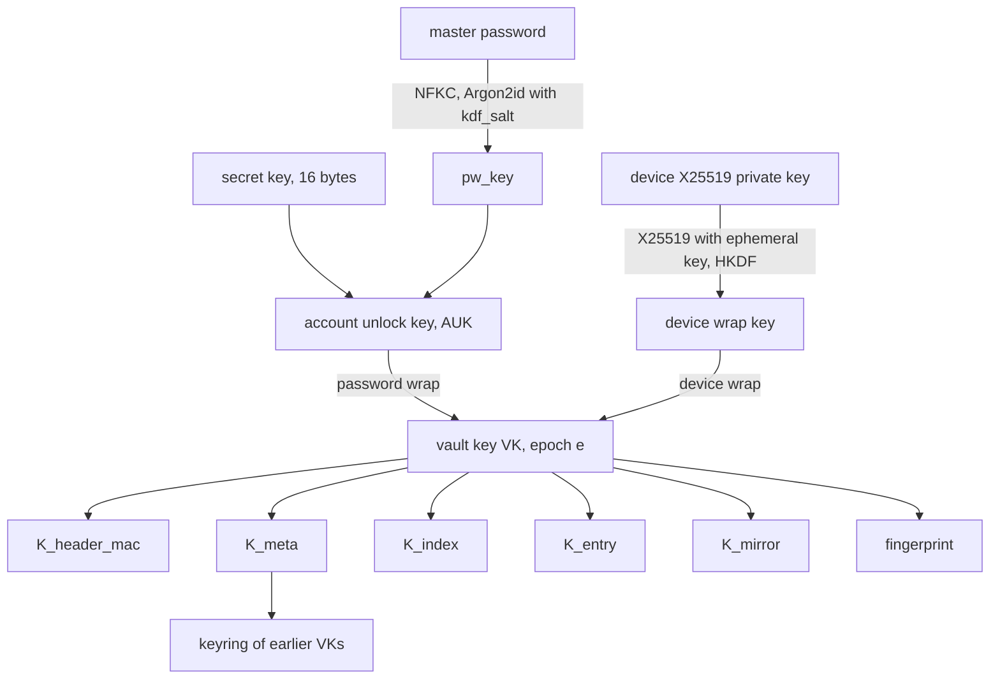

# vlt crypto and storage spec

Format version 1. Status: draft for review, 2026-10-10.

This spec defines how vlt derives and wraps keys, the byte layout of every object it stores, how
clients authenticate those objects, how the index merges, how history and deletion work, and how
devices sync, enroll, and revoke. It is normative: a client that follows it interoperates with every
other client, and the known-answer vectors in `spec/vectors/` check that it does.

## Contents

1. [Conventions](#conventions)
2. [Threat model summary](#threat-model-summary)
3. [Primitives](#primitives)
4. [Key hierarchy](#key-hierarchy)
5. [KDF parameters and calibration](#kdf-parameters-and-calibration)
6. [Bucket layout](#bucket-layout)
7. [Header object](#header-object)
8. [Header authentication and pinning](#header-authentication-and-pinning)
9. [Entry object](#entry-object)
10. [Entry text format](#entry-text-format)
11. [Index object](#index-object)
12. [Rollback detection](#rollback-detection)
13. [Client-side history](#client-side-history)
14. [Index operations and merge](#index-operations-and-merge)
15. [Sync policy](#sync-policy)
16. [Local mirror and write queue](#local-mirror-and-write-queue)
17. [Capability probe](#capability-probe)
18. [Device credentials and IAM policy](#device-credentials-and-iam-policy)
19. [Device key storage](#device-key-storage)
20. [Device enrollment](#device-enrollment)
21. [Device revocation and vault key rotation](#device-revocation-and-vault-key-rotation)
22. [Master password change](#master-password-change)
23. [Deletion and purge](#deletion-and-purge)
24. [Agent protocol](#agent-protocol)
25. [Emergency kit and recovery](#emergency-kit-and-recovery)
26. [Encrypted export format](#encrypted-export-format)
27. [Bitwarden mapping](#bitwarden-mapping)
28. [pass import and export](#pass-import-and-export)
29. [Format versioning](#format-versioning)
30. [CLI exit codes](#cli-exit-codes)
31. [Portability constraints](#portability-constraints)
32. [Test vectors](#test-vectors)

## Conventions

| Notation | Meaning |
| --- | --- |
| `a \|\| b` | Byte concatenation |
| `u8`, `u16`, `u32`, `u64` | Unsigned integers, big-endian |
| `i64` | Signed 64-bit integer, two's complement, big-endian |
| `bN` | Exactly `N` raw bytes |
| `str16` | `u16` byte length followed by that many bytes of UTF-8 |
| `bytes32` | `u32` byte length followed by that many raw bytes |
| `"label"` | The ASCII bytes of the label, no terminator |
| `HKDF(ikm, salt, info)` | HKDF-SHA256 (RFC 5869), 32-byte output |
| `HMAC(key, msg)` | HMAC-SHA256, 32-byte output |
| `AEAD(key, nonce, pt, ad)` | XChaCha20-Poly1305 seal; output is ciphertext followed by the 16-byte tag |
| `rand(N)` | `N` bytes from the operating system CSPRNG |

Every structure is parsed strictly. A decoder rejects trailing bytes, lengths that run past the end
of the input, unknown flag bits, and non-zero padding. "Reject" means the operation fails with an
integrity error (exit code 6) and nothing is written.

Object IDs, device IDs, and the vault ID are 16 random bytes. Their text form is 32 lowercase hex
characters.

## Threat model summary

The requirements document holds the full threat model. The properties this spec provides are:

| Adversary | Property |
| --- | --- |
| Reader of the bucket, including all versions | Learns object count, sizes rounded to 512 bytes (entries) or 4,096 bytes (index), timestamps, the number of enrolled devices, and the plaintext counters `epoch`, `header_seq`, and `index_seq`. Learns no path, URL, username, secret, or device label |
| Writer to the bucket without the vault key (a stolen device AWS key) | Any modification of an object is detected. Replaying an older header or index is detected by any device that has seen a newer one. On a versioned bucket, nothing is destroyed. On single-disk RustFS, which cannot version, the writer can overwrite entry objects and the index; clients detect it and recover from their local mirrors |
| Holder of a revoked device's keys | Reads everything written before the rotation that revoked it. Reads nothing written after it, once its AWS key is deleted |
| Holder of a powered-off device | Needs the master password (no-keyring CLI), the OS login (keyring CLI), or the device biometric (Android) to unlock |

Out of scope: malware running as the user on an unlocked device, a process with the user's UID
talking to an unlocked agent, hardware and side-channel attacks, and traffic analysis beyond the
leaks listed above.

## Primitives

| Purpose | Primitive | Crate |
| --- | --- | --- |
| Password stretching | Argon2id, version `0x13` (RFC 9106) | `argon2` |
| Key derivation | HKDF-SHA256 | `hkdf`, `sha2` |
| Header MAC | HMAC-SHA256 | `hmac`, `sha2` |
| AEAD | XChaCha20-Poly1305, 24-byte random nonce | `chacha20poly1305` |
| Key agreement | X25519 | `x25519-dalek` |
| Secret hygiene | Zero on drop | `zeroize` |
| Password normalisation | Unicode NFKC | `unicode-normalization` |

`hmac` and `unicode-normalization` are additions to the decided crate list; `hmac` is already a
dependency of `hkdf`.

Nonces are always random. With a 192-bit nonce, random nonces under one key carry no practical
collision risk at vlt's write volume. No counter nonces are used, so no nonce state needs to survive
a crash.

XChaCha20-Poly1305 is not key-committing. vlt does not rely on key commitment: every key that opens
an AEAD is either derived from the vault key or tried exactly once during unlock, and the header MAC
(HMAC, which commits) is checked straight after unlock.

## Key hierarchy



### Secret key

The **secret key** is 16 random bytes generated at `vlt init`. It never leaves enrolled devices and
the emergency kit. Its text form is:

1. Compute `check = SHA-256("vlt/v1/secret-key-check" || sk)[0..4]`.
2. Encode the 20 bytes `sk || check` in Crockford base32 (alphabet
   `0123456789ABCDEFGHJKMNPQRSTVWXYZ`, most significant bit first, no padding), giving 32
   characters.
3. Split into eight groups of four separated by `-`, and prefix `VLT1-`.

Example shape: `VLT1-ABCD-EFGH-JKMN-PQRS-TVWX-YZ01-2345-6789`.

Decoding is case-insensitive, ignores `-` and spaces after the prefix, and maps `O` to `0` and `I`
and `L` to `1`. A wrong check value rejects the input as a typo before any key derivation.

### Account unlock key

```
pw_key = Argon2id(password = NFKC(master_password) as UTF-8,
                  salt = kdf_salt, m = m_kib, t = t, p = p, output = 32 bytes)
AUK    = HKDF(ikm = pw_key || sk, salt = vault_id, info = "vlt/v1/auk")
```

The **account unlock key** (AUK) needs both factors. A leaked bucket gives an attacker `kdf_salt`
and the password wrap, but without the secret key every password guess also needs a 128-bit guess.
The master password is not trimmed. `vlt init` requires at least 12 characters.

### Vault key and subkeys

The **vault key** (VK) is 32 random bytes. Each VK belongs to an **epoch**, a `u32` starting at 1
and incremented by every rotation. Subkeys are derived per epoch:

```
K_purpose = HKDF(ikm = VK_e, salt = vault_id, info = "vlt/v1/" || purpose)
```

| `purpose` | Use |
| --- | --- |
| `header-mac` | HMAC key over the header |
| `meta` | AEAD key for the header's encrypted metadata |
| `index` | AEAD key for the index |
| `entry` | AEAD key for every entry object of the epoch |
| `mirror` | AEAD key for local mirror state and the write queue |
| `fingerprint` | Not a key. A public-safe 32-byte value identifying `VK_e`, stored in pins |

vlt uses a single entry key per epoch rather than per-entry keys. Each entry ciphertext is bound to
its object ID through the associated data, which gives the same swap protection, and a single key
keeps rotation and history reads simple.

### Device keys

Each device has a **device ID** (16 random bytes) and an X25519 key pair generated on the device.
The private key never leaves the device. The header holds one **device wrap** of the current VK per
enrolled device:

```
eph_sk, eph_pk = fresh X25519 key pair
ss  = X25519(eph_sk, device_pk)          ; reject if all 32 bytes are zero
DWK = HKDF(ikm = ss, salt = eph_pk || device_pk, info = "vlt/v1/device-wrap")
ct  = AEAD(DWK, nonce, VK_e, "vlt/v1/device-wrap" || vault_id || u32 epoch || device_id)
```

X25519 lets an enrolled device wrap the VK to a new device's public key without the new device's
private key ever moving, which is what enrollment by QR code needs.

### Password wrap

```
ct = AEAD(AUK, nonce, VK_e, "vlt/v1/pw-wrap" || vault_id || u32 epoch || kdf_block)
```

`kdf_block` is the exact 29-byte KDF block from the header. A bucket writer who changes the Argon2
parameters or the salt therefore breaks the wrap rather than weakening it.

### What rotation and password change touch

| Operation | Rewritten | Unchanged |
| --- | --- | --- |
| Master password change (CORE-8) | `kdf_salt`, optionally the KDF parameters, the password wrap, `header_seq`, the MAC | VK, every device wrap, the keyring, the index, every entry object |
| Vault key rotation (CORE-7) | New VK and epoch, password wrap, every remaining device wrap, the keyring (gains the old VK), metadata, MAC, the index (re-encrypted under the new epoch) | Existing entry objects. They stay encrypted under their original epoch's key, which the keyring keeps |

Rotation protects content written after the revocation. It cannot protect content the revoked
device could already read, because that device may have copied every object it could see. Existing
entry objects are therefore not re-encrypted. After revoking a lost or stolen device, the user
changes the passwords of entries that matter; each change is a new revision under the new epoch.

## KDF parameters and calibration

| Set | `m_kib` | `t` | `p` | Allowed in |
| --- | --- | --- | --- | --- |
| Floor | 65,536 (64 MiB) | 3 | 1 | Every build |
| Ceiling | 4,194,304 (4 GiB) | 64 | 16 | Every build |
| Test | 64 | 1 | 1 | Test builds only; header flag `test_kdf` set |

A client rejects a header whose parameters fall outside floor and ceiling, unless both the header's
`test_kdf` flag is set and the client is a test build. Release builds reject `test_kdf` headers
outright. The ceiling stops a bucket writer from forcing a denial of service through a huge memory
cost before the MAC can be checked.

Calibration runs at `vlt init` and at `vlt passwd --recalibrate`. It fixes `p = 1` (WASM has no
threads) and `t = 3`, then picks the largest `m_kib` in `{64, 128, 256, 512, 1024}` MiB whose
measured derivation time on the current device is at most 500 ms. If 64 MiB already takes longer,
it uses the floor.

Password unlock is the slow path. Day-to-day unlock goes through the device wrap and takes no
Argon2 work, which keeps per-device unlock under 100 ms.

## Bucket layout

The vault lives under a configured prefix (default `vlt/`) in a dedicated bucket.

| Object key | Contents | Written with |
| --- | --- | --- |
| `<prefix>header` | Header object | `If-None-Match: *` at init, then `If-Match: <etag>` |
| `<prefix>index` | Index object | `If-None-Match: *` at init, then `If-Match: <etag>` |
| `<prefix>e/<object_id hex>` | One entry revision | Always `If-None-Match: *` |

Entry objects are immutable. A well-behaved client never overwrites one; a `412` on an entry `PUT`
means the object already exists (a retried upload) and the client confirms the stored bytes match.

## Header object

| Offset | Field | Type | Notes |
| --- | --- | --- | --- |
| 0 | `magic` | `b4` | `"VLTH"` |
| 4 | `format_version` | `u16` | `1` |
| 6 | `flags` | `u16` | Bit 0 `test_kdf`. Other bits zero |
| 8 | `vault_id` | `b16` | Random at init, never changes |
| 24 | `header_seq` | `u64` | `1` at init, incremented on every header write |
| 32 | `epoch` | `u32` | Current VK epoch |
| 36 | `kdf_block` | `b29` | See below |
| 65 | `pw_nonce` | `b24` | |
| 89 | `pw_ct` | `b48` | Password wrap of `VK_epoch` |
| 137 | `device_count` | `u16` | |
| 139 | `devices` | 152 bytes each | See below, sorted by `device_id` |
| | `meta_nonce` | `b24` | |
| | `meta_ct` | `bytes32` | Encrypted metadata |
| | `mac` | `b32` | `HMAC(K_header_mac, every preceding byte)` |

`kdf_block`:

| Field | Type | Notes |
| --- | --- | --- |
| `alg` | `u8` | `1` = Argon2id version `0x13` |
| `m_kib` | `u32` | |
| `t` | `u32` | |
| `p` | `u32` | |
| `kdf_salt` | `b16` | Fresh on every password change |

Device record:

| Field | Type |
| --- | --- |
| `device_id` | `b16` |
| `device_pk` | `b32` |
| `eph_pk` | `b32` |
| `nonce` | `b24` |
| `ct` | `b48` |

Metadata plaintext, sealed as
`AEAD(K_meta, meta_nonce, meta_plain, "vlt/v1/meta" || vault_id || u32 epoch)`:

| Field | Type | Notes |
| --- | --- | --- |
| `keyring_count` | `u32` | |
| keyring entries | `u32 epoch`, `b32 vk` | Every earlier epoch, ascending |
| `device_info_count` | `u16` | Equals `device_count` |
| device info | `b16 device_id`, `u8 kind`, `str16 label`, `u64 enrolled_header_seq` | Same order as the device records |

`kind` is `1` CLI, `2` Android, `3` Firefox, `4` desktop. The label is user-chosen (`laptop`,
`pixel`), at most 64 bytes, and is used in conflict-copy paths. Labels live in the encrypted
metadata so the bucket does not reveal device names.

## Header authentication and pinning

The header is authenticated by `HMAC(K_header_mac, header bytes before mac)`, where `K_header_mac`
derives from the current VK. Only a holder of the VK can produce a valid header. The password wrap
and device wraps are additionally bound to the KDF block and epoch through their associated data.

Unlock proceeds in this order:

1. Parse the header. Reject an unknown `magic`, a `format_version` the client does not know, unknown
   flags, `test_kdf` in a release build, or KDF parameters outside floor and ceiling.
2. Open the device wrap with the device private key, or open the password wrap with the AUK. A
   failure is reported as a wrong password or an unknown device; nothing distinguishes a tampered
   wrap from a wrong password.
3. Verify `mac`. A failure is an integrity error.
4. Check the pins (below). A failure is an integrity error.
5. Decrypt the metadata.

After the first successful unlock, the device stores a **header pin** in its local state:

| Pin field | Check on every later header |
| --- | --- |
| `vault_id` | Must be equal |
| `epoch` | Must be greater than or equal |
| `fingerprint` of `VK_epoch` | If the epoch is equal, the fingerprint must be equal. If the epoch is greater, the keyring must contain the pinned epoch with a VK whose fingerprint matches the pin |
| `header_seq` | Must be greater than or equal; equal requires byte-identical header |

The pins update after every accepted header. The keyring check gives each rotation a chain of
custody: a device accepts a new VK only from a header that proves knowledge of the VK it already
trusts.

A fresh device has no pins. It takes `vault_id` from the emergency kit or from the enrollment code,
and refuses a header with a different `vault_id`. The remaining pins are set on first unlock.

## Entry object

Key: `<prefix>e/<object_id hex>`.

| Offset | Field | Type | Notes |
| --- | --- | --- | --- |
| 0 | `magic` | `b4` | `"VLTE"` |
| 4 | `format_version` | `u16` | `1` |
| 6 | `flags` | `u16` | `0` |
| 8 | `vault_id` | `b16` | |
| 24 | `epoch` | `u32` | Epoch whose `K_entry` sealed this object |
| 28 | `object_id` | `b16` | Must equal the object key's hex |
| 44 | `nonce` | `b24` | |
| 68 | `ciphertext` | rest | `AEAD(K_entry, nonce, plain, bytes 0..68)` |

The associated data is the full 68-byte prefix, so the ciphertext is bound to the vault, the epoch,
and the object ID.

Entry plaintext:

| Field | Type | Notes |
| --- | --- | --- |
| `revision` | `u64` | `1` for a new entry, parent's revision plus one for an edit |
| `parent_object_id` | `b16` | Previous revision, or 16 zero bytes for the first |
| `device_id` | `b16` | Device that wrote this revision |
| `created_unix` | `i64` | Writer's wall clock, seconds. Display only, never used for ordering |
| `content` | `bytes32` | Entry text, at most 1 MiB |
| padding | zero bytes | Up to the size rule below |

Padding makes the whole object (prefix, ciphertext, and tag) the smallest multiple of 512 bytes that
holds it, so the smallest entry object is 512 bytes. A decoder requires every padding byte to be
zero.

When a client reads an entry through the index, it checks that the object's `object_id`, the key it
was fetched from, and the index's head ID agree, and that `revision` equals the index's revision.
When walking history, it checks that each parent's revision is exactly one less than its child's.

## Entry text format

The entry content is bytes, stored verbatim. vlt never rewrites content to normalise it. The parsing
below drives display, search, TOTP, and import mapping; content that does not parse as UTF-8 is
shown and exported as-is and has no fields.

- Lines split on `\n`. A trailing `\r` on a line is ignored for parsing.
- Line 1 is the password. It may be empty.
- The **field section** follows line 1. It is a run of lines, each of which is one of:
  - a field line, `key: value`, where `key` is one or more characters other than `:` and newline,
    not starting with whitespace, and `value` is everything after the first `": "` up to the end of
    the line (leading and trailing spaces in `value` are kept);
  - a field line with an empty value, `key:`;
  - a block field, `key: |`, followed by one or more lines each indented by exactly two spaces; the
    value is those lines with the two spaces removed, joined by `\n`;
  - an `otpauth://` URI line.
- The field section ends at the first line that is none of these. If that line is empty, it is a
  separator and is not part of the notes. Everything after it is the **notes**, verbatim; an
  empty remainder means the entry has no notes.
- Keys compare case-insensitively. A key may repeat; order is kept.

Keys with meaning to vlt: `username` (also `user`, `login`), `url`, `email`, `type`, and the first
`otpauth://` line (CORE-5). `vlt find` and search match path, every `url`, and `username`.

## Index object

Key: `<prefix>index`.

| Offset | Field | Type | Notes |
| --- | --- | --- | --- |
| 0 | `magic` | `b4` | `"VLTI"` |
| 4 | `format_version` | `u16` | `1` |
| 6 | `flags` | `u16` | `0` |
| 8 | `vault_id` | `b16` | |
| 24 | `epoch` | `u32` | Epoch whose `K_index` sealed this object |
| 28 | `index_seq` | `u64` | `1` at init, incremented on every index write |
| 36 | `header_seq` | `u64` | `header_seq` of the header current when this index was written |
| 44 | `nonce` | `b24` | |
| 68 | `ciphertext` | rest | `AEAD(K_index, nonce, plain, bytes 0..68)` |

Index plaintext:

| Field | Type | Notes |
| --- | --- | --- |
| `entry_count` | `u32` | |
| entries | `str16 path`, `b16 head_object_id`, `u64 revision`, `b16 device_id` | Sorted by path bytes, paths unique |
| `tombstone_count` | `u32` | |
| tombstones | `str16 path`, `b16 head_object_id`, `u64 revision`, `b16 device_id`, `u64 removed_index_seq` | Sorted by path bytes, then `removed_index_seq` |
| padding | zero bytes | Whole object a multiple of 4,096 bytes |

`device_id` in an index entry is the writer of the head revision; merge uses it as the tiebreaker.

Paths are UTF-8, normalised to NFC on input, `/`-separated, at most 1,024 bytes, with no empty
segment, no `.` or `..` segment, no leading or trailing `/`, and no control characters.

Size at 5,000 entries: each entry costs 2 + path + 40 bytes. With a 40-byte average path that is
82 bytes, so 5,000 entries take about 410 KB plus tombstones, under the 1 MB requirement. History
lives in the entry objects, not in the index.

## Rollback detection

Per-entry AEAD stops the bucket from swapping or altering entries, and the index binds each path to
one head object ID and revision. A bucket writer can still replay an older, validly encrypted index
(for example, an earlier S3 version) to hide recent changes. Clients detect that with monotonic
counters held in local state:

| Pin | Rule |
| --- | --- |
| `index_seq` and `SHA-256(index object)` | A fetched index with a lower `index_seq` is a rollback. An equal `index_seq` with a different hash is a fork. Both are integrity errors |
| `header_seq` | As in [header pinning](#header-authentication-and-pinning) |
| `epoch` | An index whose `epoch` is lower than the pinned epoch is rejected. The index's `epoch` must equal the header's `epoch`, except during a rotation (see [revocation](#device-revocation-and-vault-key-rotation)) |

When `index.header_seq` exceeds the pinned `header_seq`, the client fetches the header before
anything else. A writer always sets `index_seq` to the fetched index's value plus one, and
conditional writes ensure two writers never publish the same value.

A device offline since before a rollback cannot detect it, and a rollback to a state newer than a
device's pin is invisible to that device. Both are inherent to a design without a trusted server.

Recovery from a rollback, a fork, or a corrupt index is explicit. `vlt repair` uploads the device's
mirrored index with `index_seq` set to the larger of the remote and pinned values plus one, after
the user confirms. `vlt repair --from-version` lists the bucket's index versions (where the backend
versions objects), shows each valid one's `index_seq` and entry count, and republishes the chosen
one the same way.

## Client-side history

Every edit writes a new entry object with a fresh `object_id`. Its plaintext records
`parent_object_id`, so the revisions of an entry form a chain from the head back to revision 1.
History works the same on every backend, and S3 Versioning, where present, is a second copy.

- `vlt log <path>` walks the chain from the index's head, one `GET` per revision, stopping at a zero
  parent. Revisions already in the mirror cost nothing.
- `vlt show <path>@<revision>` shows one revision.
- `vlt diff <path> <rev-a> <rev-b>` diffs two revisions in memory.
- `vlt restore <path> <revision>` writes a new revision whose content is the old revision's content,
  with the current head as parent. History is never rewritten.

`vlt mv` changes only the index, so a moved entry keeps its chain. `vlt cp` writes a new entry with
revision 1 and a zero parent; the copy starts its own history.

## Index operations and merge

A device never merges two index states. It records each change as an **operation** in its write
queue and, when publishing, replays the queued operations on top of the latest remote index. This is
a rebase, and it needs no tombstones for unseen changes and no clocks.

| Operation | Fields |
| --- | --- |
| `put` | `path`, `object_id`, `revision`, `parent_object_id` (zero for a new entry), `device_id` |
| `remove` | `path`, `expected_head` |
| `move` | `from`, `to`, `expected_head` |

`cp` is a `put` with a zero parent. `restore` is a `put` whose parent is the current head.

### Revision order

Revision R1 is newer than R2 when `(revision, device_id)` of R1 is greater than that of R2,
comparing `revision` numerically and then `device_id` as bytes. Revision numbers count edits along
a chain, so they never depend on a device clock, and two devices cannot tie because their IDs
differ.

### Replay rules

Let `remote` be the freshly fetched index. Each queued operation applies to `remote` in queue order.

| Operation | Remote state | Result |
| --- | --- | --- |
| `put`, new entry | Path free | Insert |
| `put`, new entry | Path taken | Conflict: the newer of the two revisions keeps the path, the other goes to a conflict path |
| `put`, edit | Head at path equals `parent_object_id` | Replace head |
| `put`, edit | Head at path differs, chains share the parent | Conflict: newer keeps the path |
| `put`, edit | Path absent, a tombstone's head equals the parent | Edit wins over delete: insert at the path, keep the tombstone as history |
| `put`, edit | Path absent, the parent is the head at another path (moved remotely) | Apply the edit at the new path, then resolve as an edit there |
| `put`, edit | Parent found nowhere | Insert at the path; report it |
| `remove` | Head equals `expected_head` | Remove the path, add a tombstone |
| `remove` | Head differs | Drop the remove (edit wins over delete); report it |
| `remove` | Path absent | Drop |
| `move` | Head at `from` equals `expected_head`, `to` free | Move |
| `move` | Head at `from` differs | Move whatever head is at `from`; the rename is the user's intent, the content is the newer one |
| `move` | `to` taken | Move to a conflict path derived from `to` |
| `move` | `from` absent | Drop; report it |

A **conflict path** is `<path>.conflict-<label>`, where `<label>` is the losing revision's device
label lower-cased with every character outside `[a-z0-9-]` replaced by `-`, cut to 32 characters. If
that path is taken, `-2`, `-3`, and so on are appended. The conflict copy points at the losing
revision's object; nothing is re-encrypted.

Every conflict and every dropped operation appears in the sync report (`vlt sync --json` lists
them), so nothing is lost silently.

## Sync policy

S3 cannot push changes, so clients poll. Polling every 10 s from four devices costs about $5 a year
in `GET` requests, which breaks the cost requirement, so vlt syncs at these points only:

| Trigger | What runs |
| --- | --- |
| Every CLI command that reads or writes the vault | One sync before the command; a write command also publishes after |
| The agent, while unlocked | One sync every 60 s (configurable, minimum 10 s). A locked agent does not poll |
| `vlt sync` | One sync, and publishes the write queue |

One sync is:

1. `GET <prefix>index` with `If-None-Match: <cached etag>`. A `304` costs one request and ends the
   sync.
2. On `200`, decode and check the index against the pins. If `index.header_seq` is above the pin,
   fetch and check the header.
3. Fetch any head entry objects missing from the mirror (the mirror keeps every head, so `grep` and
   offline reads work).
4. If the write queue is not empty, publish it (below).

A CLI command run while the network is down uses the mirror and queues writes; it reports
`offline` on stderr and exits 0.

Cost check: an agent unlocked eight hours a day polls 480 times a day, about 175,000 `GET` requests
a year, about $0.07 at $0.0004 per 1,000.

## Local mirror and write queue

The **mirror** is a directory, `$XDG_DATA_HOME/vlt/<vault_id hex>/`, created with mode `0700`:

| File | Contents |
| --- | --- |
| `header` | Last accepted header object, verbatim |
| `index` | Last accepted index object, verbatim, and its etag |
| `e/<object_id hex>` | Entry objects, verbatim |
| `state` | Pins, etags, and the write queue, sealed with `K_mirror` |

Objects in the mirror are the bucket's ciphertext, unchanged, so the mirror holds no plaintext and
no new format.

`state` layout: `"VLTS"`, `u16 1`, `u16 0`, `b16 vault_id`, `u32 epoch`, `b24 nonce`, then
`AEAD(K_mirror, nonce, serialised state, bytes 0..52)`. The plaintext serialisation is internal to
each client and is not part of the interchange format. The state is written to a temporary file and
renamed over the old one.

Publishing the queue:

1. `PUT` each queued entry object with `If-None-Match: *`. On `412`, `GET` the object and require
   identical bytes; anything else is an integrity error.
2. Fetch the index (unconditional on retry), check pins, replay the queued operations, set
   `index_seq` to the fetched value plus one, and seal under the header's current epoch.
3. `PUT` the index with `If-Match: <fetched etag>`. On `412`, go back to step 2, up to eight
   attempts with jittered backoff from 100 ms.
4. On success, clear the queue, update the pins, and report conflicts.

Only one process owns a mirror at a time: the agent if it is running, otherwise the CLI process,
which takes an exclusive `flock` on `state`.

## Capability probe

`vlt init` probes the backend before writing anything that matters. It uses the vault's own first
objects as probes, so it leaves no extra objects behind (device keys cannot delete).

1. List the bucket root with `max-keys=2`. Refuse if any object exists, inside or outside the
   prefix; vault and bucket are one-to-one.
2. `PUT <prefix>header` with `If-None-Match: *`. Expect `200`.
3. `PUT <prefix>header` again, same bytes, `If-None-Match: *`. Expect `412`. Anything else means
   conditional creation is unsupported: refuse.
4. `PUT <prefix>index` with `If-Match: "0000"`. Expect `412` (or `404`). A success means `If-Match`
   is ignored: refuse.
5. `PUT <prefix>index` with `If-None-Match: *`. Expect `200`.
6. `GetBucketVersioning`, `GetObjectLockConfiguration`, and `GetBucketLifecycleConfiguration`.

| Backend | Versioning | Object Lock | Result |
| --- | --- | --- | --- |
| AWS (endpoint is AWS or unset) | Off or suspended | Any | Refuse, and print the command that enables it |
| AWS | On | Off | Warn, continue |
| AWS | On | On | Continue; warn if no lifecycle rule keeps noncurrent versions at least 365 days |
| Other S3 (RustFS) | On | Any | Continue |
| Other S3 (RustFS) | Off | Any | Warn: "Without versioning a stolen device key can overwrite history; vlt's mirrors are the only copy." Continue |

If a refusal happens after step 2, the bucket already holds a header. The user empties it with
admin credentials (the error prints the command) and runs `vlt init` again.

`vlt doctor` repeats steps 3, 4, and 6 against the existing objects (step 3 by re-putting the
current header with `If-None-Match: *` and expecting `412`), and checks that the device key cannot
delete by sending `DeleteObject` for a non-existent key and expecting `403`.

## Device credentials and IAM policy

Each device has its own long-lived IAM access key, scoped to the vault's bucket and prefix. vlt
never holds admin credentials: enrollment and revocation print the commands, and the user runs them
with admin credentials elsewhere.

Device policy (`BUCKET` and `PREFIX` substituted):

```json
{
  "Version": "2012-10-17",
  "Statement": [
    {
      "Effect": "Allow",
      "Action": ["s3:GetObject", "s3:GetObjectVersion", "s3:PutObject"],
      "Resource": "arn:aws:s3:::BUCKET/PREFIX*"
    },
    {
      "Effect": "Allow",
      "Action": ["s3:ListBucket", "s3:ListBucketVersions", "s3:GetBucketVersioning",
                 "s3:GetBucketObjectLockConfiguration", "s3:GetLifecycleConfiguration"],
      "Resource": "arn:aws:s3:::BUCKET"
    },
    {
      "Effect": "Deny",
      "Action": ["s3:DeleteObject", "s3:DeleteObjectVersion", "s3:PutBucket*",
                 "s3:PutLifecycleConfiguration", "s3:PutObjectRetention",
                 "s3:PutObjectLegalHold", "s3:BypassGovernanceRetention",
                 "s3:DeleteBucket*", "s3:PutEncryptionConfiguration"],
      "Resource": ["arn:aws:s3:::BUCKET", "arn:aws:s3:::BUCKET/*"]
    }
  ]
}
```

`ListBucket` is not limited to the prefix, because the capability probe checks that the bucket is
dedicated. The bucket is dedicated, so this exposes nothing else.

AWS commands printed for a new device with label `L` and vault ID prefix `V` (first 8 hex
characters):

```sh
aws iam create-user --user-name vlt-V-L
aws iam put-user-policy --user-name vlt-V-L --policy-name vlt-device \
    --policy-document file://vlt-device-policy.json
aws iam create-access-key --user-name vlt-V-L
```

Revocation:

```sh
aws iam list-access-keys --user-name vlt-V-L
aws iam delete-access-key --user-name vlt-V-L --access-key-id AKIA...
aws iam delete-user-policy --user-name vlt-V-L --policy-name vlt-device
aws iam delete-user --user-name vlt-V-L
```

RustFS equivalents use `mc admin` against the RustFS alias `A`, with a policy document that has the
same `Allow` statements (RustFS denies anything not allowed, so the `Deny` statement is kept for
clarity):

```sh
mc admin policy create A vlt-device-V vlt-device-policy.json
mc admin user add A vlt-V-L <generated secret>
mc admin policy attach A vlt-device-V --user vlt-V-L
# revoke
mc admin user remove A vlt-V-L
```

The exact RustFS command set is checked against RustFS's documentation and the integration tests in
milestone 2, and this section is corrected if it differs.

## Device key storage

A device's **device secret bundle** holds its device ID, X25519 private key, the secret key, and its
S3 access key ID and secret. The secret key is kept so that the device can rewrap the password wrap
during rotation and password change, and reprint the emergency kit.

| Platform | Storage | Unlock needs |
| --- | --- | --- |
| CLI with an OS keyring (Secret Service or KWallet) | Bundle in the keyring, item attributes `service=vlt`, `vault=<vault_id hex>` | The OS login session that unlocks the keyring. No password prompt |
| CLI without a keyring | File `$XDG_DATA_HOME/vlt/<vault_id hex>/device`, mode `0600`, sealed by the master password | The master password only |
| Android (phase 3) | Bundle sealed by an Android Keystore key that requires biometric authentication | Biometric |

`vlt config set unlock.require_password true` makes a keyring-equipped CLI use the password-sealed
file instead.

Password-sealed device file:

| Field | Type |
| --- | --- |
| `magic` | `b4` `"VLTD"` |
| `format_version` | `u16` `1` |
| `flags` | `u16`, bit 0 `test_kdf` |
| `vault_id` | `b16` |
| `kdf_block` | `b29`, calibrated on this device, same floor and ceiling |
| `nonce` | `b24` |
| `ciphertext` | `AEAD(LK, nonce, bundle, every preceding byte)` |

```
LK = HKDF(ikm = Argon2id(NFKC(master_password), kdf_salt, ...), salt = vault_id,
          info = "vlt/v1/local-wrap")
```

Bundle plaintext: `b16 device_id`, `b32 device_sk`, `b16 secret_key`, `str16 access_key_id`,
`str16 secret_access_key`.

This file depends on the master password but not on the header's KDF block, so a password change on
another device does not reach it. When a no-keyring device notices a newer password wrap (its
`header_seq` pin moved and `kdf_salt` changed), it unlocks once more with the old password, then
asks for the new password, checks it against the header's password wrap, and reseals the file.
Until then, the old password still unlocks that device.

## Device enrollment

Enrollment always has two halves: the user creates the device's AWS key with admin credentials, and
an existing secret (an enrolled device or the emergency kit) gives the new device the VK.

1. On the new device, run `vlt enroll start --label pixel`. It generates the device ID and X25519
   key pair, prints the IAM commands and policy, and shows an **enrollment code** as text and as a
   QR code: `vlt-enroll:1:<vault_id hex>:<device_id hex>:<device_pk base64url>`, plus a six-digit
   confirmation number, `u32(SHA-256(code)[0..4]) mod 1,000,000`.
2. Run the IAM commands with admin credentials and give the access key to the new device
   (`vlt enroll start` prompts for it, or reads it from the standard `AWS_*` variables).
3. Either path authorises the device:
   - On an enrolled device, run `vlt enroll approve <code>` (or scan the QR code). The user checks
     that both screens show the same confirmation number. The enrolled device adds a device record
     and metadata entry, increments `header_seq`, recomputes the MAC, and writes the header with
     `If-Match`.
   - On the new device, enter the master password and the secret key from the emergency kit. The
     new device unwraps the VK itself and adds its own device record the same way.
4. The new device unlocks through its device wrap, sets its pins, and fills its mirror.

`vlt init` enrolls the first device as part of creating the vault.

## Device revocation and vault key rotation

`vlt revoke <label>` runs on any enrolled device:

1. Print the IAM revocation commands. The user runs them first; until the access key is deleted, the
   revoked device can still read every object.
2. Prompt for the master password (needed to rebuild the password wrap) and confirm the AUK by
   opening the current password wrap.
3. Unless `--keep-secret-key` is given, generate a new secret key and print a new emergency kit. The
   revoked device knows the old secret key, so keeping it leaves only the master password between
   that device's holder and any copy of the new header. `--keep-secret-key` suits retiring a device
   that is still under the user's control.
4. Generate `VK_{e+1}`. Build the header: `epoch = e + 1`, keyring gains `(e, VK_e)`, a fresh
   password wrap, a fresh device wrap for every remaining device, metadata without the revoked
   device, `header_seq + 1`, new MAC. Write it with `If-Match`.
5. Fetch the index, re-seal it under `K_index` of the new epoch with `index_seq + 1` and the new
   `header_seq`, and write it with `If-Match`.
6. Re-seal the local mirror state under the new `K_mirror`. Every other device does the same on its
   next sync.

Between steps 4 and 5 the bucket holds a header at epoch `e + 1` and an index at epoch `e`. A
client that sees this state reads the index with the keyring's `VK_e` and, if it publishes, seals
the index under epoch `e + 1`, which completes the rotation. A crash between the steps therefore
self-heals on the next write from any device.

Each remaining device verifies the rotation through the keyring check in its header pin. A device
whose wrap was removed fails to unlock and reports that it has been revoked.

The revoked device's holder keeps the old VK and can still produce headers and indexes that are
valid under epoch `e`. Devices that have seen epoch `e + 1` reject them through the epoch pin.

## Master password change

`vlt passwd` on an enrolled device:

1. Unlock (any method) and prompt for the new password twice.
2. Generate a new `kdf_salt`. Keep the KDF parameters, or recalibrate with `--recalibrate`.
3. Derive the new AUK with the device's stored secret key and rewrap the current VK.
4. Increment `header_seq`, recompute the MAC, and write the header with `If-Match`.
5. If this device uses a password-sealed device file, reseal it under the new password.

No entry object, the index, the keyring, or any device wrap changes. A device that has forgotten the
master password can run `vlt passwd --forgotten` if it unlocks through its keyring-held device key;
it skips the old-password prompt.

## Deletion and purge

`vlt rm <path>` is a `remove` operation. It removes the path from the index and adds a tombstone
holding the path and its last head. Every revision's ciphertext stays in the bucket as history, and
`vlt log --deleted` and `vlt restore` reach it through the tombstone.

Purging removes ciphertext for good. Device keys cannot delete, so purge is a separate procedure
that the user runs with credentials that hold `s3:DeleteObject` and `s3:DeleteObjectVersion`:

1. Run `vlt purge plan <path>` on an enrolled device. The path must already be removed. vlt walks
   the tombstone's chain and prints every object key in it, and, on a versioned bucket, every
   version ID of those keys (from `ListObjectVersions`). It writes a plan file listing them.
2. Run the printed commands with purge credentials, for example
   `aws s3api delete-object --bucket B --key vlt/e/<id> --version-id <v>` for each line. On a bucket
   with Object Lock in compliance mode, objects inside their retention period cannot be deleted by
   anyone until it expires; the plan says so.
3. Run `vlt purge commit <plan>`. vlt checks that every listed object is gone (`HEAD` returns `404`)
   and publishes an index with the tombstone removed.

Purge does not reach older index versions, which still contain the path in encrypted form until the
lifecycle rule expires them, other devices' mirrors until they next sync and prune, or encrypted
exports. `vlt purge plan` prints these limits.

Mirrors prune entry objects that are no longer reachable from any head or tombstone in the current
index.

## Agent protocol

The agent (CLI-3) holds the unlocked keys and owns the mirror while running. CLI commands talk to it
over a Unix socket and never receive key material.

| Aspect | Rule |
| --- | --- |
| Socket path | `$XDG_RUNTIME_DIR/vlt/agent-<vault_id hex 8>.sock`; without `XDG_RUNTIME_DIR`, `/tmp/vlt-<uid>/` |
| Permissions | Directory `0700`, socket `0600`, both owned by the user. The agent refuses to start if the directory has other owners or wider modes |
| Peer check | Every connection's peer UID (`SO_PEERCRED` on Linux, `getpeereid` on FreeBSD) must equal the agent's UID |
| Process hardening | `RLIMIT_CORE` set to 0, `PR_SET_DUMPABLE` 0 on Linux, `PROC_TRACE_CTL` disabled on FreeBSD, key buffers `mlock`ed where the platform allows and zeroised on lock and exit |
| Timeouts | Lock after 15 minutes idle (configurable, `agent.idle_timeout`) and after 8 hours total (`agent.max_lifetime`). Locking zeroises keys; the agent stays running and stops polling |
| Start | A CLI command that finds no agent starts one, then unlocks it |

Framing: each message is a `u32` length (at most 16 MiB) followed by that many bytes of UTF-8 JSON.
Requests carry `"v": 1`, an `"id"`, an `"op"`, and arguments. Responses carry the same `"id"` and
either `"ok"` with a result or `"err"` with `{"code": <exit code>, "message": <text>}`. Error
messages never contain entry content, paths, or key material.

| `op` | Arguments | Result |
| --- | --- | --- |
| `status` | | `locked`, `vault_id`, `device_label`, `last_sync`, `queue_len` |
| `unlock` | `password` (absent for keyring unlock) | Nothing |
| `lock` | | Nothing |
| `sync` | | Sync report |
| `list` | `prefix` | Paths |
| `show` | `path`, `revision` | Content (base64) and parsed fields |
| `put` | `path`, `content`, `expected_head` | New head ID and revision |
| `remove` | `path` | Nothing |
| `move`, `copy` | `from`, `to` | Nothing |
| `find`, `grep` | Pattern | Matches |
| `log` | `path`, `deleted` | Revisions |

The Firefox native-messaging host (phase 4) is a client of the same protocol.

## Emergency kit and recovery

`vlt init`, `vlt revoke`, and `vlt kit` print the **emergency kit** to standard output, formatted
for a printer. It is not written to disk unless `--output <file>` is given, which warns.

| Kit field | Example |
| --- | --- |
| Vault ID | `3f1c...` (32 hex characters) |
| Secret key | `VLT1-....` |
| Endpoint | `https://s3.eu-west-2.amazonaws.com` |
| Region | `eu-west-2` |
| Bucket | `ned-vlt` |
| Prefix | `vlt/` |
| Master password | A blank line to fill in by hand, or to leave blank and memorise |
| Recovery steps | The procedure below |

Recovery on a fresh machine:

1. Create an access key for the new device with admin credentials (the kit lists the commands).
2. Run `vlt enroll start --label <name>` with the kit's endpoint, region, bucket, prefix, and vault
   ID.
3. Choose the kit path: enter the master password and the secret key.
4. The device unwraps the VK, enrolls itself, and fills its mirror.

What each loss costs:

| Lost | Recovery |
| --- | --- |
| A device | Revoke it from another device; nothing is lost |
| The master password, with an enrolled device that unlocks without it | `vlt passwd --forgotten` on that device |
| The emergency kit, with an enrolled device | `vlt kit` reprints it |
| The master password and every device that unlocks without it | The vault is lost. No one can recover it, and an encrypted export does not help, because it needs the password too |

## Encrypted export format

`vlt export --encrypted <file>` writes one self-contained file. It opens with `vlt import --backup`
and the master password plus the secret key, on any machine, with no bucket.

| Field | Type | Notes |
| --- | --- | --- |
| `magic` | `b4` | `"VLTX"` |
| `format_version` | `u16` | `1` |
| `flags` | `u16` | Bit 0 `test_kdf`, bit 1 `password_only` |
| `vault_id` | `b16` | Source vault, informational |
| `kdf_block` | `b29` | Fresh salt; the vault's current parameters |
| `nonce` | `b24` | |
| `ciphertext` | rest | `AEAD(XK, nonce, payload, every preceding byte)` |

```
XK = HKDF(ikm = Argon2id(NFKC(password), kdf_salt, ...) || sk, salt = vault_id,
          info = "vlt/v1/export")
```

With `--password-only`, flag bit 1 is set and the secret key is left out of `ikm`
(`info = "vlt/v1/export-password-only"`). That file can be opened with the password alone, so it
is as strong as the password; vlt warns when writing it.

Payload:

| Field | Type |
| --- | --- |
| `created_unix` | `i64` |
| `entry_count` | `u32` |
| entries | `str16 path`, `u32 revision_count`, then revisions newest first |
| `tombstone_count` | `u32` |
| tombstones | `str16 path`, `u32 revision_count`, then revisions newest first |

Revision: `u64 revision`, `i64 created_unix`, `b16 device_id`, `bytes32 content`.

`--no-history` writes only the head revision of each entry and no tombstones. The file is sealed in
one AEAD call, which bounds it by memory; at 5,000 entries with history it is a few tens of MB.

## Bitwarden mapping

The importer reads Bitwarden's JSON export, plain or password-protected (decrypted in memory, so the
plaintext never touches disk). Each item becomes one entry.

### Path

| Rule | Detail |
| --- | --- |
| Base | `<folder name>/<item name>`; items without a folder go to the root. Bitwarden folder names already use `/` for nesting |
| `/` in an item name | Replaced by `∕` (U+2215) |
| Leading or trailing whitespace | Trimmed |
| Empty name | `Untitled` |
| Name `.` or `..` | Prefixed with `_` |
| Duplicate path | Suffix ` (2)`, ` (3)`, and so on |
| Any of the above changed the name | Field `bw-name: <original name>` |

### Fields by item type

Line 1 is listed first; the other lines follow in the order shown. Empty or null values are omitted.

| Bitwarden | vlt line |
| --- | --- |
| `login.password` | Line 1 |
| `login.username` | `username: <value>` |
| `login.uris[i].uri` | `url: <value>`, one line per URI, in order |
| `login.uris[i].match` | `url-match: <i+1> <domain\|host\|startsWith\|exact\|regex\|never>` |
| `login.totp`, an `otpauth://` URI | That URI as its own line |
| `login.totp`, a `steam://` URI | `totp: <value>` |
| `login.totp`, a bare secret | `otpauth://totp/<name>?secret=<secret, spaces removed, upper-cased>&issuer=<name>`, URL-encoded |
| `login.passwordRevisionDate` | `bw-password-revised: <value>` |
| `login.fido2Credentials` | `bw-fido2: <compact JSON>` (kept for CORE-14) |
| Secure note (`type` 2) | Line 1 empty, `type: note` |
| `card.number` | Line 1 |
| Card (`type` 3) | `type: card`, then `cardholder`, `brand`, `exp-month`, `exp-year`, `code` |
| Identity (`type` 4) | Line 1 empty, `type: identity`, then `title`, `first-name`, `middle-name`, `last-name`, `company`, `email`, `phone`, `address1`, `address2`, `address3`, `city`, `state`, `postal-code`, `country`, `ssn`, `passport-number`, `license-number`, `username` |
| SSH key (`type` 5) | Line 1 empty, `type: ssh-key`, `public-key`, `fingerprint`, `private-key` (block) |
| `fields[i]`, text or hidden | `<name>: <value>` |
| `fields[i]`, boolean | `<name>: true` or `<name>: false` |
| `fields[i]`, hidden | Also `bw-hidden: <name>` |
| `fields[i]`, linked | `bw-linked: <name> -> <linked property name>` |
| `favorite: true` | `bw-favorite: true` |
| `reprompt: 1` | `bw-reprompt: true` |
| `passwordHistory[i]` | `password-history: <lastUsedDate> <password>`, most recent first |
| `creationDate`, `revisionDate` | `bw-created: <value>`, `bw-revised: <value>` |
| `notes` | A blank line, then the notes verbatim |

Value encoding:

- A value containing `\n` uses the block form, `key: |` followed by each line indented two spaces.
- A password containing `\n` leaves line 1 empty and becomes a `password: |` block.
- A custom field whose name is empty, contains `:` or a newline, starts with whitespace, or equals
  (case-insensitively) a key this mapping already emits for the item, is written as
  `field-<i>: <value>` with `field-<i>-name: <name as a JSON string>`, where `<i>` is its 1-based
  position in `fields`.

### Definition of a loss

A loss is a non-empty value in the Bitwarden export that the inverse of this mapping cannot recover
from the vlt entry. The acceptance test imports a Bitwarden export, exports to pass, applies the
inverse mapping to the pass store, and compares item by item. Every difference must be one of these
explained differences:

| Explained difference | Reason |
| --- | --- |
| `id`, `folderId`, `organizationId`, `collectionIds` | Bitwarden-internal identifiers; the folder survives as the path |
| Folder objects with no items | vlt has no empty directories |
| A bare TOTP secret becoming an `otpauth://` URI | The secret is recoverable from the URI's `secret` parameter |
| Whitespace trimmed from an item name | Recorded in `bw-name` |
| Attachments | Bitwarden's JSON export does not contain them |
| Items in Bitwarden's trash | Bitwarden's export does not contain them |

Anything else is a loss and fails the test.

## pass import and export

Import reads `~/.password-store` (or `$PASSWORD_STORE_DIR`), decrypts each `*.gpg` file with the
local `gpg`, and stores the decrypted bytes verbatim as the entry content at the path without
`.gpg`. The folder tree is kept. Decryption output stays in memory (piped from `gpg`, never written
to a file). Non-UTF-8 content is kept as bytes.

Export writes a working store for a chosen GPG key: `.gpg-id` with the key ID, and one
`<path>.gpg` per live entry, produced by piping the content to
`gpg --encrypt --recipient <key> --output <file>`. Content is written verbatim, so a pass import
followed by a pass export is byte-identical per entry. History and tombstones are not exported to
pass. Conflict copies are exported as ordinary entries.

JSON and CSV exports are plaintext and run only with `--i-understand`. They write to standard
output unless `--output` is given.

## Format versioning

Every object begins with a magic and a `format_version`. Version 1 is the version this spec
defines.

- The header's `format_version` is the vault's format version. Every other object in the vault uses
  the same version.
- A client refuses to read an object whose version it does not know, and tells the user to upgrade.
- A client never writes a format version newer than it knows, and never writes a version newer than
  the vault's. A client that knows a newer version keeps writing the vault's version until an
  explicit `vlt upgrade`, which a future spec defines.
- Changing any byte layout, label, or derivation in this spec requires a new format version, new
  test vectors, and a spec change approved before code.

## CLI exit codes

| Code | Meaning |
| --- | --- |
| 0 | Success, including offline success with writes queued |
| 1 | Other error |
| 2 | Usage error |
| 3 | Path or revision not found |
| 4 | Locked, wrong password, or device not enrolled |
| 5 | Sync completed with conflicts that need attention (only with `--strict`) |
| 6 | Integrity error: authentication failure, rollback, fork, or malformed object |
| 7 | Backend or network error with no offline fallback |
| 8 | Backend lacks a required capability |

## Portability constraints

`vlt-core` holds everything in this spec except network and file I/O, so that Android (UniFFI) and
Firefox (WASM) reuse it unchanged.

- No filesystem access, no network access, no threads, and no async runtime in its public API. It
  exposes encode, decode, seal, open, merge, and history functions, plus a sans-I/O sync state
  machine that tells its caller which objects to fetch or write.
- Randomness comes through a caller-supplied `rand_core` `CryptoRng`, so tests and vector generation
  are deterministic. Production callers pass the OS RNG (`getrandom`, with the `wasm_js` backend on
  WASM).
- It builds for `wasm32-unknown-unknown`, which CI checks.
- Public types are plain data (byte vectors, strings, integers, enums), which UniFFI and
  `wasm-bindgen` can both express.

## Test vectors

`spec/vectors/` holds JSON files of known-answer vectors. All binary values are lowercase hex. Each
file has a `description`, the inputs (including the nonces, ephemeral keys, and random IDs that a
real client would generate), and the expected outputs. Every client in every language checks them
in its test suite.

| File | Covers |
| --- | --- |
| `secret-key.json` | Secret key text encoding, decoding with lower case, `O`/`I`/`L` substitution, and a bad check value |
| `kdf.json` | NFKC normalisation, Argon2id `pw_key` and AUK, with the test parameters and with the floor parameters |
| `subkeys.json` | Every `K_purpose` for a fixed VK and vault ID |
| `wraps.json` | Password wrap and device wrap of a fixed VK |
| `header.json` | A full header with two devices and a one-entry keyring, and its MAC |
| `entry.json` | Entry objects: a first revision, an edit, and one whose content crosses a 512-byte boundary |
| `index.json` | An index with entries and a tombstone, sealed and padded |
| `device-file.json` | A password-sealed device file |
| `export.json` | An encrypted export with history |
| `entry-text.json` | Parsing cases for the entry text format, including blocks, `otpauth://`, and a separator |
| `tamper.json` | For each object kind, inputs with one flipped byte per field, each of which must be rejected |

The vectors were generated by a throwaway program written against the decided crates. That program
is not part of the repository; the vectors are the reference.
